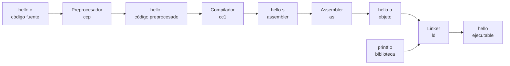

# El proceso de compilación

Escribir un programa en C es solo el primer paso: el procesador no entiende C, entiende instrucciones de máquina. La **compilación** es la cadena de traducciones que convierte un archivo de texto en un programa ejecutable. Entender sus etapas ayuda a saber dónde buscar cuando algo falla.

## Por qué hay que traducir

El procesador ejecuta instrucciones muy simples —sumar dos números, mover un dato de un registro a otro, saltar a otra dirección— codificadas en binario. C, en cambio, está pensado para personas: tiene nombres, bloques, funciones y comentarios. La compilación tiende el puente entre ambos mundos y, de paso, revisa que el programa tenga sentido.

## Las cuatro etapas

El curso muestra la cadena clásica de `gcc`:

| Etapa | Herramienta | Qué hace | Archivo que produce |
|---|---|---|---|
| **Preprocesador** | `ccp` | Expande `#include`, `#define` y macros | `hello.i` |
| **Compilador** | `cc1` | Traduce C a assembler | `hello.s` |
| **Assembler** | `as` | Traduce assembler a instrucciones de máquina | `hello.o` |
| **Linker** | `ld` | Une los objetos y las bibliotecas en un ejecutable | `hello` |

> [!tip] La idea central
> Cada etapa traduce a un lenguaje más cercano a la máquina. Al final, el ejecutable es un archivo binario que el sistema operativo puede cargar en memoria y ejecutar.

## El papel del linker

El programa de ejemplo usa `printf`, pero `printf` no está escrito en nuestro archivo: vive en la biblioteca estándar de C. El compilador genera un objeto `hello.o` con una referencia pendiente a `printf`; el **linker** la resuelve uniendo `hello.o` con `printf.o`.

Por eso un error de linker se ve distinto de un error de compilación: el compilador puede aceptar que `printf` existe (está declarada en `stdio.h`), pero si la biblioteca no está disponible, el linker no encuentra la implementación y falla al final.

> [!warning] Compilar no es ejecutar
> `gcc hello.c -o hello` solo construye el ejecutable. Para que el programa corra hay que ejecutarlo (`./hello`). Un programa puede compilar sin errores y aun así fallar al ejecutarse, por ejemplo si divide por cero.

## Preguntas de repaso

> [!question]- ¿Cuál es la diferencia entre el compilador y el assembler?
> El compilador traduce C a assembler, un texto con instrucciones simbólicas. El assembler traduce ese texto a instrucciones de máquina en binario, el archivo objeto.

> [!question]- ¿Por qué el linker necesita `printf.o`?
> Porque nuestro programa llama a `printf`, pero su implementación no está en `hello.c`; está en la biblioteca estándar. El linker une ambas partes para que la llamada tenga destino.

> [!question]- Un programa compila bien pero al ejecutarse se cae. ¿En qué etapa se detecta ese error?
> En ninguna de las etapas de compilación: es un error de ejecución (*runtime*). El compilador solo revisa la forma del programa, no lo que pasa cuando corre.

> [!question]- ¿Qué ventaja tiene separar la compilación en etapas?
> Permite reutilizar objetos ya compilados (no recompilar todo), detectar errores en la etapa correcta y entender mejor dónde falla el proceso.
