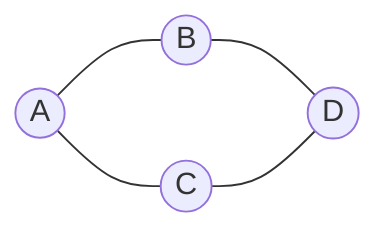

# Qué es un grafo

Google Maps, Instagram y una red de computadores parecen problemas distintos, pero todos se pueden modelar con la misma estructura: un **grafo**. Un grafo representa objetos y las relaciones entre ellos, y permite responder preguntas como "¿hay un camino entre estos dos nodos?" o "¿cuál es la ruta más corta?".

## Tres ejemplos

- **Red social:** cada persona es un nodo y cada amistad es una conexión. Con esa estructura se estudian la influencia, las comunidades y las recomendaciones de contactos.
- **Google Maps:** cada intersección es un nodo y cada calle es una conexión. La distancia o el tiempo se guardan como **pesos** en las conexiones, y el problema típico es encontrar la ruta más corta.
- **Red de computadores:** cada router es un nodo y cada enlace de comunicación es una conexión. Permite estudiar la conectividad y el enrutamiento.

> [!tip] Definición
> Un **grafo** es un par $G = (V, E)$, donde $V$ es el conjunto de **vértices** (nodos) y $E$ es el conjunto de **aristas** (conexiones).

## Tipos de grafos

| Tipo | Qué significa | Ejemplo |
|---|---|---|
| **No dirigido** | La conexión es bidireccional: $(A, B) = (B, A)$ | Amistad en Facebook |
| **Dirigido** | La conexión tiene dirección: $A \to B$ no es lo mismo que $B \to A$ | Seguir a alguien en Instagram o X |
| **Ponderado** | Cada arista tiene un valor: distancia, tiempo, costo o capacidad | Calles de Google Maps |

Un mismo problema puede necesitar un tipo u otro. Una calle de doble sentido se modela como no dirigida; una de un solo sentido, como dirigida.

> [!warning] La dirección cambia el problema
> En un grafo dirigido, que exista un camino de $A$ a $B$ no garantiza que exista de $B$ a $A$. Ignorar la dirección puede dar una respuesta incorrecta.

## Por qué importa

Muchos problemas de la vida real se vuelven manejables cuando se expresan como grafos: rutas, redes sociales, dependencias entre tareas, conexiones eléctricas, horarios. Una vez que el problema es un grafo, se pueden usar algoritmos conocidos en vez de inventar una solución desde cero.

> [!tip] Para profundizar
> Los recorridos y los caminos más cortos se ven con más detalle en [[Estructuras de Datos/15-Grafos y DFS/_Índice|Grafos y DFS]] y [[Estructuras de Datos/17-Caminos más cortos/_Índice|Caminos más cortos]] de Estructuras de Datos.

## Preguntas de repaso

> [!question]- ¿Qué representan los vértices y las aristas de un grafo?
> Los vértices representan los objetos (personas, intersecciones, routers) y las aristas representan las relaciones entre ellos (amistades, calles, enlaces).

> [!question]- ¿Cuál es la diferencia entre un grafo dirigido y uno no dirigido?
> En el dirigido las aristas tienen dirección y $A \to B$ no implica $B \to A$. En el no dirigido la conexión es bidireccional.

> [!question]- ¿Qué agrega un grafo ponderado?
> Un valor o **peso** a cada arista, como distancia, tiempo o costo. Permite comparar caminos por algo más que la cantidad de saltos.

> [!question]- ¿Por qué Google Maps se modela como un grafo ponderado?
> Porque las intersecciones son nodos, las calles son aristas y la distancia o el tiempo de cada calle es el peso. Así se puede buscar la ruta de menor costo.
