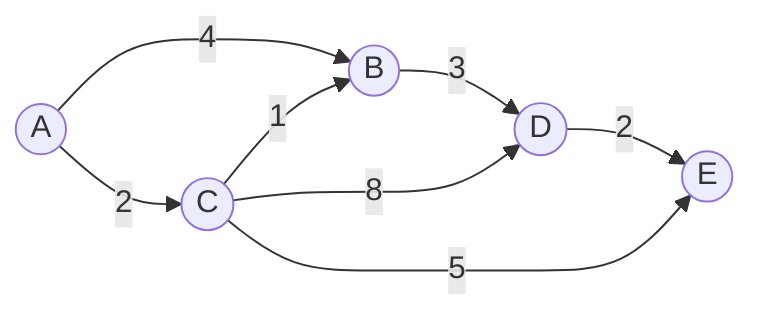

# Camino más corto con Dijkstra

Cuando las aristas tienen pesos, BFS ya no basta: contar aristas no es lo mismo que sumar distancias. El **algoritmo de Dijkstra** encuentra la distancia mínima desde un nodo origen a todos los demás en un grafo con pesos no negativos.

## El problema

En un mapa, la ruta con menos calles no siempre es la más rápida: una calle larga puede pesar más que varias cortas. Para comparar rutas hay que sumar los pesos de las aristas, no contarlas.

Dijkstra requiere que los pesos sean **no negativos**. Con pesos negativos, el algoritmo puede dar una respuesta incorrecta y se necesitan otros métodos.

## La idea

Se mantiene una distancia tentativa para cada nodo:

1. La distancia al origen es 0; las demás empiezan en infinito.
2. Se elige el nodo no visitado con la menor distancia.
3. Se revisan sus vecinos: si la distancia al vecino pasando por este nodo es menor, se actualiza.
4. Se repite hasta visitar todos los nodos.

> [!example]- Transcripción del grafo
> - $A \to B = 4$, $A \to C = 2$.
> - $C \to B = 1$, $B \to D = 3$.
> - $C \to D = 8$, $C \to E = 5$.
> - $D \to E = 2$.

## Paso a paso

Partiendo de $A$:

| Paso | Nodo visitado | Distancias actualizadas |
|---|---|---|
| Inicio | — | $A=0$, $B=\infty$, $C=\infty$, $D=\infty$, $E=\infty$ |
| 1 | $A$ | $B=4$, $C=2$ |
| 2 | $C$ | $B=3$, $D=10$, $E=7$ |
| 3 | $B$ | $D=6$ |
| 4 | $D$ | $E=8$ (no mejora: 8 > 7) |
| 5 | $E$ | sin cambios |

Resultado: $A=0$, $C=2$, $B=3$, $D=6$, $E=7$. Los caminos son $A \to C \to B$ para $B$, $A \to C$ para $C$, $A \to C \to B \to D$ para $D$ y $A \to C \to E$ para $E$.

> [!tip] La idea central
> Dijkstra construye la solución de a poco: en cada paso elige el nodo no visitado más cercano y actualiza sus vecinos. Cuando un nodo se visita, su distancia ya es la mínima.

## Complejidad

Con una **cola de prioridad** implementada con un heap, Dijkstra tarda $O((V + E) \log V)$. Sin una cola de prioridad eficiente, la búsqueda del nodo de menor distancia puede hacer que el algoritmo sea más lento.

## Aplicaciones

- GPS y navegación: rutas con distancia o tiempo.
- Redes de computadores: camino de menor costo entre routers.
- Videojuegos: movimiento de personajes en un mapa.
- Logística y transporte: planificación de rutas.

> [!warning] Dijkstra no sirve con pesos negativos
> Si una arista tiene peso negativo, un camino que parece largo puede terminar siendo más barato. El algoritmo puede haber visitado un nodo con una distancia que ya no es la mínima. Para esos casos existen otros algoritmos.

> [!tip] Para profundizar
> Los caminos más cortos y sus variantes se ven con más detalle en [[Estructuras de Datos/17-Caminos más cortos/_Índice|Caminos más cortos]] de Estructuras de Datos.

## Preguntas de repaso

> [!question]- ¿Por qué BFS no basta para un grafo ponderado?
> Porque BFS minimiza la cantidad de aristas, no la suma de los pesos. Una ruta con más aristas puede tener menor costo total.

> [!question]- ¿Qué requisito tienen los pesos en Dijkstra?
> Deben ser no negativos. Con pesos negativos el algoritmo puede fallar.

> [!question]- ¿Qué hace Dijkstra en cada paso?
> Elige el nodo no visitado con la menor distancia tentativa, lo marca como visitado y actualiza las distancias de sus vecinos si encuentra un camino más corto.

> [!question]- ¿Cuál es la complejidad de Dijkstra con una cola de prioridad?
> $O((V + E) \log V)$ usando un heap.
