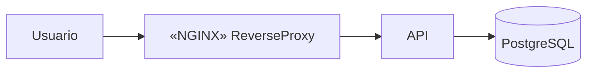

# Diagramación modelos y lenguajes de descripción

Diagramar es la forma de **transmitir conocimiento clave de manera eficiente** mediante dibujos. Entregarle el código a alguien para que entienda el sistema es lento; un buen diagrama lo comunica en minutos. En este curso, además, el diagrama de componentes vale cerca de un tercio de cada prueba.

## Qué es un buen diagrama

- **Va acompañado de un relato** de su funcionamiento: por qué se hizo así.
- **Está enfocado en una audiencia específica.** Para el equipo puede ser detallado; para otras personas, más simplificado. Hay que cuidar la experiencia de quien lo lee (*developer experience*).

## Modelo y metamodelo

- **Modelo:** representación abstracta de un sistema.
- **Metamodelo:** representación abstracta para **entender el modelo**, es decir, el "modelo del modelo" (hay varios niveles de abstracción).

¿Para qué sirve un metamodelo? Permite **definir lenguajes de modelación** que a su vez describen sistemas de software. Un lenguaje de modelación necesita:
- una **sintaxis abstracta**: qué elementos existen y cómo se combinan (componente, interfaz, conector);
- una **semántica** formal o semiformal: qué significa cada elemento;
- una **sintaxis concreta**: cómo se escribe o se dibuja (notación gráfica o textual).

Necesitamos saber **cómo entender los modelos** que aplicamos: por ejemplo, que en UML un círculo significa "interfaz provista" y no otra cosa.

## Architecture Description Language (ADL)

> [!tip] ADL
> Lenguaje de modelación diseñado para describir software o arquitecturas **legibles por humanos y por máquinas**.

- Tiene una **representación formal**, textual o gráfica (ACME, UML, Structurizr).
- Es legible por stakeholders y por sistemas de comprobación, **incluidos los LLM**, lo que facilita usarlo con IA.
- Es **analizable**: se puede verificar consistencia, completitud o desempeño.
- **Permite generar código.**

**Desventajas:** está enfocado en desarrolladores (alguien que no es técnico, ni una IA, probablemente no lo entienda) y muestra la idea general, pero no necesariamente todas las partes del sistema.

### Diagramming as code

Diagramas creados desde **código legible**. Son útiles para intercambiar información de forma estandarizada y **fácil de modificar** (se versionan con git). Ejemplos: D2, PlantUML, Mermaid, Archimate (también es un ADL).

## Tipos de diagramación

| Vista | Qué muestra |
|---|---|
| **Organizacional** | La estructura de la organización: cómo se ve y funciona internamente |
| **De sistemas** | Las interconexiones entre sistemas y subsistemas, entre las organizaciones involucradas y con los sistemas externos |
| **De componentes** | Los aspectos funcionales y no funcionales de los componentes: funcionalidades encapsuladas |

## Conceptos principales

- **Componentes:** la especificación funcional o no funcional de los elementos y sus interfaces. En el dibujo, una caja con la funcionalidad.
- **Conectores:** cómo interactúan los componentes. Son las líneas.
- **Configuraciones arquitectónicas:** la estructura completa, es decir, cómo se conectan componentes y conectores.

Existen distintos estándares para dibujarlos: 4+1, C4 y UML, que se ven en [[02 - Vistas 4+1 C4 y variantes de UML]].

## Preguntas de repaso

> [!question]- ¿Qué dos condiciones debe cumplir un buen diagrama según el curso?
> Ir acompañado de un relato que explique su funcionamiento y sus decisiones, y estar enfocado en una audiencia específica, con el nivel de detalle adecuado para quien lo va a leer.

> [!question]- Diferencie modelo y metamodelo.
> El modelo es una representación abstracta de un sistema. El metamodelo es una representación abstracta del modelo mismo: define qué elementos puede tener un modelo, cómo se combinan y qué significan. Con él se definen los lenguajes de modelación.

> [!question]- ¿Qué es un ADL y qué ventajas tiene?
> Un lenguaje de modelación formal para describir arquitecturas, legible por humanos y máquinas. Permite analizar propiedades como la consistencia o la completitud, generar código y trabajar junto con herramientas de IA.

> [!question]- ¿Qué ventaja tiene "diagramming as code" frente a dibujar en una herramienta gráfica?
> El diagrama es texto: se versiona con git, se revisa en pull requests, se modifica fácilmente y se intercambia de forma estandarizada. Ejemplos: Mermaid, PlantUML, D2.

> [!question]- Nombre los tres tipos de diagramación y qué muestra cada uno.
> La vista organizacional (la estructura de la organización), la de sistemas (interconexiones entre sistemas, organizaciones y sistemas externos) y la de componentes (aspectos funcionales y no funcionales de los componentes).

> [!question]- ¿Cuáles son los tres conceptos principales de toda descripción arquitectónica?
> Componentes (elementos y sus interfaces), conectores (cómo interactúan) y configuraciones arquitectónicas (cómo se combinan componentes y conectores en la estructura completa).

> [!question]- V o F: "Un diagrama de arquitectura debe ser igual de detallado sin importar quién lo lea".
> Falso. Debe enfocarse en una audiencia específica: más detalle para el equipo técnico y más simplificado para el negocio u otras personas.
