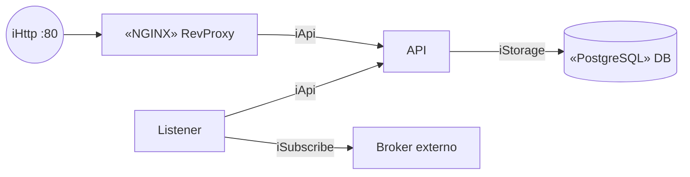

# Notación del diagrama de componentes UML

El diagrama de componentes tiene muy pocos elementos: **componentes**, **interfaces** y **conectores**. La dificultad no está en la notación, sino en usarla con precisión. Una pauta descuenta **6 puntos si no hay interfaces** y descuenta por cada interfaz mal implementada. Esta nota fija las reglas de notación con los croquis de clases y los de la ayudantía.

## Componentes

- Una **caja con nombre** (el rectángulo) y el **ícono de componente** en la esquina.
- **El nombre es un sustantivo, nunca un verbo:** `PaymentService`, `Broker`, `Catálogo`; no `Pagar` ni `ProcesarDatos`.
- **Estereotipo** entre `«»`: indica qué rol específico cumple el componente.
  - `«component»`: un componente de software autónomo y reutilizable.
  - Otros comunes: `«subsystem»`, `«process»`, `«service»`, `«specification»`, `«realization»`, `«implement»`.
  - También se usan para indicar la tecnología concreta: `«NGINX» ReverseProxy` indica que el reverse proxy se levanta con nginx.
- Un componente puede **contener otros** (cajas dentro de cajas). Hay que desglosar todo lo necesario para que se entienda el sistema.

> [!example]- Transcripción de la imagen
> - Un componente **Course** con estereotipo `<<stereotype>>` y el ícono de componente, que requiere una interfaz (`Manager`) y provee otra (`CourseForStudent`).
> - Un **Componente** central, en azul, se conecta con líneas punteadas a `«component» WeatherService`, `«component» UserService` y `Customer EJB`.

## Interfaces

> [!tip] Interfaz
> **Contrato** que define un conjunto de operaciones que un componente promete implementar, **sin especificar cómo**.

| Símbolo | Nombre | Significado |
|---|---|---|
| **○** círculo (*lollipop*) | **Interfaz provista** | El componente **ofrece** este contrato a otros |
| **(** semicírculo (*socket*) | **Interfaz requerida** | El componente **necesita** este contrato de otro |
| **○(** el círculo dentro del semicírculo | **Conector** | Quien requiere se enchufa a quien provee |

- **Siempre se nombran.** Convención: prefijo `i`, como `iNotify`, `iPayment`, `iPublish`, `iSubscribe` o `iAuth`.
- Pueden anotarse con el protocolo o el contrato: "API REST → URL, `POST {…}`".

> [!example]- Transcripción de la imagen
> - Croquis: `«Nginx»` conectado con un conector `(o` a una **API**.
> - Al lado, la definición: "Interfaz: contrato de la conexión". Un círculo con un palo significa "Provee", y un semicírculo con un palo significa "Requiere".
> - Anotación: "API REST → URL, `POST {}`".

> [!example]- Transcripción de la imagen
> - El mismo croquis, en una foto anterior: `«Nginx»` se conecta a la **API** mediante un conector, con las notas "Interfaz: contrato de la conexión", "Provee" y "Requiere".

## Ejemplos de la E0 y la E1 del proyecto

> [!example]- Transcripción de la imagen
> - Un componente grande **EC2** con un puerto en el borde (`:80`), por donde entra la interfaz externa.
> - Dentro, `«Nginx» PROXY` se conecta a la **API**, con la anotación `curl localhost:80`.
> - Leyenda: "Provee" (círculo) y "Requiere" (semicírculo).

> [!example]- Transcripción de la imagen
> - Un puerto externo entra a `«NGINX» RevProxy`, que se conecta con la **API**. Sobre la API se anota "balanceo de cargas".
> - Bajo la API hay un **Listener**. Desde el borde del componente sale una interfaz requerida hacia un **Broker** externo.

Estos croquis muestran tres reglas:
- Un **puerto** (un cuadrado en el borde) indica por dónde entra o sale una interfaz de un componente contenedor, como la EC2.
- El **reverse proxy** es un componente propio (con estereotipo) entre el exterior y la API, no una flecha.
- Los **sistemas externos** (el broker del curso) quedan fuera de la frontera y se conectan por una interfaz requerida.

> [!warning] Errores de notación que descuentan
> - Componentes con nombre de **verbo**.
> - Interfaces **sin nombre**, o con el círculo y el semicírculo invertidos (quien provee no es quien consume).
> - Usar **flechas sueltas** en vez de interfaces. Sin interfaces, el diagrama pierde 6 puntos.
> - Confundir el orden de las interfaces con el flujo.

## Preguntas de repaso

> [!question]- ¿Qué significa el círculo y qué significa el semicírculo en un diagrama de componentes?
> El círculo (lollipop) es una interfaz provista: el componente ofrece ese contrato. El semicírculo (socket) es una interfaz requerida: el componente necesita ese contrato de otro. Al unirlos se forma el conector.

> [!question]- ¿Por qué los componentes se nombran con sustantivos?
> Porque representan piezas de software con una responsabilidad (`Notificador`, `PaymentService`), no acciones. Los verbos describen operaciones, que pertenecen a las interfaces.

> [!question]- ¿Para qué sirve un estereotipo? Dé dos ejemplos.
> Indica el rol o la naturaleza del componente. Por ejemplo, `«service»` para un servicio y `«NGINX»` para indicar que el reverse proxy se implementa con nginx. `«subsystem»` y `«process»` son otros ejemplos.

> [!question]- ¿Qué convención de nombres se usa para las interfaces y por qué es obligatorio nombrarlas?
> El prefijo `i` (`iPayment`, `iNotify`). Es obligatorio porque la interfaz es el contrato entre componentes: sin nombre no se sabe qué se intercambia, y la pauta descuenta las interfaces mal implementadas o sin nombre.

> [!question]- ¿Qué representa un puerto en el borde de un componente contenedor?
> El punto por donde una interfaz entra o sale del componente contenedor (por ejemplo, el puerto 80 de una EC2), que conecta el exterior con los componentes internos.

> [!question]- Dibuje con interfaces la relación entre una API que publica en un broker externo y un worker que se suscribe.
> API —( iPublish ○— Broker —○ iSubscribe )— Worker. La API requiere `iPublish`, que provee el broker, y el worker requiere `iSubscribe`, que también provee el broker. La API y el worker no se conectan directamente.

> [!question]- V o F: "Basta con unir los componentes con flechas para que el diagrama de componentes sea válido".
> Falso. Las relaciones se expresan con interfaces provistas y requeridas, con su nombre. Un diagrama sin interfaces se corrige con un fuerte descuento, o directamente no se considera un diagrama de componentes UML.
