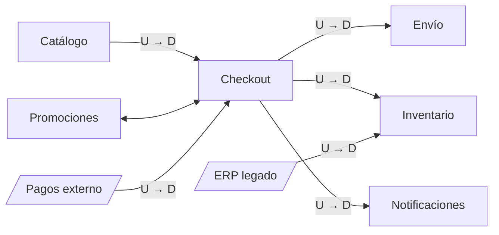

# El context map como mapa de decisiones de integración

Con DDD estratégico el dominio queda partido en contextos. El **context map** une esos contextos con flechas, y la idea central de este bloque es que **cada flecha es una decisión de integración, no una simple línea**. Elegir mal la relación de una flecha se paga cada vez que el otro lado cambia.

## De dominio a bounded context

Primero hay que recordar los conceptos de DDD:
- **Dominio:** el área de negocio que resuelve el sistema completo. Es lo principal.
- **Subdominio:** cómo se subdivide la empresa para trabajar. Es un concepto de **negocio**: refleja cómo se organiza la empresa.
- **Bounded context (contexto acotado):** el concepto **técnico**. Es una frontera dentro de la cual un modelo y su vocabulario tienen un significado único. Responde a cómo se va a implementar el negocio.

En un e-commerce, el subdominio *gestión de compras* se puede partir en varios contextos: **Checkout**, **Catálogo**, **Gestión de ventas** e **Integración con medios de pago**. Cada uno tiene su propio modelo de "producto". Para Catálogo, un producto tiene descripción, fotos en 4K y categorías. Para Checkout solo importan el id, el precio y una miniatura de 240p.

## Qué es el context map

> [!tip] Context map (Evans, 2003)
> Es un diagrama cuyos **nodos son bounded contexts** y cuyas **flechas son relaciones entre sus modelos**. Cada flecha lleva una etiqueta con el tipo de relación y marca quién es **U** y quién es **D**.

- **U, upstream (aguas arriba):** el contexto que **provee** la interfaz y tiene el modelo o la información principal.
- **D, downstream (aguas abajo):** el contexto que **consume** esa interfaz y depende del modelo de U.

Los elementos de un context map son el nodo, la flecha con U y D, la etiqueta de la relación y, cuando existen, el **punto de traducción** (una ACL del lado de D) o el **punto de publicación** (un lenguaje publicado del lado de U).

Un buen context map responde cuatro preguntas: ¿cuántos modelos hay?, ¿quién depende de quién?, ¿dónde se traduce?, ¿qué se rompe si el otro cambia?

> [!warning] Lo que el context map no es
> - **No es un diagrama de despliegue.** Dos contextos pueden vivir en el mismo monolito.
> - **No es un modelo entidad-relación.** Una flecha no es una llave foránea: se está hablando de integración de sistemas, no de entidades.
> - **No es un organigrama**, aunque los equipos suelen seguir las fronteras de los contextos.

## Tres preguntas por flecha y la regla del poder

Para decidir qué relación tiene cada flecha, el curso propone tres preguntas:
1. ¿Quién consume el modelo de quién?
2. ¿Qué pasa en mi contexto cuando el modelo del otro cambia?
3. ¿Quién tiene el poder de decir "así es el contrato"?

Integrar es hacer convivir dos modelos que **no coinciden y que no deben coincidir**. Si Checkout adoptara el "producto" completo de Catálogo, cada cambio en las fotos o las categorías le pegaría a un contexto al que no le importan. De ahí sale la regla que ordena las siete relaciones:

> [!tip] Regla del poder
> **Mientras menos poder tengo sobre el upstream, más traducción necesito.** Con un socio que planifica conmigo puedo co-diseñar el contrato. Con un proveedor externo que no me escucha, tengo que protegerme con una capa de traducción.

## Ejemplo: el mapa de gestión de compras

> [!example]- Transcripción de la imagen
> - Título: "Gestión de Compras". Arriba se resume la relación "Checkout —o— Catálogo".
> - De izquierda a derecha: **MdP** (medio de pago) se conecta a una **ACL** que está dentro de la frontera punteada de **CHE** (Checkout). Una flecha señala que la ACL pertenece a CHE.
> - CHE consume, mediante una interfaz requerida, la **API** que expone **CAT** (Catálogo). La API está dentro de la frontera punteada de CAT.
> - Junto a CAT se anotan los datos que entrega: `pr_id`, `price`, `IVA` (agregado a pedido de Checkout) e `img 4k`.
> - Debajo de CHE cuelgan **PROMO** (Promociones) y **Env.** (Envío), conectados por interfaces.

La pizarra muestra dos decisiones típicas. El medio de pago es externo, así que Checkout no tiene poder sobre él y pone una **ACL** dentro de su frontera para traducir el modelo ajeno. Catálogo, en cambio, publica una **API** pensada para quien la necesite. Cuando Checkout pidió el IVA, Catálogo lo agregó, una señal de que Checkout tiene voz en esa relación.

El diagrama muestra los contextos del e-commerce con sus flechas, todavía sin etiquetar. Las relaciones posibles se ven en [[03 - Partnership Shared Kernel y Customer Supplier]] y en [[04 - Conformist Anticorruption Layer Open Host Service y Separate Ways]]. El etiquetado de cada flecha se resuelve en [[05 - Ejercicio del context map de un e-commerce]].

## Preguntas de repaso

> [!question]- ¿Cuál es la diferencia entre subdominio y bounded context?
> El subdominio es un concepto de negocio: cómo se divide la empresa para trabajar. El bounded context es técnico: la frontera dentro de la cual un modelo tiene un significado único. Un subdominio como gestión de compras puede implementarse con varios contextos (Checkout, Catálogo, Pagos).

> [!question]- En una flecha del context map, ¿qué significan U y D?
> U (upstream) es quien provee la interfaz y tiene el modelo principal. D (downstream) es quien la consume y depende de ese modelo. Si U cambia, D puede verse afectado. Lo contrario no ocurre, salvo que la relación le dé voz a D.

> [!question]- V o F: "Una flecha del context map entre Checkout y Catálogo equivale a una llave foránea de pedidos a productos".
> Falso. El context map no es un modelo ER: la flecha representa una relación de integración entre dos modelos (quién consume a quién y cómo se traduce), no una restricción entre tablas.

> [!question]- V o F: "Si dos contextos están en el mismo monolito, no tiene sentido dibujar su relación en el context map".
> Falso. El context map no es un diagrama de despliegue. Dentro de un monolito modular, los módulos siguen siendo contextos con modelos distintos, y la relación entre ellos define qué se rompe cuando uno cambia.

> [!question]- Enuncie la regla del poder y aplíquela a la integración con un proveedor de pagos externo.
> Mientras menos poder se tiene sobre el upstream, más traducción se necesita. Un proveedor de pagos no cambia su API por un cliente, así que el contexto propio debería traducir su modelo, típicamente con una capa anticorrupción, para que los cambios del proveedor no contaminen el dominio.

> [!question]- ¿Por qué se dice que los modelos de dos contextos "no deben coincidir"?
> Porque cada contexto necesita una vista distinta del mismo concepto. Si se forzara un único modelo (por ejemplo, un "producto" con todo lo que necesitan Catálogo, Checkout y Envío), cada cambio para un contexto afectaría a todos los demás. Se volvería al acoplamiento de un modelo canónico.

> [!question]- Nombre las tres preguntas que se hacen por cada flecha.
> ¿Quién consume el modelo de quién? ¿Qué pasa en mi contexto cuando el modelo del otro cambia? ¿Quién tiene el poder de decir "así es el contrato"?
