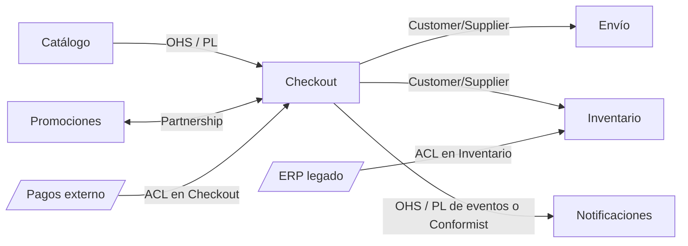

# Ejercicio del context map de un e-commerce

Este ejercicio aplica las siete relaciones al e-commerce de referencia. Para cada flecha hay que decidir **quién es U, quién es D y qué relación tiene**, justificando con la regla del poder: *mientras menos poder tengo sobre el upstream, más traducción necesito*. Más de una respuesta puede ser válida. Lo que se evalúa es la justificación.

## El mapa

Las flechas van de U a D. Los nodos con borde inclinado son contextos externos o legados, sobre los que no se tiene control.

## Flecha por flecha

**1. Catálogo → Checkout: Open Host Service + Published Language.** Catálogo es U: tiene la información principal de los productos. No solo lo consume Checkout: también Búsqueda, Recomendaciones y la app. En vez de negociar con cada uno, publica una API documentada. Si al principio Checkout era su único cliente y le pedía cambios (como agregar el IVA), la relación habría sido Customer/Supplier. Con muchos consumidores, lo natural es OHS.

**2. Promociones ↔ Checkout: Partnership.** Las dos flechas indican que ninguno es claramente U. Una promoción mal aplicada en el carrito es un fracaso de ambos, así que los dos equipos trabajan a la vez, co-diseñan el contrato y liberan coordinados. Promociones es pequeño, por eso el acuerdo es viable.

**3. Checkout → Envío: Customer/Supplier (o Conformist).** Checkout inicia el flujo y entrega el pedido, así que es U. Si Envío es un equipo interno con necesidades propias (peso, dimensiones de los bultos) y Checkout las incorpora a lo que envía, la relación es Customer/Supplier. Si Envío simplemente adopta el modelo de pedido de Checkout tal como viene, sin pedir nada, es Conformist. Ambas respuestas son válidas si se justifican. Partnership también es defendible si ambos equipos planifican juntos.

**4. Checkout → Inventario: Customer/Supplier.** Al confirmar un pedido, Checkout pide reservar stock. Ambos son internos, Inventario necesita datos concretos para reservar y hay un contrato versionado entre ellos.

**5. Pagos (externo) → Checkout: Anticorruption Layer.** El proveedor de pagos es U y no va a cambiar su API por nosotros: el poder es mínimo. Ser Conformist metería sus estados y su vocabulario en el dominio. La ACL dentro de Checkout traduce su modelo y además permite cambiar de proveedor reemplazando solo la capa.

**6. ERP (legado) → Inventario: Anticorruption Layer.** El ERP legado tiene un modelo antiguo y difícil de cambiar. Inventario no debe heredar sus códigos ni sus formatos, así que lo traduce en su frontera.

**7. Checkout → Notificaciones: Open Host Service con eventos publicados, o Conformist.** Notificaciones escucha a muchos contextos (Checkout, Envío, Pagos). Si Checkout publica eventos con un esquema documentado (`PedidoConfirmado`), es OHS/PL. Si Notificaciones consume lo que Checkout emita sin negociar, es Conformist. **Separate Ways** también es defendible: Checkout podría tener su propio envío de correos de confirmación dentro de su contexto, y el equipo de Notificaciones quedaría conectado solo a Promociones para sus campañas.

> [!warning] El error típico: confundir la dirección de los datos con U y D
> U es quien **provee el modelo** del que el otro depende, no necesariamente quien "manda" más datos. Para identificar a U conviene preguntarse: si este contexto cambia su modelo, ¿a quién rompe?

> [!tip] Plantilla de respuesta para una flecha
> "**X es U y Y es D** porque Y depende del modelo de X. Y **tiene / no tiene** poder sobre X porque *(interno o externo, uno o muchos consumidores, legado)*. Por lo tanto la relación es **R**, cuyo costo es *(…)*, aceptable porque *(…)*."

## Variantes para practicar

| Situación nueva | Relación esperada | Por qué |
|---|---|---|
| Checkout pasa a consumir un servicio de cálculo de impuestos del gobierno | ACL (o Conformist si el modelo es simple y estable) | U externo y sin voz |
| Catálogo y Búsqueda usan la misma librería `ProductId` versionada | Shared Kernel | Subconjunto pequeño y compartido por acuerdo |
| Un contexto de Reportes solo necesita el total vendido por día | Separate Ways o consumir eventos publicados | Lo compartido es mínimo |
| Tres equipos piden cada semana campos distintos a Inventario | Migrar de Customer/Supplier a OHS | La mesa de negociación se llena |

## Preguntas de repaso

> [!question]- ¿Por qué Pagos → Checkout se resuelve con ACL y no con Conformist, si en ambos casos Checkout no tiene poder?
> Porque el modelo de pagos es ajeno, cambia según el proveedor y es crítico. Con Conformist, sus estados se reparten por el dominio de Checkout, y cambiar de proveedor o recibir un cambio de API rompería todo. La ACL concentra la traducción en un punto, así que cambiar de proveedor es cambiar la capa.

> [!question]- ¿Qué tendría que pasar para que Catálogo → Checkout fuera Customer/Supplier en vez de OHS?
> Que Checkout fuera uno de pocos consumidores y tuviera voz en la planificación de Catálogo (pide campos como el IVA y Catálogo los agenda para él). Con muchos consumidores, negociar uno a uno no escala y Catálogo publica un protocolo único.

> [!question]- Justifique por qué Promociones ↔ Checkout es Partnership usando las tres preguntas por flecha.
> Ambos consumen el modelo del otro: Checkout las reglas de descuento y Promociones el contenido del carrito. Si uno cambia, el otro se rompe de inmediato. Ninguno tiene el poder de imponer el contrato: lo co-diseñan. Además fallan juntos (un descuento mal aplicado es un error de ambos) y Promociones es pequeño, así que la coordinación es viable.

> [!question]- ¿En qué contexto vive la ACL de la flecha ERP → Inventario y qué hace concretamente?
> Vive en Inventario, dentro de su frontera. Recibe los registros del ERP (sus códigos de producto, unidades y formatos antiguos) y los traduce a los conceptos de Inventario (SKU, stock disponible, reservas) para que nada del vocabulario del ERP entre al dominio.

> [!question]- Defienda Separate Ways para Checkout → Notificaciones e indique su riesgo.
> Si Checkout solo necesita enviar un correo de confirmación, puede hacerlo dentro de su propio contexto sin integrarse con Notificaciones: cero acoplamiento y la relación más barata. El riesgo es la duplicación: plantillas, preferencias de contacto o reglas de envío distintas en dos lugares, que pueden volverse inconsistentes.

> [!question]- V o F: "En el context map, la flecha Checkout → Envío indica que Envío llama a la API de Checkout".
> Falso, o al menos no necesariamente. La flecha indica que Envío (D) depende del modelo de Checkout (U). Técnicamente, la comunicación puede ser una llamada de Checkout a Envío, un evento o una cola. El context map describe la dependencia entre modelos, no el mecanismo ni la dirección de las llamadas.
