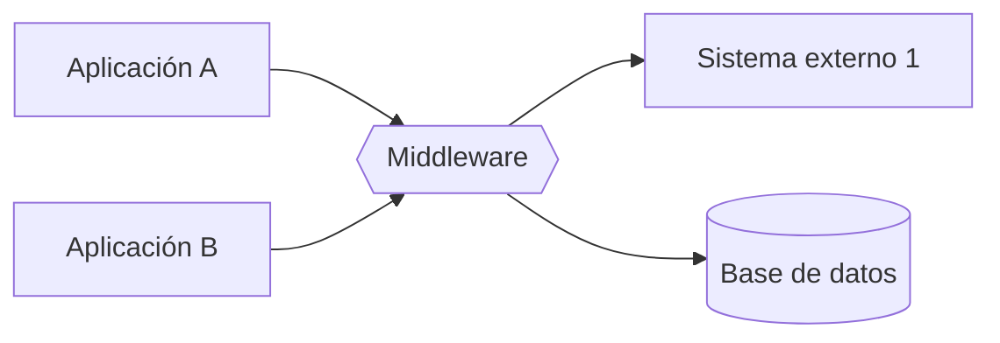

# Tácticas básicas de integración encapsulamiento middleware y estándares

El context map decide **qué relación** tiene cada flecha. Las tácticas y patrones de integración deciden **cómo se cruza** esa flecha. Son soluciones reusables para conectar dos o más sistemas. Funcionan como los estilos y los patrones de diseño: dan un lenguaje compartido, simplifican la implementación y resuelven problemas que ya son comunes.

## El catálogo de patrones de integración

| Familia | Patrones | Idea |
|---|---|---|
| **Básicos** | Encapsular, middleware, estándares | Ocultar, intermediar y acordar formatos |
| **MOM** | Brokers, motores de procesos | Comunicación indirecta por mensajes |
| **SOA** | Servicios con contrato propio, bus | El servicio como unidad de integración |
| **APIs estructuradas** | REST, GraphQL | Contratos sobre la web |
| **RPC** | gRPC | Llamar funciones remotas tipadas y rápidas |

Esta nota cubre los básicos, que son la base de todos los demás: un broker es un middleware, una API REST es un encapsulamiento con un estándar encima.

## Conceptos base: distancia modular y encapsulamiento

- **Distancia modular:** si dos componentes se integran, conviene que estén **cerca**, es decir, que no haya *n* contextos ni intermediarios entre ellos. Cada salto agrega latencia, un punto de falla y una traducción más.
- **Encapsulamiento:** aplicar el **principio de ocultamiento de información** y la **aislación de significado**. Lo que un componente es por dentro no debe filtrarse a quien lo usa.

## Encapsular

> [!tip] Encapsular (Bass y Kazman)
> Envolver un módulo en una **interfaz explícita** y **regular todos los accesos** a través de ella.

Al encapsular, el módulo queda poco acoplado, bien cohesionado y solo expone una interfaz. Ojalá sea lo más simple posible: es mejor englobar todo en un componente que expone una interfaz que dejar acceso a sus partes internas. Los otros sistemas no saben cómo funciona por dentro; solo se preocupan de enviar los datos correctos. En notación de componentes, es una caja con una sola interfaz provista (`[Componente]—o`).

Qué se gana:
- **reuso cómodo** de la funcionalidad, y mejores capacidades de **testing** y **seguridad**, porque hay un único punto de entrada que probar y proteger;
- **evitar acoplamiento indeseado**, porque se comunica por contratos (interfaces) y no por detalles internos;
- **evitar la propagación de cambios**: mientras el contrato se mantenga, el interior puede cambiar libremente.

De esta idea nace el concepto de **API** (*Application Programming Interface*). La ACL del context map es encapsular aplicado a un modelo completo.

## Middleware

El **middleware** es software intermediario que resuelve dependencias. Provee servicios y capacidades comunes a aplicaciones que pueden o no estar bajo nuestro control. Es una **capa intermedia entre sistemas** que facilita la integración, porque mejora la abstracción y la interoperabilidad.

Ejemplos:
- **MOM:** colas de mensajes entre emisores y receptores.
- **JDBC:** una aplicación Java habla con cualquier base de datos a través del driver, sin conocer el protocolo de cada motor.
- **Reverse proxy:** un intermediario delante de los servidores.
- **API Gateway:** un punto único de entrada a varios servicios.
- **ACL:** la capa de traducción hacia un modelo ajeno.

> [!warning] Middleware no es lo mismo que arquitectura en capas
> El middleware es una capa *entre sistemas*, pero **no obliga a que el sistema completo sea por capas**. Se puede usar un middleware en un sistema orientado a eventos, en microservicios o en un monolito.

> [!warning] El middleware también cuesta
> Las pautas piden reconocer sus problemas clásicos: código adicional que mantener, estado que preservar si el middleware lo guarda, **latencia adicional** por el salto extra y **un punto de falla más**. Proponer un middleware sin mencionar su costo deja la respuesta incompleta.

## Estándares

**Adherir a estándares** (HTTP, JSON Schema, OpenAPI, AsyncAPI, formatos de fecha ISO 8601) reduce la connascence entre sistemas: ambos lados acuerdan con un tercero conocido en vez de inventar un formato propio. Es lo que hace posible el Published Language del Open Host Service.

## Las tácticas de integrabilidad de Bass y Kazman

| Grupo | Tácticas | Ejemplo |
|---|---|---|
| **Limitar dependencias** | Encapsular · usar un intermediario · restringir rutas de comunicación · adherir a estándares · abstraer servicios comunes | ACL, MOM, API Gateway, OpenAPI |
| **Adaptar** | Descubrir (*service discovery*) · ajustar la interfaz (*tailor interface*) · configurar el comportamiento | Un broker que transforma formatos |
| **Coordinar** | Orquestar · gestionar recursos | Un motor de procesos que define el flujo |

> [!example]- Respuesta modelo: proveedores con una API XML que casi nadie entiende
> **Problema:** el registro civil y los conservadores exponen APIs con un protocolo muy específico y XML que solo dos desarrolladores entienden.
> **Respuesta:** poner un **middleware** que concentre ese conocimiento y exponga una **interfaz interna sencilla**, compatible con el resto del sistema (si el sistema es EDA, que se integre por eventos o callbacks a través del broker).
> **Tácticas a nombrar:** encapsulamiento de la complejidad, abstracción de servicios comunes y uso de un intermediario.
> **Costo a reconocer:** un componente más que mantener y operar.

## Preguntas de repaso

> [!question]- ¿Qué relación hay entre encapsular y el surgimiento del concepto de API?
> Encapsular significa exponer solo una interfaz explícita y regular por ella todos los accesos. Esa interfaz, pensada para que otros programas la usen sin conocer el interior, es justamente una API. REST, gRPC o GraphQL son formas distintas de definir esa interfaz.

> [!question]- Nombre cuatro ejemplos de middleware y qué dependencia resuelve cada uno.
> MOM: desacopla en el tiempo a emisor y receptor. JDBC: aísla a la aplicación del protocolo de cada base de datos. Reverse proxy o API Gateway: ocultan la ubicación y la cantidad de servidores detrás de un punto de entrada. ACL: protege el modelo propio del modelo de un proveedor.

> [!question]- V o F: "Si agrego un middleware, mi sistema pasa a tener arquitectura en capas".
> Falso. El middleware es un intermediario entre sistemas y no impone el estilo en capas al sistema completo. Puede convivir con EDA, microservicios o un monolito.

> [!question]- ¿Por qué la distancia modular importa al integrar?
> Porque cada contexto o intermediario entre dos componentes agrega latencia, un punto de falla y una traducción. Si dos componentes se comunican mucho, conviene que estén cerca. Si no lo están, el diseño debería justificar cada salto.

> [!question]- Un equipo propone un middleware para integrar proveedores heterogéneos. ¿Qué problemas debería anticipar?
> Código adicional que mantener, preservación del estado si el middleware lo guarda, latencia adicional por el salto extra y un punto de falla más (que puede requerir replicación). No invalidan el middleware, pero hay que mencionarlos y mitigarlos.

> [!question]- Clasifique estas tácticas en "limitar dependencias", "adaptar" o "coordinar": a) API Gateway · b) orquestador de un flujo de pagos · c) broker que convierte XML en JSON · d) adoptar OpenAPI.
> a) Limitar dependencias (intermediario y restricción de rutas). b) Coordinar (orquestar). c) Adaptar (ajustar la interfaz). d) Limitar dependencias (adherir a estándares).

> [!question]- ¿Qué aporta adherir a un estándar como OpenAPI frente a acordar un formato propio entre dos equipos?
> Reduce la connascence: ambos lados dependen de una especificación conocida y documentada, y no de un acuerdo informal. Además permite generar clientes y validar contratos automáticamente, y facilita que un tercer consumidor se integre sin negociar (Published Language).
