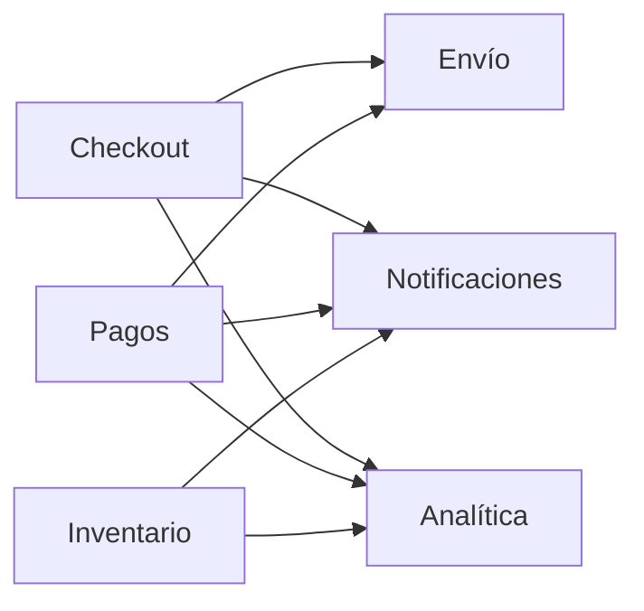

# Monolito y comunicación indirecta entre contextos

Antes de hablar de colas y brokers conviene preguntarse si hace falta separar el sistema. El **monolito** es la primera arquitectura de casi todo producto, y el curso lo defiende como **el default correcto**. Esta nota explica qué se gana con él, cuándo conviene partirlo y por qué, al partirlo, la comunicación directa punto a punto deja de servir.

## El monolito como primera arquitectura

Un monolito es **un solo quantum**: un despliegue y una base de datos. Todo el código vive en un único gran bloque. Tiene **alta cohesión** y un acoplamiento **estático** entre módulos (se llaman en el mismo proceso), y no hay que preocuparse de transmitir datos por la red.

Eso no significa que la modularidad deje de importar. Un **monolito modular** sigue siendo un solo quantum, pero sus fronteras internas de módulo coinciden con los **bounded contexts** del context map. Checkout, Catálogo y Promociones son módulos con interfaces claras dentro de la misma aplicación. Empresas como Buk trabajan sobre un monolito en Ruby on Rails y lo modularizan por dentro. El problema rara vez es el monolito en sí, sino que nadie pensó en cómo iba a funcionar su organización interna.

> [!tip] El monolito no es inherentemente malo
> Es el punto de partida correcto: es muy útil para desarrollar rápido y, cuando un cambio queda dentro de un módulo, el despliegue sigue siendo uno solo. Su costo es tener un único quantum: todo escala, falla y se despliega junto.

## Cuándo sí partirlo

Partir el sistema se justifica por al menos una de tres razones, y cada frontera nueva debería poder defenderse con alguna:

| Razón | Señal concreta |
|---|---|
| **Cadencia** | Un equipo necesita desplegar varias veces al día y el resto una vez al mes; el despliegue único los frena |
| **Escala** | Una parte recibe 100 veces más carga que el resto (por ejemplo, la búsqueda) y escalar todo el monolito para ella es caro |
| **Fallas propias** | Una parte inestable (por ejemplo, un scraper o un proveedor externo) no debe tumbar al resto |

> [!warning] Partir sin razón es pagar costos sin beneficio
> Separar en servicios trae latencia de red, fallas parciales, consistencia eventual y más operación. Si no hay diferencia de cadencia, escala o fallas, el monolito modular es mejor respuesta. En un caso de prueba, cada frontera que se dibuje debe tener su justificación.

## Sin monolito: la comunicación pasa a ser indirecta

Cuando los contextos viven en procesos o máquinas distintas, ya **no se puede asumir comunicación punto a punto casi instantánea**. La red falla, tiene latencia y el otro lado puede estar caído. Hay que pensar en formas de conexión simples y reusables, sin ignorar los principios de integrabilidad.

La separación ya está dibujada en el context map. Lo que se decide ahora es **cómo cruzar cada flecha**. Mientras más fácil sea integrar los subsistemas, más fácil será tomar la decisión de separarlos.

### El problema de las integraciones punto a punto

Imagine *N* sistemas que emiten información y *M* que la reciben, todos conectados directamente por APIs:

- Cada emisor tiene que conocer y llamar a cada receptor, así que hay hasta $N \times M$ integraciones.
- Agregar un receptor nuevo obliga a modificar a todos los emisores que deben avisarle.
- Si un receptor está caído, el emisor tiene que reintentar, guardar el mensaje o fallar.
- Todo termina muy acoplado: un cambio en un receptor obliga a actualizar a todos los que lo llaman.

La respuesta del curso es poner un intermediario que reciba y entregue los mensajes: el **MOM**. Con él, cada sistema se conecta una sola vez y las integraciones pasan de $N \times M$ a $N + M$.

> [!example]- Respuesta modelo: muchos servicios que se integran sin acoplarse
> **Pregunta tipo:** el sistema tiene muchos servicios distintos que deben comunicarse sin modificar las integraciones a cada rato y con bajo acoplamiento. ¿Qué medida de integración usaría?
> **Respuesta:** un **MOM**. Hay que describir cómo sería el sistema sin él: una conexión de todos con todos, donde cada cambio toca muchas integraciones. Luego explicar que, al ser un intermediario de mensajería, el MOM concentra el envío (y puede adaptar los mensajes), así que cada servicio se conecta solo con él.

## Preguntas de repaso

> [!question]- ¿Qué es un monolito modular y en qué se diferencia de un monolito "a secas"?
> Es un monolito (un quantum: un despliegue y una base de datos) cuyas fronteras internas de módulo coinciden con los bounded contexts. Mantiene la simplicidad operativa del monolito, pero con módulos de interfaces claras. Si mañana hay que separar un contexto, la frontera ya existe.

> [!question]- V o F: "El monolito es una mala práctica que solo se usa por falta de experiencia".
> Falso. Es el default correcto para partir: desarrollo rápido, sin red entre módulos y un solo despliegue. Solo conviene partirlo cuando hay razones de cadencia, escala o fallas propias.

> [!question]- Nombre las tres razones que justifican partir un monolito y dé un ejemplo de cada una.
> Cadencia: el equipo de promociones despliega a diario y el de facturación una vez al mes. Escala: la búsqueda recibe mucha más carga que el resto. Fallas propias: un scraper lento o inestable no debe tumbar la tienda.

> [!question]- ¿Cuántas integraciones hay entre 5 emisores y 4 receptores conectados punto a punto, y cuántas con un MOM?
> Punto a punto, hasta $5 \times 4 = 20$ integraciones. Con un MOM, cada sistema se conecta una vez con el intermediario: $5 + 4 = 9$. Además, un receptor nuevo no obliga a cambiar a los emisores.

> [!question]- ¿Por qué al separar el sistema "no se puede asumir comunicación punto a punto casi instantánea"?
> Porque la comunicación pasa por la red: puede fallar, tiene latencia y el otro proceso puede estar caído o lento. El diseño tiene que contemplar esos casos (reintentos, colas, asincronía) en vez de tratar la llamada remota como una llamada local.

> [!question]- Mini caso: una startup de 4 personas con un solo producto quiere partir su backend en 8 microservicios "para escalar". ¿Qué le recomendaría?
> Un monolito modular. Con un equipo tan pequeño no hay diferencias de cadencia, y probablemente tampoco de escala ni de fallas que justifiquen 8 quanta. Los microservicios le agregarían red, consistencia eventual y operación sin beneficio. Si los módulos siguen los bounded contexts, separarlos después será barato.
