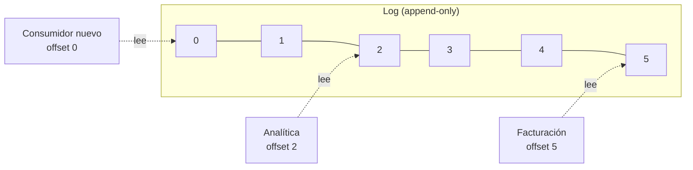

# Colas frente a logs de eventos

Un MOM puede guardar los mensajes de dos formas muy distintas: como una **cola**, donde el mensaje se consume y desaparece, o como un **log**, donde el evento queda guardado y cada consumidor avanza a su ritmo. La táctica en ambos casos es la misma (usar un intermediario y adherir a un estándar de esquema), pero cambian los casos de uso y los costos.

## La diferencia

| | Cola | Log |
|---|---|---|
| Qué pasa al consumir | El mensaje **se consume y desaparece** | El evento **se guarda**; consumir no lo borra |
| Estado del consumidor | Lo lleva la cola (qué falta entregar) | Cada consumidor lleva su **offset** (hasta dónde leyó) |
| Consumidores | Compiten por los mensajes: cada uno lo procesa una vez | **N consumidores independientes** leen todo |
| Releer la historia | No se puede | **Replay** desde cualquier offset |
| Ejemplos | RabbitMQ (colas clásicas), Amazon SQS | **Kafka**, Redpanda, RabbitMQ Streams, Kinesis |

En el log, Facturación va al día, Analítica va atrasada y un consumidor recién agregado empieza desde el principio. **Ninguno cambia lo que ven los demás.**

Un log también admite **retención** (cuánto tiempo se guardan los eventos) y **compactación** (conservar solo el último evento de cada clave, por ejemplo el último estado de cada pedido).

## Cuándo usar un log

- **Sí:**
  - Hay **muchos consumidores** que necesitan el mismo flujo.
  - Se necesita **auditoría** o un **registro de las interacciones** entre sistemas.
  - Hay que **reprocesar** (por ejemplo, después de corregir un bug en un consumidor).
  - Se quiere **integrar un contexto nuevo sin tocar al emisor**: el nuevo consumidor lee la historia y nadie más cambia.
- **No:**
  - Es una **tarea que se hace una vez** y listo, una cola de trabajo, como "redimensionar esta imagen".
  - Se requiere **orden global estricto** (un log particionado solo garantiza orden dentro de cada partición).
  - Se necesita **latencia mínima**.

**Ejemplo:** en un banco, "el usuario A transfirió \$10.000 a B" es un hecho que interesa a Saldos, Antifraude, Notificaciones y Auditoría. Con un log, cada uno lo consume a su ritmo y, si mañana se crea un contexto de Reportes regulatorios, lee toda la historia sin pedirle nada al emisor.

## Lo que cuesta

- **Gestión de offsets:** cada consumidor debe guardar bien hasta dónde leyó. Un error hace que se salte eventos o los procese dos veces.
- **Esquemas versionados:** los eventos viejos siguen ahí, así que los consumidores deben entender todas las versiones del formato.
- **Un cluster que operar:** brokers, particiones y réplicas.
- **Leer historia es lento:** buscar algo en un log implica recorrerlo. En la práctica se separa el almacenamiento: los eventos recientes quedan en almacenamiento rápido, y los históricos se archivan en un almacenamiento frío (un "baúl") más barato.

## Cómo se distribuye un log: particiones y réplicas

> [!example]- Transcripción de la imagen
> - Tres brokers. El **Topic 1** está dividido en **Partition 0, 1 y 2**.
> - En azul (**Leader**): Broker 1 lidera la partición 0, Broker 2 la partición 1 y Broker 3 la partición 2.
> - En blanco (**in-sync Replica**): Broker 1 tiene una réplica de la partición 1, Broker 2 de la 2 y Broker 3 de la 0.
> - Las flechas van de cada líder a su réplica en otro broker.

Así escala un log como Kafka. Las **particiones** reparten la carga: cada una puede escribirse y leerse en paralelo en un broker distinto. Las **réplicas sincronizadas** dan tolerancia a fallos: si el Broker 1 cae, la réplica de la partición 0 en el Broker 3 pasa a ser líder. El costo es que el orden solo se garantiza **dentro** de cada partición.

> [!warning] Un log no reemplaza a la base de datos
> Guardar eventos no significa que sea cómodo consultar el estado actual ("¿cuánto stock queda?"). Para eso, los consumidores construyen sus propias vistas a partir del log. Proponer un log como única persistencia de consultas frecuentes es un error de performance.

## Preguntas de repaso

> [!question]- ¿Qué es un offset y por qué permite que un log tenga N consumidores independientes?
> Es la posición del último evento que leyó un consumidor. Como cada consumidor guarda su propio offset y leer no borra eventos, cada uno avanza a su ritmo sin afectar a los otros, y uno nuevo puede empezar desde el principio.

> [!question]- ¿Cola o log? a) Generar el PDF de una boleta · b) Auditar todas las transferencias de un banco · c) Enviar un correo de bienvenida · d) Alimentar a cinco sistemas con cada cambio de precio
> a) Cola: es una tarea que se hace una vez. b) Log: hay auditoría y reprocesamiento. c) Cola: tarea única. d) Log: muchos consumidores independientes del mismo flujo.

> [!question]- V o F: "Un log de eventos como Kafka garantiza orden global de todos los mensajes de un tópico".
> Falso. El orden se garantiza dentro de cada partición. Con varias particiones, dos eventos en particiones distintas pueden procesarse en cualquier orden. Si se necesita orden por pedido, se usa el id del pedido como clave de partición.

> [!question]- Nombre tres costos de usar un log en vez de una cola.
> La gestión de offsets por consumidor, el versionado de esquemas (los eventos viejos se siguen leyendo) y la operación de un cluster (brokers, particiones, réplicas). Además, buscar en la historia es lento si no se separan los datos recientes de los archivados.

> [!question]- En la figura de las particiones, ¿qué pasa si cae el Broker 2?
> La partición 1, cuyo líder estaba en el Broker 2, pasa a tener como líder a su réplica sincronizada en el Broker 1. La réplica de la partición 2 que vivía en el Broker 2 se pierde, pero el líder de esa partición (Broker 3) sigue funcionando. El tópico sigue disponible, con menos redundancia hasta que se recupere el broker.

> [!question]- Mini caso: se crea un contexto de Recomendaciones que necesita todas las compras del último año. ¿Qué ventaja da tener un log frente a una cola?
> Con un log, Recomendaciones se suscribe y hace replay desde el offset correspondiente a hace un año, sin tocar a Checkout ni a ningún otro consumidor. Con una cola, esos mensajes ya se consumieron y desaparecieron, así que habría que pedirle a Checkout que reenviara o exportara la historia.
