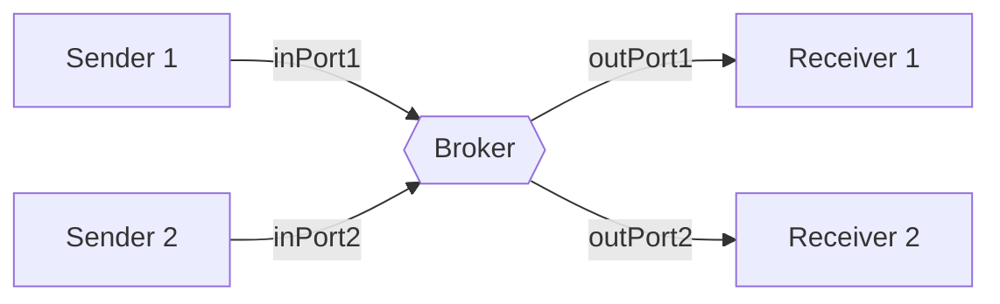

# Broker de ruteo y transformación y motores de procesos

Una cola o un log solo **transportan** mensajes. Cuando hay *N* emisores y *M* receptores con formatos distintos, se necesita un intermediario que además sepa **a quién va cada mensaje** y **cómo adaptarlo**: el **broker**. Si encima hay que recordar en qué paso va un proceso de negocio largo, aparece el **motor de procesos**. Son dos escalones más de inteligencia en el middleware, y cada escalón trae su propio riesgo.

## Broker: ruteo y transformación

> [!tip] Broker
> Intermediario que, además de transportar, **enruta** y **transforma** los mensajes. Aplica las tácticas de Bass y Kazman **adaptar** y **ajustar la interfaz** (*tailor interface*).

- **Ruteo:** el broker sabe a qué receptor va cada mensaje. Los sistemas se comunican a través de **canales**, y los emisores no necesitan conocer a los receptores. Como un receptor también puede ser emisor, se pueden formar flujos en varias direcciones, incluso ciclos, siempre ordenados por las rutas del broker. Ya no hay comunicación de un solo lado hacia el otro.
- **Transformación:** convierte el formato de un emisor al que espera el receptor (XML a JSON, renombrar campos, cambiar unidades). Son **reglas de forma, no de negocio**: es el principio de *smart endpoints, dumb pipes*, donde la lógica vive en los servicios y el canal solo transporta y adapta.

**Escenario:** el proveedor de pagos envía XML con sus propios códigos de estado. El broker puede traducirlo al formato que entiende Checkout, así que la traducción del proveedor (una ACL) puede vivir en el broker.

> [!warning] El riesgo del broker: que también viva la regla de negocio
> Si en el broker se empieza a programar "si el monto es mayor a \$1.000.000, mandar a revisión manual", el broker deja de ser un tubo tonto y pasa a contener el dominio. Termina siendo un componente que todos los equipos deben tocar para cambiar su lógica. Transformar la forma sí; decidir el negocio, no.

## Motores de procesos

> [!tip] Motor de procesos
> Un **superset del broker**: además de enrutar y transformar, **guarda el estado del proceso** y **orquesta** los pasos. Aplica la táctica de Bass y Kazman **coordinar · orquestar**.

El motor vincula los **pasos del negocio** con los sistemas que los ejecutan y define el **flujo macro**: "recibir pedido → reservar stock → cobrar → si el cobro falla, liberar stock → despachar". Sabe en qué paso va cada pedido, qué pasos fallaron y qué falta.

- **Se usa en:** flujos de pago, procesos largos y procesos complejos que requieren **auditabilidad**, porque el motor registra cada transición.
- **Herramientas:** Apache Airflow define flujos como grafos dirigidos acíclicos (DAGs) de tareas. Camunda modela procesos de negocio en notación BPMN, con compuertas, tareas de usuario y temporizadores.
- **Contras:**
  - **Persistencia que escalar:** cada instancia de proceso tiene estado guardado, y con millones de pedidos ese almacenamiento se vuelve un problema de escala.
  - **SPOF (punto único de falla):** si el motor cae, ningún proceso avanza.

| | Cola o log | Broker | Motor de procesos |
|---|---|---|---|
| Transporta | ✔ | ✔ | ✔ |
| Enruta | – | ✔ | ✔ |
| Transforma formato | – | ✔ | ✔ |
| Guarda estado del proceso | – | – | ✔ |
| Orquesta pasos de negocio | – | – | ✔ |
| Riesgo principal | Operar el cluster | Que absorba reglas de negocio | SPOF y persistencia que escalar |

## Lo que se hereda de SOA

La **arquitectura orientada a servicios** aporta al módulo de integración la idea del **servicio como unidad con contrato propio**, junto con sus valores: *smart endpoints, dumb pipes* y el reuso.

SOA también deja una advertencia. Su bus de integración (**ESB**, *Enterprise Service Bus*), llevado al extremo, se convirtió en un **intermediario que sabe demasiado**: ruteo, transformación, reglas, orquestación, todo en un único componente. A eso se sumó el **modelo canónico**, que es un shared kernel forzado a toda la empresa. **Escenario:** con un bus así, agregar un segundo proveedor de pagos obliga a tocar el bus, y con él a todos los que lo usan. Es exactamente lo que el broker "tonto" y la ACL buscan evitar.

## Preguntas de repaso

> [!question]- ¿Qué agrega un broker sobre una cola simple?
> Ruteo (sabe a qué receptor va cada mensaje, así que los emisores no conocen a los receptores) y transformación (adapta el formato entre emisor y receptor). Una cola solo guarda y entrega mensajes a quien la consume.

> [!question]- ¿Qué significa "dumb pipes" y por qué limita lo que debe hacer un broker?
> Que el canal de comunicación debe ser tonto: transporta y, a lo más, adapta la forma de los mensajes, pero no contiene reglas de negocio. Si el broker decide cosas del negocio, se acopla a todos los dominios, y cada cambio de lógica obliga a tocar un componente compartido.

> [!question]- ¿Por qué se dice que un motor de procesos es un "superset" del broker?
> Porque hace todo lo que hace el broker (enrutar y transformar) y además guarda el estado de cada instancia de proceso y orquesta la secuencia de pasos de negocio.

> [!question]- Nombre dos desventajas de un motor de procesos y una forma de mitigar cada una.
> SPOF: se mitiga replicando el motor (varias instancias con estado compartido o consenso). Persistencia que escalar: se mitiga particionando el almacenamiento de las instancias de proceso y archivando los procesos terminados.

> [!question]- V o F: "Es buena práctica que el broker aplique reglas como 'pedidos sobre \$1.000.000 van a revisión manual', porque centraliza la lógica".
> Falso. Es una regla de negocio y debería vivir en el contexto dueño de esa decisión. Ponerla en el broker lo transforma en un intermediario que sabe demasiado, el mismo problema del ESB en SOA.

> [!question]- ¿Por qué el modelo canónico de SOA se describe como un shared kernel forzado a toda la empresa?
> Porque obliga a que todos los servicios compartan un mismo modelo de datos. Igual que un shared kernel, cada cambio exige acuerdo y despliegues acoplados, pero esta vez entre todos los equipos de la empresa y no entre dos.

> [!question]- Mini caso: un flujo de pago tiene 6 pasos, algunos tardan horas y la auditoría exige saber en qué paso falló cada pago. ¿Broker o motor de procesos?
> Motor de procesos. Hace falta guardar el estado de cada pago entre pasos que tardan horas, orquestar la secuencia (incluidas las compensaciones si un paso falla) y registrar cada transición para la auditoría. El broker no guarda estado del proceso. Hay que mencionar como costo el SPOF y la persistencia que escalar.
