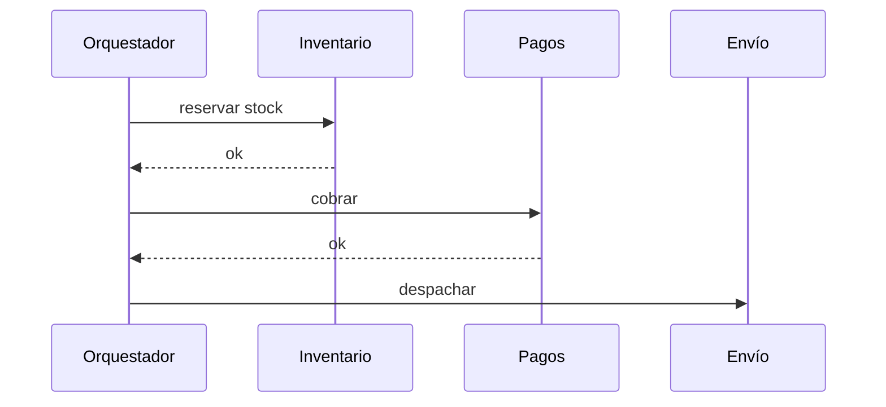

# Orquestación frente a coreografía

Cuando un proceso de negocio cruza varios servicios hay dos formas de coordinarlo: con un **director** que le dice a cada uno qué hacer (**orquestación**) o dejando que **cada servicio reaccione a lo que hacen los demás** (**coreografía**). Esta pregunta aparece en casi todas las pruebas, y la pauta exige la diferencia, la elección, una desventaja y cómo resolverla.

## Las dos formas

> [!tip] Definiciones
> - **Orquestación:** hay un servicio encargado de **hacer seguimiento de los demás y coordinarlos**. Sabe el flujo completo, llama a cada paso y maneja los errores. Es la topología **mediator** de EDA y la idea del motor de procesos.
> - **Coreografía:** los sistemas **se coordinan entre ellos directamente**, notificándose eventos, errores o el fin de su parte del flujo para que el siguiente continúe. Nadie tiene la vista completa. Es la topología **broker** de EDA.

En la coreografía, cada servicio escucha un evento, hace lo suyo y publica el siguiente. Si el pago se rechaza, Inventario escucha `PagoRechazado` y libera el stock por su cuenta.

## Comparación

| | Orquestación | Coreografía |
|---|---|---|
| Dónde vive el flujo | En el orquestador, explícito | Repartido entre los servicios, implícito |
| Visibilidad y trazabilidad | Alta: un lugar para ver en qué paso falló | Baja: hay que seguir eventos entre servicios |
| Acoplamiento | Todos dependen del orquestador | Bajo: cada servicio solo conoce eventos |
| Escalabilidad y performance | El orquestador es **SPOF** y cuello de botella | Sin centro que saturar |
| Mantenibilidad | Cambiar el flujo es cambiar un lugar | Cambiar el flujo toca varios servicios |
| Errores | Centralizados en el orquestador | Cada servicio maneja los suyos |
| Encaja con | Flujos críticos y auditables, pocos equipos | Muchos equipos autónomos, flujos que evolucionan |

> [!warning] La desventaja que pide la pauta
> - **Coreografía:** se pierde **mantenibilidad y trazabilidad**, porque la coordinación está repartida y cuesta saber quién tiene el error.
> - **Orquestación:** se pierde **performance y escalabilidad**, porque el orquestador es un **SPOF** y concentra toda la carga.
> Nombrar solo "es más complejo" no alcanza: hay que decir qué atributo se sacrifica y por qué.

## Caso resuelto: trazabilidad en una empresa grande

**Enunciado:** una empresa con muchos equipos, cada uno dueño de un microservicio, coordina sus transacciones por coreografía. Cuando una transacción falla, los equipos pasan horas preguntándose "quién tiene el error". La gerencia propone volver a orquestación para tener un solo lugar donde monitorear. ¿Es buena idea? ¿Qué alternativa mantiene la coreografía?

**Respuesta esperada:**
1. **Analizar la propuesta.** Un orquestador (mediator) centralizaría todos los flujos y capturaría los errores en un punto, así que el problema de visibilidad se resuelve.
2. **Concluir que no conviene en este caso.** Con muchos equipos separados, el orquestador concentraría la carga de todos los flujos (riesgo de colapso y SPOF) y además se volvería un cuello de botella **organizacional**: todos los equipos tendrían que coordinarse con el dueño del orquestador para cambiar cualquier flujo.
3. **Proponer la alternativa.** Mantener la coreografía y agregar observabilidad:
   - un **servicio de gestión de errores** o un **sidecar** en cada servicio que reporte los fallos a un lugar central;
   - un **id de correlación** que viaje en cada evento, con trazas distribuidas que permitan reconstruir el camino de una transacción.
4. **Justificar.** Se recupera la trazabilidad sin centralizar el control: cada equipo sigue siendo autónomo y no aparece un SPOF.

> [!example]- Caso resuelto 2: scrapers lentos en una máquina aparte
> **Enunciado:** los scrapers tardan en ejecutarse y se mueven a una máquina aparte. ¿Coreografía u orquestación? Dé la diferencia, la elección, una desventaja y cómo la resolvería.
> **Una respuesta posible:** la diferencia es la de la tabla. Se elige **orquestación** para tener un único lugar que lance los scrapers, sepa cuáles terminaron y reintente los que fallan. La desventaja es que el orquestador es un SPOF y limita la escalabilidad. Se resuelve replicando el orquestador y dejando que los scrapers trabajen tomando tareas de una cola (workers), así el orquestador solo coordina y no ejecuta.
> La elección en sí no da puntaje: lo que se evalúa es que la desventaja y su solución sean coherentes con lo elegido.

## Preguntas de repaso

> [!question]- Explique la diferencia entre orquestación y coreografía en dos frases.
> En orquestación, un servicio central conoce el flujo, coordina a los demás y maneja los errores. En coreografía, cada servicio reacciona a eventos de los otros y publica los suyos, sin un coordinador con la vista completa.

> [!question]- ¿Qué atributo se sacrifica en cada enfoque?
> En coreografía se sacrifican la mantenibilidad y la trazabilidad, porque el flujo está repartido. En orquestación se sacrifican la performance y la escalabilidad, porque el orquestador es un SPOF y un cuello de botella.

> [!question]- ¿Con qué topología de EDA se corresponde cada enfoque?
> Orquestación con la topología mediator (un mediador coordina los pasos). Coreografía con la topología broker (los componentes se encadenan por eventos a través del broker, sin coordinador).

> [!question]- V o F: "Para resolver la falta de trazabilidad en una coreografía, la única opción es pasar a orquestación".
> Falso. Se puede mantener la coreografía y agregar observabilidad: ids de correlación en los eventos, trazas distribuidas, un sidecar que reporte errores o un servicio central de gestión de errores. Se gana visibilidad sin centralizar el control.

> [!question]- Mini caso: un flujo de pagos bancarios con 4 pasos exige auditar cada transición y compensar si un paso falla. ¿Qué enfoque elige y qué costo debe mencionar?
> Orquestación, típicamente con un motor de procesos: el flujo queda explícito, cada transición se registra y el orquestador ejecuta las compensaciones. Hay que mencionar que es un SPOF y un posible cuello de botella, y mitigarlo con réplicas y persistencia del estado.

> [!question]- ¿Por qué en una empresa con muchos equipos la orquestación también es un problema organizacional y no solo técnico?
> Porque el orquestador contiene los flujos de todos: cualquier cambio de proceso pasa por el equipo dueño del orquestador. Ese equipo se convierte en un cuello de botella para la cadencia de los demás, justo lo contrario de la autonomía que se buscaba al separar en servicios.
