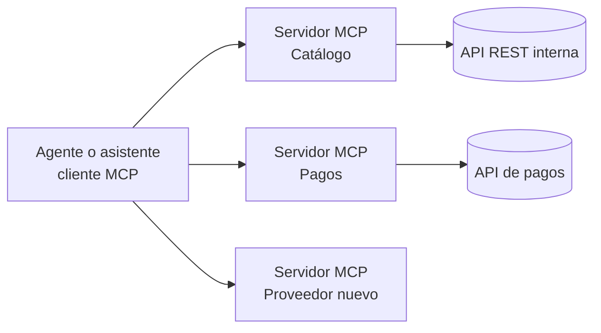
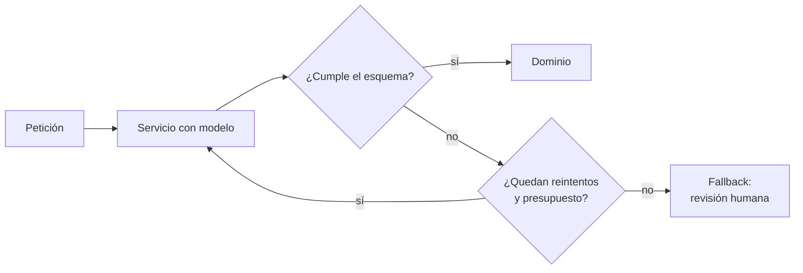

# MCP e integración de componentes no deterministas

Los mecanismos anteriores asumen que, del otro lado del contrato, hay un programa que hace siempre lo mismo. Con los modelos de lenguaje aparecen dos situaciones nuevas: el **cliente** de una API puede ser un modelo, y el **proveedor** de un servicio puede tener un modelo adentro. En ambos casos, el contrato deja de ser determinista y las tácticas de integración ganan una columna nueva: el **costo** por llamada.

## MCP: cuando el cliente es un modelo

El **Model Context Protocol (MCP)**, de 2024, es un mecanismo para integrar modelos de IA con herramientas. Un cliente (un asistente o un agente) se conecta a **servidores MCP**, y cada servidor expone tres tipos de capacidades:
- **tools:** acciones que el modelo puede invocar;
- **resources:** datos que puede leer;
- **prompts:** plantillas de instrucciones.

Por debajo, la comunicación usa **JSON-RPC**.

La diferencia con una API tradicional es quién la consume. **El consumidor del contrato no es determinista**: el modelo decide qué herramienta llamar según la **descripción en prosa** de cada una. Esa descripción **es la interfaz**. Una API normal está pensada para humanos que escriben código contra ella; MCP está pensado para que un modelo la lea en tiempo de ejecución. En la práctica, es el lugar donde reaparece la idea de HATEOAS: el cliente descubre en ejecución qué puede hacer.

| Pros | Contras |
|---|---|
| **Nativo para IA**: todos los proveedores de modelos lo consumen | **Overhead** sobre APIs simples |
| **Observable**: cada llamada a una tool queda registrada | **Un componente más**, montado sobre una especificación volátil |
| **No contamina las APIs principales**: el servidor MCP es un adaptador aparte | |

**Escenario:** integrar un proveedor nuevo es agregar un servidor MCP más. El problema nuevo es la **autorización**: qué puede hacer el modelo en nombre de quién, y cómo se evita que una instrucción maliciosa lo lleve a usar herramientas que no debería.

## Cuando el proveedor tiene un modelo adentro

Si un servicio usa un modelo de lenguaje (por ejemplo, para clasificar reclamos o extraer datos de documentos), su contrato es **estadístico**: devuelve una respuesta con el esquema *S* con probabilidad *p*, no siempre. Las tácticas para integrarlo:

1. **Validar el esquema en la frontera.** Toda respuesta se valida contra el esquema esperado antes de entrar al dominio, como una ACL que además desconfía.
2. **Reintentar con idempotencia.** Si la respuesta no cumple, se reintenta, y la operación debe ser idempotente para que el reintento no duplique efectos.
3. **Presupuesto por llamada.** Hay un límite de latencia y de costo por llamada, con **timeout** y **circuit breaker** para dejar de llamar a un proveedor que está fallando.
4. **Fallback definido.** Hay que decidir de antemano qué pasa cuando no se cumple: una regla simple, una cola de revisión humana o un valor por defecto.

> [!tip] Una columna más en las medidas
> En una integración con modelos, cada escenario de calidad debe medir latencia y disponibilidad, y también **costo por llamada**: cada reintento consume tokens y dinero.

> [!warning] No confiar en la salida del modelo
> Tratar la respuesta de un modelo como si fuera una API determinista (usar su JSON sin validarlo) es el error típico. Tarde o temprano el modelo devuelve un campo de más, un formato distinto o un valor inventado. La validación en la frontera y el fallback son obligatorios.

## Preguntas de repaso

> [!question]- ¿Qué expone un servidor MCP y sobre qué protocolo?
> Expone tools (acciones), resources (datos) y prompts (plantillas), y se comunica con el cliente usando JSON-RPC.

> [!question]- ¿Por qué se dice que en MCP "la descripción en prosa es la interfaz"?
> Porque el consumidor es un modelo que decide qué herramienta usar leyendo su descripción en lenguaje natural. Si la descripción es ambigua, el modelo usa mal la herramienta, aunque el esquema técnico sea correcto.

> [!question]- Nombre dos ventajas y dos desventajas de MCP.
> Ventajas: es nativo para IA (todos los proveedores lo consumen) y es observable, sin contaminar las APIs principales porque el servidor MCP es un adaptador aparte. Desventajas: agrega overhead sobre APIs simples y es un componente más, sobre una especificación que todavía cambia.

> [!question]- ¿Qué significa que el contrato de un servicio con un modelo adentro sea "estadístico"?
> Que no siempre cumple: con probabilidad *p* devuelve el esquema esperado, y con probabilidad *1−p* devuelve algo distinto (formato incorrecto, datos inventados). Por eso hay que diseñar para el caso en que no cumple.

> [!question]- Ordene y explique las cuatro tácticas para integrar un componente no determinista.
> Validar el esquema en la frontera (nada no validado entra al dominio), reintentar con idempotencia (repetir sin duplicar efectos), presupuesto por llamada con timeout y circuit breaker (acotar latencia y costo) y fallback definido (qué hacer si igual falla).

> [!question]- Mini caso: un agente de IA de soporte necesita consultar pedidos y emitir reembolsos. ¿Qué problema nuevo aparece al exponerle esas acciones por MCP?
> La autorización. Hay que definir en nombre de qué usuario actúa el agente, limitar qué tools puede usar (consultar sí, reembolsar solo bajo cierto monto o con confirmación humana) y protegerse de instrucciones maliciosas que lo lleven a ejecutar acciones indebidas.

> [!question]- V o F: "Si un modelo devuelve JSON, basta con parsearlo para integrarlo como cualquier API".
> Falso. Parsear no garantiza que cumpla el esquema ni que los valores sean correctos. Hay que validarlo en la frontera, reintentar o aplicar un fallback cuando no cumple, y controlar el costo y la latencia de cada llamada.
