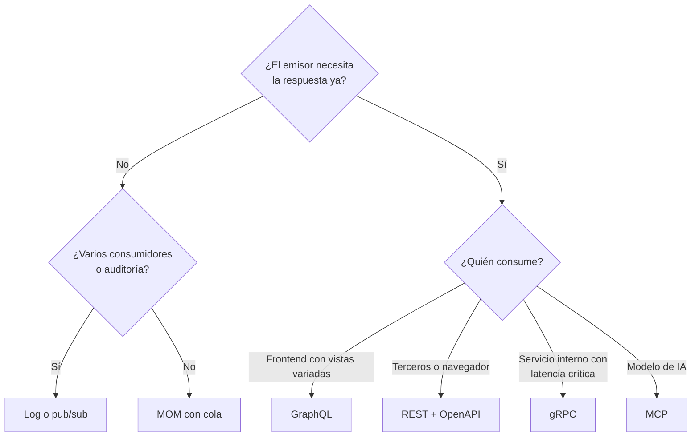

# Cómo elegir el mecanismo de integración

En la prueba casi nunca se pregunta "¿qué es gRPC?". Se pregunta "**dado este caso, ¿qué mecanismo de integración usaría y por qué?**". Esta nota reúne los mecanismos del bloque (middleware, MOM, broker, motor de procesos, REST, gRPC, GraphQL y MCP) en una guía para decidir, con las justificaciones que esperan las pautas.

## Comparación general

| Mecanismo | Comunicación | Fuerte en | Débil en | Señal en el enunciado |
|---|---|---|---|---|
| **Middleware / ACL** | Depende | Aislar formatos y protocolos ajenos | Componente extra, latencia, SPOF | "Proveedores legados", "protocolo que nadie entiende" |
| **MOM (cola)** | Asíncrona, 1-1 o N-N | Desacople temporal, tolerancia a fallos | Formato acordado, consistencia eventual | "No perder mensajes", "el proveedor se cae", "muchos servicios" |
| **Log (Kafka)** | Asíncrona, N consumidores | Replay, auditoría, consumidores nuevos | Offsets, operar el cluster | "Auditoría", "trazabilidad", "reprocesar" |
| **Broker** | Asíncrona con ruteo | Enrutar y transformar formatos | Riesgo de absorber reglas de negocio | "Cada equipo usa solo parte de los datos" |
| **Motor de procesos** | Orquestada, con estado | Flujos largos y auditables | SPOF, persistencia que escalar | "Proceso de varios pasos", "compensar si falla" |
| **REST** | Síncrona, petición-respuesta | Estándar, web, caché, legible | Overhead, over/underfetching | "API pública", "terceros", "navegador" |
| **gRPC** | Síncrona o streaming | Latencia mínima, binario, tipado | No web-nativo, no legible | "Tiempo real entre servicios", "alta velocidad", "dispositivos" |
| **GraphQL** | Petición-respuesta y suscripción | Vistas del frontend, un endpoint | Caché, optimización, seguridad | "App móvil", "muchas pantallas distintas" |
| **MCP** | JSON-RPC | Exponer herramientas a modelos | Overhead, spec volátil, autorización | "Agente de IA", "asistente que usa sistemas" |

## Árbol de decisión

Sobre cualquier hoja se agregan, si el caso lo pide:
- un **middleware o ACL** si el otro lado es ajeno o legado;
- un **motor de procesos** si el flujo tiene varios pasos con estado.

> [!tip] Estructura de una respuesta con puntaje completo
> 1. **Nombrar** el mecanismo.
> 2. **Ubicarlo** en el sistema: entre qué componentes va.
> 3. **Justificar** con el atributo que mejora (performance, desacople, tolerancia a fallos, integrabilidad).
> 4. **Reconocer su costo** y cómo se mitiga.
> Las pautas suelen repartir algo así como 1 punto por nombrar, 1 por ubicar y 2 por justificar.

## Mini casos resueltos

> [!example]- Satélite que distribuye datos de exploración a 8 equipos de análisis
> **Pregunta:** ¿qué herramienta o estilo usaría para propagar la información a cada equipo, si deben manejar mucho volumen y una falla puede significar enviar una colonia a una zona inhabitable?
> **Respuesta:** un **event bus o broker con persistencia**, al estilo de un log. Recibe y distribuye grandes volúmenes sin bloquear. Desacopla a los equipos entre sí y del origen. Si un equipo falla, puede hacer **replay** y no pierde datos críticos. Filtra por tópicos para que cada equipo reciba solo lo suyo, y permite agregar instancias por equipo.
> Es mejor que un pub/sub simple porque este último no almacena mensajes, pierde datos si nadie escucha y no permite replay.

> [!example]- Startup que integra proveedores legados con archivos CSV, XLSX o JSON
> **Respuesta:**
> - **Middlewares adaptadores por proveedor** que aíslan la heterogeneidad.
> - Un **orquestador** del proceso de ingesta: obtener, parsear, validar, transformar y cargar.
> - **No** imponer un esquema a los proveedores, porque no tenemos poder sobre ellos.
> - **No** agregar cómputo, porque eso es una táctica de performance y el volumen es bajo.

> [!example]- Muchos servicios distintos que deben comunicarse sin tocar integraciones a cada rato
> **Respuesta:** un **MOM**. Hay que describir la alternativa sin él (todos conectados con todos, $N \times M$ integraciones) y justificar que el intermediario concentra el envío y puede adaptar mensajes, así que cada servicio se conecta solo con él.

## Preguntas de repaso

> [!question]- ¿Qué pregunta separa primero a MOM de REST, gRPC o GraphQL?
> Si el emisor necesita la respuesta en el momento. Si no la necesita, conviene la comunicación asíncrona por MOM o log, que desacopla en el tiempo y tolera fallos. Si la necesita, se elige entre los mecanismos síncronos según quién consume.

> [!question]- ¿Cuándo un log es mejor que una cola simple y cuándo un pub/sub simple no basta?
> Un log es mejor cuando hay varios consumidores independientes, auditoría o necesidad de reprocesar. Un pub/sub simple no basta cuando no se puede perder información: no almacena mensajes, pierde lo que nadie escucha y no permite replay.

> [!question]- Mini caso: un banco expone a fintechs externas la consulta de saldos. ¿REST, gRPC o GraphQL?
> REST con OpenAPI: los consumidores son terceros heterogéneos, el contrato publicado (Published Language) les permite integrarse solos y la caché y las herramientas web ayudan. gRPC exigiría distribuir `.proto` y no es web-nativo. GraphQL agregaría riesgos de exposición de datos sin necesidad.

> [!question]- Mini caso: un servicio de recomendaciones consulta al servicio de perfiles 2.000 veces por segundo dentro del mismo equipo. ¿Qué mecanismo usar?
> gRPC: es comunicación interna de alta frecuencia dentro de un contexto, donde importan la latencia y la serialización eficiente, y el acoplamiento al `.proto` es barato porque es el mismo equipo.

> [!question]- ¿Qué cuatro elementos debe tener una respuesta de "elija un mecanismo de integración"?
> Nombrar el mecanismo, ubicarlo entre los componentes concretos del sistema, justificarlo con el atributo que mejora y reconocer su costo con una mitigación.

> [!question]- V o F: "REST siempre es la mejor opción de integración porque es el estándar de la web".
> Falso. REST es adecuado para APIs públicas y web, pero tiene overhead y es síncrono. Para comunicación asíncrona y tolerante a fallos conviene MOM, para latencia mínima entre servicios gRPC y para vistas de frontend variadas GraphQL. La elección depende del caso.
