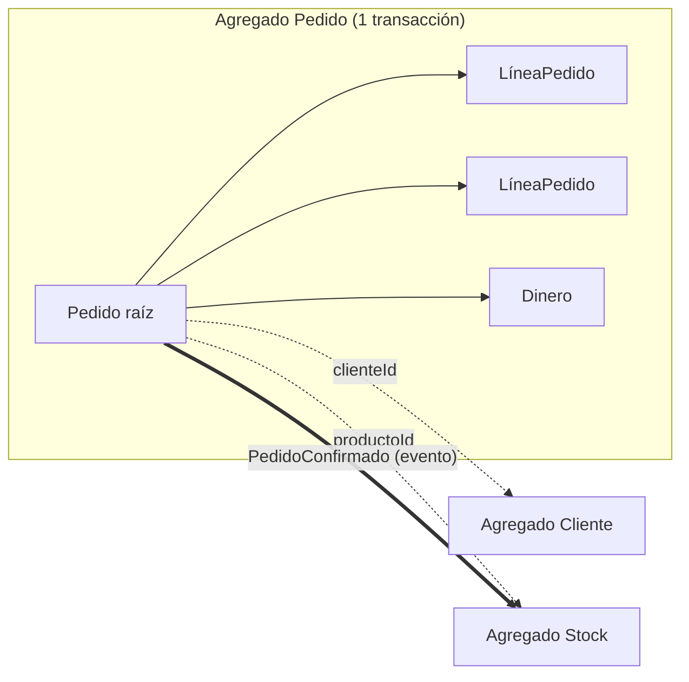

# Agregados y raíz del agregado

Entidades y objetos de valor sueltos no bastan: alguien tiene que garantizar que las reglas de negocio se cumplan **todas a la vez**. El **agregado** es esa frontera. Es el concepto central del DDD táctico, porque define qué se guarda junto, qué se bloquea junto y qué puede quedar consistente "más tarde".

## Definiciones

> [!tip] Agregado (*aggregate*)
> Un grupo de **entidades y objetos de valor que cambian juntos para proteger un invariante**. Es un **límite de consistencia**: dentro de él, las reglas se cumplen siempre.

> [!tip] Raíz del agregado (*aggregate root*)
> La **única entidad visible desde afuera**. **Todo cambio pasa por ella**, y los objetos internos solo se modifican a través de sus métodos.

Un **invariante** es una regla que debe ser cierta en todo momento. En un pedido: **total = suma de las líneas**.


> [!example]- Transcripción de la imagen
> - Un recuadro punteado rotulado **Aggregate — límite de consistencia**.
> - Dentro: **Pedido #101230** (*Aggregate Root · Entity*, invariante: total = Σ líneas), **LíneaPedido ×N** (*Entity · identidad local*), **Dinero** (*Value Object*: monto + moneda) y **Dirección** (*Value Object*: de entrega).
> - Fuera del límite, con flechas punteadas: **Cliente** (otro agregado, referenciado vía `clienteId`) y **Stock** (otro agregado, referenciado vía `productoId`).

La LíneaPedido es una entidad con **identidad local**: es "la línea 2 del pedido #101230" y no tiene sentido fuera de él.

## Las tres reglas

1. **Todo cambio entra por la raíz.** Nadie hace `pedido.lineas[2].cantidad = 5`. Se llama `pedido.cambiarCantidad(linea, 5)`, y la raíz recalcula el total. Así el invariante no se puede saltar.
2. **Una transacción = un agregado.** El agregado se carga, se modifica y se guarda completo en una transacción. No se modifican dos agregados en la misma transacción.
3. **Entre agregados: referencia por id y consistencia eventual.** El pedido guarda `clienteId` y `productoId`, no los objetos Cliente y Stock. Si confirmar un pedido debe descontar stock, eso ocurre **después**, reaccionando a un evento, no en la misma transacción.



## El agregado en código

Extracto adaptado de *domain-driven-hexagon*:

```typescript
export class UserEntity extends AggregateRoot<UserProps> {
  static create(create: CreateUserProps): UserEntity {        // fábrica
    const id = v4();
    const props: UserProps = { ...create, role: UserRoles.guest };
    const user = new UserEntity({ id, props });
    user.addEvent(new UserCreatedDomainEvent({ aggregateId: id, email: props.email }));
    return user;
  }
  makeAdmin(): void { this.changeRole(UserRoles.admin); }     // intención de negocio
  private changeRole(newRole: UserRoles): void {
    this.addEvent(new UserRoleChangedDomainEvent({ aggregateId: this.id, oldRole: this.props.role, newRole }));
    this.props.role = newRole;
  }
  updateAddress(props: UpdateUserAddressProps): void {
    this.props.address = new Address({ ...this.props.address, ...props });  // nuevo objeto de valor
  }
  validate(): void { /* reglas de negocio antes de persistir */ }
}
```

Qué hay que notar en el código:
- El método estático **`create` es una fábrica**: el agregado nace válido y con su rol por defecto.
- Los métodos públicos expresan **intenciones del negocio** (`makeAdmin`, `updateAddress`), no setters genéricos.
- Cada cambio de estado **registra un evento de dominio** (`UserCreated`, `UserRoleChanged`).
- La dirección se **reemplaza** por un nuevo objeto de valor, no se modifica.
- `validate()` verifica los invariantes antes de persistir.

> [!warning] Referenciar por objeto en vez de por id
> Si el agregado Pedido contiene el objeto Cliente completo, cargar un pedido carga al cliente, y guardar el pedido podría modificar al cliente en la misma transacción. Se rompe la regla "una transacción = un agregado" y crecen los bloqueos. Entre agregados se referencia **por id**.

## Preguntas de repaso

> [!question]- ¿Qué es un invariante y cuál protege el agregado Pedido?
> Es una regla que debe cumplirse siempre. El agregado Pedido protege que el total sea igual a la suma de sus líneas: cualquier cambio en las líneas pasa por la raíz, que recalcula el total en la misma operación.

> [!question]- ¿Por qué todo cambio debe pasar por la raíz del agregado?
> Porque la raíz es la que conoce y verifica los invariantes. Si se pudiera modificar una línea directamente, el total quedaría desactualizado y el agregado en un estado inválido.

> [!question]- Explique la regla "1 transacción = 1 agregado" y qué se hace cuando una operación afecta a dos agregados.
> Cada transacción carga, modifica y guarda un solo agregado, lo que mantiene las transacciones cortas y con pocos bloqueos. Si una operación afecta a otro agregado (confirmar un pedido descuenta stock), el primero emite un evento de dominio y el segundo reacciona después, con consistencia eventual.

> [!question]- ¿Por qué entre agregados se referencia por id y no por objeto?
> Para que cada agregado se cargue y se guarde de forma independiente. Referenciar por objeto mezcla las fronteras de consistencia, agranda las cargas y obliga a modificar varios agregados en la misma transacción.

> [!question]- ¿Qué significa que LíneaPedido tenga "identidad local"?
> Que tiene un id, pero solo dentro de su pedido ("línea 2 del pedido #101230"). No se referencia desde fuera del agregado y no existe sin su pedido.

> [!question]- En el código de `UserEntity`, identifique la fábrica, un método con intención de negocio y el uso de un objeto de valor.
> La fábrica es el método estático `create`, que asigna el id, el rol por defecto y emite `UserCreated`. Un método con intención es `makeAdmin()`. El objeto de valor es `Address`, que `updateAddress` reemplaza por uno nuevo.

> [!question]- V o F: "Si confirmar un pedido debe descontar stock, ambos cambios deben hacerse en la misma transacción para que el sistema sea correcto".
> Falso en DDD táctico. Pedido y Stock son agregados distintos, así que cada uno cambia en su propia transacción y se coordinan con un evento (`PedidoConfirmado`) con consistencia eventual. Si el negocio exige que ambos sean ciertos a la vez sin excepción, hay que reconsiderar la frontera del agregado.
