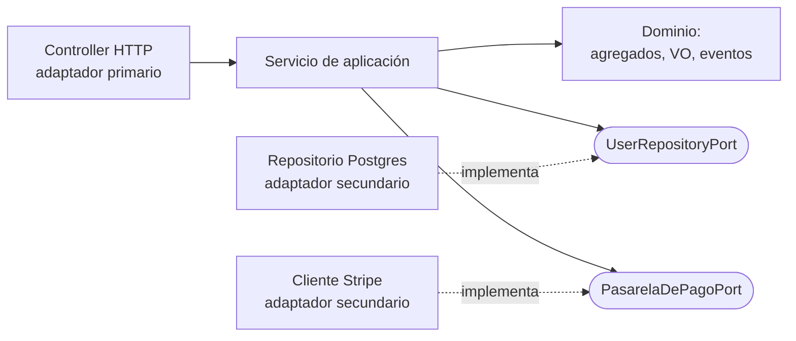

# Arquitectura hexagonal con puertos y adaptadores

Los bloques del DDD táctico necesitan una estructura de código que los proteja. Si el agregado puede importar el ORM, tarde o temprano lo hará. La **arquitectura hexagonal** (Cockburn, 2005), también llamada **puertos y adaptadores**, pone **el dominio al centro** y hace que **todas las dependencias apunten hacia adentro**.

## La idea


> [!example]- Transcripción de la imagen
> - Al centro, un hexágono **Core Application** que contiene un círculo **Domain**.
> - En los bordes del hexágono, cuatro rectángulos rojos rotulados **Port**.
> - Afuera, cuatro adaptadores conectados a esos puertos: **UI Adapter** y **REST Adapter** a la izquierda, **Database Adapter** y **Stripe Adapter** a la derecha.

- **Dominio al centro:** no importa nada de afuera, ni frameworks, ni base de datos, ni HTTP.
- **Puertos:** interfaces que expresan **lo que el núcleo necesita, en su propio lenguaje**. Por ejemplo, `UserRepositoryPort` o `PasarelaDePagoPort`.
- **Adaptadores:** implementan o usan los puertos con tecnología concreta.
  - **Primarios** o de entrada: controllers HTTP, CLI, consumidores de eventos. Llaman al núcleo.
  - **Secundarios** o de salida: repositorios, clientes de APIs externas (Stripe), mensajería. El núcleo los usa a través de un puerto.
- **Regla de dependencia:** **siempre hacia adentro**. El adaptador conoce al puerto; el dominio nunca conoce al adaptador.



> [!tip] Onion, Clean y la ACL
> **Onion** y **Clean Architecture** son la misma regla de dependencia con otros nombres para los anillos. La **capa anticorrupción** del context map es un **adaptador**: traduce el modelo ajeno al lenguaje del puerto.

## La estructura en código


> [!example]- Transcripción de la imagen
> - Un círculo dividido en **Interface** (izquierda, verde) e **Infrastructure** (derecha, naranja), con el **Core** al centro.
> - En Interface: **HTTP Controllers**, **Presenters**, **Event Controllers** y **CLI Controllers**, que reciben a usuarios finales, apps de terceros y usuarios técnicos y pasan DTOs hacia adentro.
> - En el Core, hexágonos de **Application Services**, **Domain Services**, **Entities/Aggregates** y **Value Objects**, más **Commands** y **Queries** (las queries pueden saltarse la capa de dominio).
> - En Infrastructure: **Ports** conectados a adaptadores de **Repository** (bases de datos PostgreSQL, MySQL, MongoDB), **External Resources** (e-mail, SMS, APIs de terceros) y **Microservices** (cola de mensajes).
> - Leyenda: las dependencias apuntan hacia adentro; los datos fluyen por todas las capas.

Estructura de un módulo del proyecto *domain-driven-hexagon*:

```text
src/modules/user/
  commands/create-user/
    create-user.command.ts
    create-user.service.ts           # servicio de aplicación (command handler)
    create-user.http.controller.ts   # adaptador primario
    create-user.request.dto.ts
  queries/find-users/find-users.query-handler.ts
  domain/        user.entity.ts, value-objects/address.value-object.ts, events/, user.errors.ts
  database/      user.repository.port.ts (puerto), user.repository.ts (adaptador), user.mapper.ts
  dtos/          user.response.dto.ts
src/libs/ddd/    Entity, AggregateRoot, ValueObject, DomainEvent, RepositoryPort
```

**Fitness function:** una prueba automática verifica que `domain/` **no importe** de `commands/`, de `database/` ni de NestJS. Así la regla de dependencia no depende de la disciplina del equipo: si alguien la rompe, falla el build.

## La cadena completa

**Dominio → contextos → relaciones → agregados → puertos → (solo si un requisito lo exige) despliegue separado.** Separar un contexto en otro servicio es el **último** paso, y solo se justifica por cadencia, escala o fallas propias. Con puertos bien definidos, ese paso consiste en cambiar un adaptador.

> [!warning] Hexagonal no significa microservicios
> Un monolito modular puede ser perfectamente hexagonal por dentro. La arquitectura hexagonal organiza **dependencias de código**; el despliegue es una decisión aparte.

## Preguntas de repaso

> [!question]- ¿Qué es un puerto y en qué lenguaje se escribe?
> Es una interfaz que expresa lo que el núcleo necesita del exterior (guardar usuarios, cobrar un pago), escrita en el lenguaje del dominio y no en el de la tecnología: `UserRepositoryPort.findOneByEmail`, no `SELECT * FROM users`.

> [!question]- Diferencie adaptadores primarios y secundarios con un ejemplo de cada uno.
> Los primarios son de entrada y llaman al núcleo: un controller HTTP o un consumidor de eventos. Los secundarios son de salida y el núcleo los usa a través de un puerto: el repositorio de Postgres o el cliente de Stripe.

> [!question]- ¿Qué dice la regla de dependencia y qué ganamos al cumplirla?
> Que las dependencias apuntan siempre hacia adentro: los adaptadores conocen a los puertos y el dominio no conoce a nadie de afuera. Se gana que el dominio se pruebe sin infraestructura, y que cambiar la base de datos o un proveedor solo requiera cambiar un adaptador.

> [!question]- ¿Por qué se dice que la ACL del context map es un adaptador?
> Porque traduce el modelo de un sistema ajeno (un proveedor de pagos) al lenguaje del puerto que define el dominio. El dominio solo conoce el puerto, y la ACL es la implementación que habla con el proveedor.

> [!question]- ¿Qué es una fitness function en este contexto?
> Una prueba automática que verifica una característica arquitectónica. Por ejemplo, que la carpeta `domain/` no importe de `database/`, de `commands/` ni del framework. Si alguien rompe la regla de dependencia, falla el build.

> [!question]- V o F: "Para aplicar arquitectura hexagonal hay que desplegar cada puerto como un microservicio".
> Falso. La arquitectura hexagonal organiza las dependencias dentro del código y funciona igual en un monolito. El despliegue separado es el último eslabón de la cadena, y solo se aplica si un requisito lo exige.

> [!question]- Mini caso: un equipo quiere cambiar de Stripe a otro proveedor de pagos. ¿Qué cambia si el sistema es hexagonal y qué cambia si no lo es?
> Si es hexagonal, se escribe un nuevo adaptador que implementa `PasarelaDePagoPort`, y el dominio y los servicios de aplicación no cambian. Si no lo es, las llamadas y los tipos de Stripe están repartidos por el dominio y hay que modificar código de negocio en muchos lugares.
