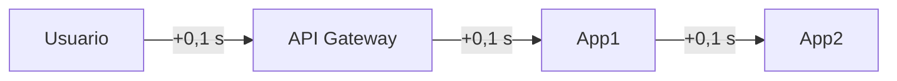

# Tácticas de performance de Bass y Kazman

Cuando una pregunta pide "medidas para mejorar la performance", la pauta espera **tácticas con nombre**, ubicadas en el sistema y justificadas. Bass y Kazman las ordenan en dos familias: **manejar mejor los recursos** (atender más rápido) y **controlar la demanda** (atender menos o en mejor orden).

## Factores base que afectan la performance

- **Estilos**: cuántos saltos y capas hay entre el usuario y los datos.
- **Hardware**: CPU, RAM, disco, GPU.
- **Red y protocolos de comunicación**.
- **Algoritmos y estructuras de datos**.
- **Priorizaciones**: qué se atiende primero.
- **Caching**.

## Manejo de recursos

| Táctica | Idea | Ejemplo |
|---|---|---|
| **Incrementar recursos** (vertical) | Una máquina más potente | Pasar de 8 a 32 GB de RAM |
| **Introducir concurrencia** (horizontal micro) | Más hilos o procesos en la misma máquina | Pool de workers |
| **Múltiples copias de cómputo** (horizontal macro) | Más máquinas detrás de un balanceador | 4 réplicas de la API |
| **Múltiples copias de datos** | Cachés y réplicas de lectura | Redis, CDN |
| **Usar colas y limitar su tamaño** | Absorber picos sin colapsar | Cola de trabajos con máximo 10.000 |
| **Scheduling de recursos** | Decidir qué se ejecuta y cuándo | Trabajos pesados de noche |
| **Prioridad en recursos** | Recursos reservados para lo crítico | Pool dedicado a pagos |
| **Infraestructura elástica** | Crecer y decrecer según la demanda | Autoscaling en la nube |

**Vertical vs horizontal:** escalar verticalmente es hacer crecer un servidor (agregarle RAM o CPU). Es simple, pero tiene un techo físico y sigue siendo un punto único de falla. Escalar horizontalmente es agregar servidores (réplicas). No tiene techo práctico y da redundancia, pero necesita balanceo y que los servicios no guarden estado de sesión.

## Control de demanda

| Táctica | Idea | Ejemplo |
|---|---|---|
| **Limitar respuestas** | Rechazar el exceso en vez de colapsar | `429 Too Many Requests` |
| **Priorizar eventos** | Lo crítico primero | Cola con prioridad para pagos |
| **Reducir overhead** | Menos trabajo por petición | Menos capas, menos serializaciones, limpiar basura |
| **Limitar tiempos de ejecución** | No esperar indefinidamente | Timeouts |
| **Aumentar la eficiencia** | Mejores algoritmos o resultados aproximados | Conteos aproximados, paginación |

## Estilos y performance

- Algunos estilos rinden mejor que otros según el escenario.
- Los **estilos distribuidos** (SOA, *space-based*, microservicios) pueden alcanzar altos niveles de performance, **a cambio de consistencia y complejidad**.
- Ciertos estilos **penalizan la performance**: los de **capas** y SOA empresarial, porque cada capa o intermediario suma tiempo.

**Ejemplo:** el usuario llega a una API Gateway que llama a App1, que llama a App2. Si cada salto agrega unos 100 ms de red y procesamiento, la petición ya lleva 300 ms antes de hacer trabajo útil. **Cada capa agregada a una SOA suma tiempo**, y si el salto cruza internet se suma además la latencia de la transmisión.

> [!warning] "El escalado horizontal siempre mejora la performance" es falso
> Más réplicas ayudan si el cuello de botella es el cómputo de la aplicación. Si el cuello está en una base de datos compartida, un recurso con bloqueo o la red, más réplicas generan más contención. Además, cada réplica agrega coordinación. Hay que **medir primero** para saber dónde está el cuello.

> [!tip] Respuesta tipo: "dos medidas de mejora de performance"
> Para cada medida hay que nombrar la táctica, decir **dónde** va (entre qué componentes) y **por qué** ataca el problema del enunciado.
> Ejemplo: "los usuarios recargan varias veces la página de cobros pendientes y si tarda más de 2 s los pagos exitosos bajan un 35%". Medidas posibles:
> 1. Caché de los cobros pendientes por usuario, porque las recargas piden lo mismo.
> 2. Mejorar el hardware o separar la base de lecturas, para acelerar la primera carga.

## Preguntas de repaso

> [!question]- ¿En qué se diferencian las tácticas de manejo de recursos de las de control de demanda?
> Las de manejo de recursos hacen que el sistema atienda más o más rápido (más máquinas, concurrencia, cachés). Las de control de demanda reducen u ordenan lo que entra (rate limiting, priorización, timeouts), para que el sistema no colapse con la carga que tiene.

> [!question]- Alternativas: a) El escalado horizontal siempre mejora la performance · b) Sharding es en un servidor y partitioning en varios · c) Un load balancer es un middleware que puede mejorar la performance · d) Los navegadores traen una caché tipo CDN
> c). a) es falsa porque depende de dónde esté el cuello de botella. b) está al revés: el sharding reparte entre servidores. d) es falsa: el navegador tiene su propia caché local, no una CDN.

> [!question]- ¿Qué ventaja y qué límite tiene escalar verticalmente?
> Es simple: no cambia la arquitectura ni exige servicios sin estado. Pero tiene un techo físico y de costo, y sigue siendo un único punto de falla.

> [!question]- ¿Por qué el estilo en capas puede penalizar la performance?
> Porque cada petición atraviesa todas las capas, y cada una agrega procesamiento, serialización o saltos de red. Con varias capas o intermediarios, la latencia se acumula aunque cada capa sea rápida.

> [!question]- ¿Qué devuelve una API que aplica rate limiting y qué atributo protege?
> Devuelve `429 Too Many Requests` a quien excede el límite. Protege la performance y la disponibilidad para el resto de los usuarios, porque el exceso se rechaza en vez de saturar el sistema.

> [!question]- Mini caso: una API tiene p99 de 4 s y el monitoreo muestra la CPU de la base de datos al 95% y los servidores web al 20%. ¿Qué táctica propone y cuál descarta?
> Se descarta agregar servidores web, porque no son el cuello de botella. Conviene reducir la carga de la base: cachear las consultas repetidas, agregar réplicas de lectura u optimizar índices. La teoría de colas explica por qué el 95% de utilización dispara la latencia.

> [!question]- ¿Por qué "usar colas y limitar su tamaño" se considera una táctica de performance?
> La cola absorbe los picos: las peticiones esperan en vez de saturar al servidor. Limitar su tamaño evita que la espera crezca sin control y agote la memoria. Cuando la cola se llena, se rechaza el exceso de forma controlada.
