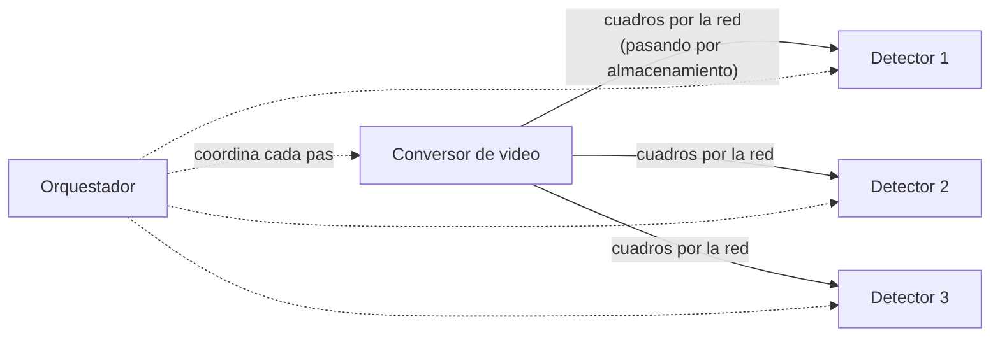

# Caso Amazon Prime Video de microservicios a monolito

En 2023, el equipo de Prime Video publicó que había **juntado** parte de un sistema distribuido en un solo proceso y había **reducido su costo en un 90%**. Se volvió famoso como "Amazon volvió al monolito". El caso sirve para entender que las falacias de la red tienen consecuencias concretas, y que partir un sistema es una decisión con costo, no un avance automático.

## El sistema

Un **monitor en tiempo real de la calidad de las transmisiones**: analiza las reproducciones en streaming para detectar latencia, corrupción de video, mala sincronización de audio o esperas demasiado largas.

La versión original estaba **distribuida en componentes desacoplados** (funciones serverless y servicios orquestados): un componente convertía el video en cuadros, otros detectores analizaban esos cuadros y un orquestador coordinaba los pasos.

## El problema

- **Mucho tiempo orquestando por la red:** cada paso de cada video pasaba por el orquestador.
- **Se enviaban los videos (sus cuadros) por la red** para que los procesaran los sistemas desacoplados. Esto generaba **mucha latencia** y **altos costos** de recursos y de dinero.
- Las falacias en juego: **el ancho de banda no es infinito**, **el costo de transporte no es cero** y **la latencia no es cero**.

## La solución

- **Solución inicial:** mover **esa parte** del sistema a un proceso único (un "monolito" para este flujo), de modo que los cuadros no salieran de la memoria del proceso. Así se redujo el costo en un **90%**. **El resto de la plataforma siguió distribuido.**
- **Solución final:** optimizar el flujo para **no depender de la red para mover archivos pesados**, aprovechando las funciones serverless solo en la recepción de los videos.

> [!tip] La lección
> No es "los microservicios son malos" ni "el monolito es mejor". Es que **la frontera se puso donde los componentes conversaban demasiado y movían demasiados datos**. Dentro de esa frontera conviene la eficiencia (un proceso); entre fronteras, la independencia. Y la decisión salió de **medir**: costo y latencia reales.

> [!warning] Lo que el caso no dice
> Amazon no reemplazó toda su arquitectura por un monolito. Juntó **un subsistema** cuyo patrón de uso no calzaba con la distribución. Responder en una prueba que "Amazon demostró que los microservicios no sirven" es un error de interpretación.

## Cómo usar el caso en una respuesta

Sirve como argumento cuando un enunciado propone separar en servicios algo que:
- intercambia **grandes volúmenes de datos** en cada operación;
- necesita **baja latencia** entre los pasos;
- se escala siempre en conjunto (no hay diferencia de cadencia, escala ni fallas entre las partes).

En esos casos, conviene mantener las partes juntas (monolito modular o un servicio con varios módulos) o mover el procesamiento hacia donde están los datos.

## Preguntas de repaso

> [!question]- ¿Qué problema concreto tenía el monitor de Prime Video en su versión distribuida?
> Los cuadros de video viajaban por la red entre componentes desacoplados y un orquestador coordinaba cada paso. Eso producía mucha latencia y un costo muy alto de transferencia y orquestación.

> [!question]- ¿Qué falacias de la red ilustra el caso?
> Principalmente que el ancho de banda no es infinito y que el costo de transporte no es cero. También que la latencia no es cero, porque cada paso orquestado por la red sumaba tiempo.

> [!question]- ¿Cuánto se redujo el costo y qué se cambió exactamente?
> Un 90%, al juntar en un solo proceso el flujo de análisis de video para que los cuadros no salieran a la red. Solo se movió esa parte; el resto de la plataforma siguió distribuido.

> [!question]- V o F: "El caso Prime Video demuestra que los monolitos siempre tienen mejor performance que los microservicios".
> Falso. Demuestra que, para un subsistema que mueve muchos datos entre pasos muy acoplados, la distribución tenía un costo mayor que su beneficio. La decisión depende del patrón de comunicación y se toma midiendo.

> [!question]- ¿Qué criterio del bloque de integración explica la decisión de Prime Video?
> La regla "dentro del contexto, eficiencia; entre contextos, independencia", junto con la distancia modular: componentes que conversan mucho y comparten datos pesados deben estar cerca, idealmente en el mismo proceso.

> [!question]- Mini caso: un equipo propone separar en 4 microservicios el pipeline que procesa imágenes de 50 MB, cada uno aplicando un filtro distinto. ¿Qué responde?
> Que cada etapa movería 50 MB por la red, con latencia y costo de transferencia en cada paso, igual que en Prime Video. Si las etapas no difieren en cadencia, escala ni fallas, conviene un solo servicio (o pipe & filter dentro de un proceso) que procese la imagen en memoria, y separar solo si alguna etapa lo justifica.
