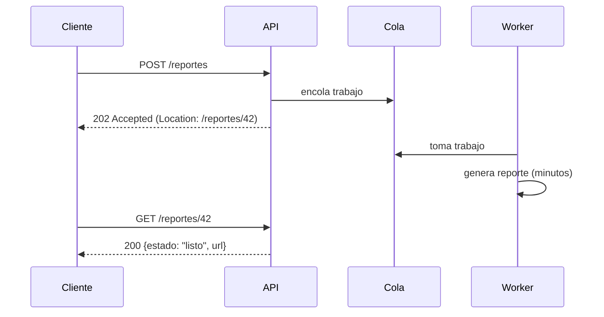

# Asincronía y el modelo de NodeJS

Muchas operaciones no necesitan bloquear a quien las pide: enviar un correo, procesar un video o sincronizar datos con un servidor lejano. La **asincronía** libera al que invoca para que siga trabajando, y es una de las formas más efectivas de mejorar la **performance percibida**. NodeJS llevó esa idea al servidor completo.

## Qué es

> [!tip] Asincronía
> **Invocar tareas sin esperar a que se completen.** La recepción se confirma, pero el invocador no sabe todavía si la tarea terminó. Así **los sistemas invocadores pueden seguir operando**.

Un patrón común es la petición-respuesta asíncrona: el servidor responde `202 Accepted` con una URL de estado, y el cliente consulta después o recibe un aviso cuando termina.

**Implementación:**
- **Manejo de errores y timeouts** (*rejects*): la tarea puede fallar cuando el invocador ya se fue.
- **Monitoreo cuidadoso**, porque las fallas no se ven en la respuesta inmediata.
- Una **política de scheduling**: qué tarea se ejecuta primero y con cuántos workers.

**Es nativa de varios estilos y herramientas:**
- **EDA**, colas y brokers;
- implementaciones de **SOA** y algunas de **cliente-servidor**;
- en el código: **promises, callbacks, async/await** y programación reactiva.

| Pros | Contras |
|---|---|
| Sistemas liberados para otras tareas | Complejidad para entender el flujo |
| **Mejor performance percibida** | **Callback hell** |
| Mejor UX y experiencia de desarrollo | **Manejo de errores complejo**: a veces requiere patrones como **Saga** o **mediators** |
| Implementa concurrencia | **Race conditions** y falta de sincronización |
| Hoy `async/await` oculta mucha complejidad | **Testing y debugging** más difíciles |

## NodeJS

Servidores web **altamente escalables** en conexiones concurrentes:
- **No es multi-hilo para el código del usuario:** un **solo hilo** maneja un **loop de eventos** con una cola.
- Escrito en **JavaScript**, guiado por eventos, con **I/O asíncrono y no bloqueante**.
- Soporta **conexiones con alta concurrencia**: mientras una petición espera a la base de datos, el hilo atiende otras.
- Tiene una comunidad activa y NPM (**ojo con la seguridad** de las dependencias), y suele implementar las novedades del lenguaje.

> [!example]- Transcripción de la imagen
> - Arriba, dos bloques: **Javascript** (amarillo) y **C/C++** (azul).
> - Debajo, la **Librería estándar de Node** (en JavaScript) y luego los **Bindings node (socket, http, etc.)**, que la conectan con C/C++.
> - En la base: **V8** (el motor de JavaScript), **Pool de threads**, **Loop de eventos**, **DNS (c-ares)** y **crypto (OpenSSL)**.

El código del usuario corre en un solo hilo sobre V8. Por debajo, Node delega el I/O a C/C++: el **loop de eventos** recibe las notificaciones y un **pool de hilos** ejecuta las operaciones que no tienen versión asíncrona en el sistema operativo (archivos, DNS, crypto). Hoy ambas piezas las provee la librería **libuv**.

**Usos en la industria:** LinkedIn (su app móvil web fue 20 veces más rápida), Pinterest, eBay (gateway de obtención de datos), GitHub (descargas), Palm/HP (WebOS), Yahoo! Mail y Rackspace.

> [!warning] Dónde NodeJS no es buena idea
> - Sistemas de **tiempo real estricto**.
> - **Procesamiento numérico** y aplicaciones **intensivas en CPU**: un cálculo largo bloquea el único hilo y todas las demás peticiones esperan. Se puede delegar a WebAssembly o a workers.
> - **Datasets grandes en memoria**, por los límites del heap de V8.
> - Además, tiene poco soporte de multithreading, requiere entender bien la asincronía y un solo hilo puede volverse difícil de manejar.

> [!example]- Caso: robot explorador que no debe detenerse al enviar datos
> **Pregunta:** un robot debe escapar de un lugar peligroso, pero el envío de sus datos lo bloquea. ¿Conviene hacer el envío asíncrono?
> **Respuesta:** sí. Un bloqueo en el envío puede hacer que el robot se pierda o se dañe. Opciones:
> - **Asincronía por eventos:** el robot publica sus datos en una cola local o en un pub/sub, y un worker los propaga cuando hay conexión, mientras la navegación sigue.
> - **Síncrono, pero interrumpible:** un componente de seguridad aborta el envío si detecta peligro, guarda lo no enviado y lo reanuda después.
> En ambos casos, la información pendiente debe persistirse para no perderla, y la decisión debe verse en el diagrama.

## Preguntas de repaso

> [!question]- ¿Qué gana un sistema al invocar tareas de forma asíncrona y qué pierde?
> Gana que el invocador sigue operando, mejora la performance percibida y la concurrencia. Pierde la certeza inmediata de que la tarea terminó, y suma complejidad: manejo de errores diferido, race conditions y debugging más difícil.

> [!question]- ¿Qué devuelve una API en el patrón de petición-respuesta asíncrona y cómo se entera el cliente del resultado?
> Responde `202 Accepted` con la ubicación de un recurso de estado. El cliente consulta esa URL periódicamente o recibe una notificación (webhook o evento) cuando la tarea termina.

> [!question]- ¿Cómo atiende NodeJS miles de conexiones con un solo hilo?
> Con I/O no bloqueante y un loop de eventos. El hilo inicia una operación de I/O, la delega al sistema operativo o al pool de hilos y sigue atendiendo otras peticiones. Cuando el I/O termina, el loop ejecuta el callback correspondiente.

> [!question]- ¿Por qué NodeJS es mala opción para un servicio que comprime videos?
> Porque comprimir video es intensivo en CPU: el cálculo ocupa el único hilo del loop de eventos y bloquea todas las demás peticiones hasta terminar. Conviene otro runtime o delegar el trabajo a workers aparte.

> [!question]- Nombre tres contras de la asincronía y un patrón para manejar errores en flujos asíncronos largos.
> Callback hell, race conditions y testing o debugging complejos (además del manejo de errores). Para flujos largos con varios pasos se usa el patrón Saga, con compensaciones, o un mediator que coordine.

> [!question]- V o F: "Una operación asíncrona termina más rápido que su versión síncrona".
> Falso, o al menos no necesariamente. La tarea puede tardar lo mismo o más. Lo que mejora es que el invocador no espera, así que suben el throughput y la performance percibida.

> [!question]- ¿Qué estilos arquitectónicos son nativamente asíncronos?
> EDA (eventos y brokers), las colas de mensajes (MOM), muchas implementaciones de SOA y algunas variantes de cliente-servidor. En el código se expresa con promises, callbacks, async/await y programación reactiva.
