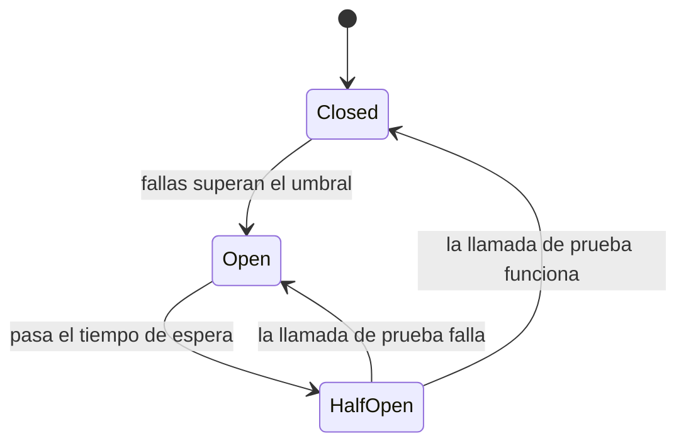

# Control de demanda con rate limiting circuit breakers y prioridades

Las tácticas de manejo de recursos tienen un límite: siempre puede llegar más carga de la que se puede atender. Las de **control de demanda** aceptan ese hecho y deciden **qué se atiende, qué se rechaza y qué espera**, para que el sistema se degrade de forma controlada en vez de colapsar.

## El catálogo

- **Limitar respuestas:** `429 Too Many Requests`.
- **Priorizar eventos** en arquitecturas distribuidas.
- **Reducir overhead** y limpiar basura.
- **Limitar tiempos de ejecución** con timeouts.
- **Aumentar la eficiencia** del uso de recursos, incluso con aproximaciones (un conteo aproximado en vez de exacto).

## Limitar respuestas

**Throttling (rate limiting):**
- **Indiscriminado:** un límite global (por ejemplo, 10.000 req/s para todos).
- **Por usuario o por id:** cada cliente tiene su cuota (por ejemplo, 100 req/min), y quien la excede recibe `429` con un header `Retry-After`. Así un solo cliente abusivo no afecta a los demás.

**WAF** (*Web Application Firewall*):
- **Limitaciones regionales:** bloquear o limitar tráfico de ciertas regiones.
- ***Bot walling*:** detectar y bloquear bots, incluso con *honeypots* (trampas) apoyados en IA.

**Circuit breaker:** cuando un servicio del que dependemos falla repetidamente, **dejar de llamarlo** por un tiempo en vez de seguir esperando timeouts. Tiene tres estados:

- **Closed:** las llamadas pasan normalmente y se cuentan las fallas.
- **Open:** las llamadas **fallan de inmediato** (o usan un fallback) sin tocar al servicio caído. Se protege a ambos lados: el llamador no se bloquea esperando y el servicio caído no recibe más carga mientras se recupera.
- **Half-open:** pasado el tiempo de espera, se dejan pasar unas pocas llamadas de prueba para decidir si cerrar el circuito.

Se usa en conjunto con **reintentos inteligentes con *jitter***: reintentar con *backoff* exponencial (1 s, 2 s, 4 s…) más un componente aleatorio, para que miles de clientes no reintenten exactamente al mismo tiempo.

## Timeouts

Toda llamada remota debe tener un **tiempo máximo**. Sin timeout, un servicio lento retiene hilos y conexiones del llamador hasta agotarlos, y la lentitud se propaga hacia arriba. El timeout de un llamador debe ser mayor que el de sus dependencias, para no abandonar una operación que todavía podía terminar.

## Priorización de eventos

- Previene el **head-of-line blocking**: que una cola llena de eventos de baja prioridad retrase a los críticos.
- Ciertos dominios lo exigen: pagos antes que reportes, alarmas antes que métricas.
- Se implementa en sistemas de colas (las colas con prioridad de RabbitMQ) o separando colas por prioridad, con más workers en la crítica.

| Táctica | Protege contra | Costo |
|---|---|---|
| Rate limiting | Abuso y picos de un cliente | Rechaza peticiones legítimas en el límite |
| WAF | Bots y ataques por región | Falsos positivos, operación |
| Circuit breaker | Fallas en cascada por dependencias caídas | Respuestas degradadas mientras está abierto |
| Reintentos con jitter | Fallas transitorias | Más carga si se configura mal |
| Timeouts | Hilos bloqueados por servicios lentos | Cortar operaciones que habrían terminado |
| Priorización | Que lo crítico espere detrás de lo trivial | Lo de baja prioridad puede esperar mucho (inanición) |

> [!warning] Reintentar sin control empeora la falla
> Si un servicio está saturado y todos sus clientes reintentan de inmediato, la carga se multiplica y el servicio nunca se recupera (*retry storm*). Por eso los reintentos van con backoff, jitter, un límite de intentos y un circuit breaker.

## Sobre la performance

Es un **proceso constante de trabajo y medición**. Hay que implementar las estrategias y tácticas óptimas **para su caso**. **No existe la bala de plata**: se busca la solución menos mala.

## Preguntas de repaso

> [!question]- ¿Qué código HTTP devuelve el rate limiting y qué diferencia hay entre throttling indiscriminado y por usuario?
> Devuelve `429 Too Many Requests`. El indiscriminado aplica un límite global a todo el tráfico. El por usuario asigna una cuota a cada cliente, así que uno abusivo no consume la capacidad de los demás.

> [!question]- Describa los tres estados de un circuit breaker y cuándo se pasa de uno a otro.
> Closed: las llamadas pasan y se cuentan las fallas; si superan un umbral, pasa a Open. Open: las llamadas fallan de inmediato sin tocar al servicio; tras un tiempo de espera pasa a Half-open. Half-open: se prueban unas pocas llamadas; si funcionan, vuelve a Closed, y si fallan, a Open.

> [!question]- ¿Por qué se agrega jitter a los reintentos?
> Para que muchos clientes que fallaron al mismo tiempo no reintenten todos en el mismo instante. El componente aleatorio reparte los reintentos en el tiempo y evita picos sincronizados sobre un servicio que se está recuperando.

> [!question]- ¿Qué problema resuelve la priorización de eventos y qué riesgo trae?
> Evita el head-of-line blocking: que eventos críticos esperen detrás de muchos de baja prioridad. El riesgo es la inanición: si siempre hay eventos de alta prioridad, los de baja pueden no procesarse nunca.

> [!question]- ¿Por qué toda llamada remota debe tener un timeout?
> Porque sin él, un servicio lento retiene indefinidamente hilos y conexiones del llamador. Al agotarlos, el llamador también se vuelve lento o se cae, y la falla se propaga en cascada.

> [!question]- Mini caso: el proveedor de pagos responde muy lento y la API de checkout empieza a acumular peticiones hasta caerse. ¿Qué tácticas aplica?
> Timeout corto a las llamadas al proveedor, un circuit breaker que se abra ante fallas repetidas y devuelva "pago en proceso" o encole el cobro para después (asincronía con MOM), y reintentos con backoff y jitter limitados. Opcionalmente, rate limiting en la entrada para proteger al checkout.

> [!question]- V o F: "Reintentar inmediatamente y sin límite es la mejor forma de manejar las fallas transitorias".
> Falso. Si el servicio está saturado, los reintentos inmediatos multiplican su carga y provocan una tormenta de reintentos. Se reintenta con backoff, jitter y un límite, junto con un circuit breaker.
