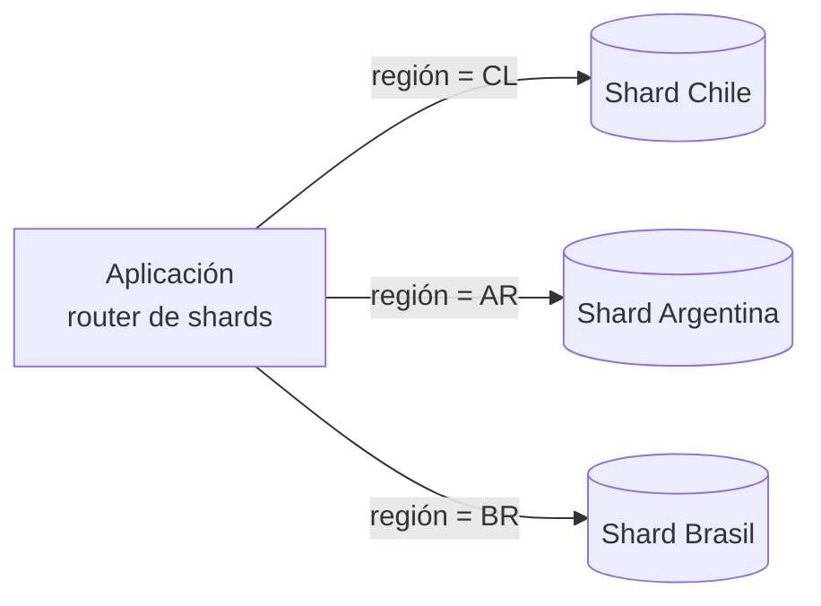

# Sharding y partitioning

Cuando una tabla crece tanto que ni los índices alcanzan, hay que **dividirla**. Hay dos formas que las pruebas confunden a propósito: **partitioning** divide los datos **dentro de una base**, y **sharding** los reparte **entre varias bases o máquinas**.

## Sharding

> [!tip] Sharding
> **Particionar los datos de una manera que tenga sentido para la aplicación** y repartirlos entre **varios servidores**. El criterio puede ser un índice, el id, la ubicación geográfica o incluso separar solo algunas tablas. **La aplicación debe saber a qué servidor preguntar.**

- **Partición horizontal (shard):** se reparten **filas** (pueden ser de varias tablas). Un shard puede distribuirse en varias máquinas.
- **Partición vertical:** se separan **columnas**, de forma parecida a normalizar: tablas grandes pasan a ser tablas con pocas columnas.



**Ventajas:**
- **Tablas pequeñas**, con pocas tuplas, así que las búsquedas son más rápidas.
- **Escalabilidad horizontal**, distribuida en varias máquinas: el tiempo de búsqueda se divide si se coordina.
- Se puede aplicar **redundancia** replicando cada shard.
- **Cuidado: un buen shard no requiere compartir datos** con otros shards.

**Riesgos:**
- **Complejidad** del SQL, del software y operacional (por ejemplo, modificar el schema en todos los shards).
- **Punto único de falla**: un shard corrupto puede afectar a todo el sistema.
- **Failover y backups más complejos**, y **rebalanceo de datos** cuando un shard crece más que otros.
- **Escrituras**: retardo si hay réplicas lentas.
- **Joins entre shards** (*cross-shard joins*): caros o imposibles.

## Partitioning

Otra forma de separar la información es **por algún otro parámetro**, como el tiempo o rangos de valores, dentro de **la misma base de datos**. PostgreSQL, por ejemplo, permite particionar una tabla de eventos por mes:

```sql
CREATE TABLE eventos (id bigint, fecha date, payload jsonb) PARTITION BY RANGE (fecha);
CREATE TABLE eventos_2026_10 PARTITION OF eventos FOR VALUES FROM ('2026-10-01') TO ('2026-11-01');
CREATE TABLE eventos_2026_11 PARTITION OF eventos FOR VALUES FROM ('2026-11-01') TO ('2026-12-01');
```

Una consulta del mes actual solo lee esa partición.
- **Pros:** índices más eficientes y tablas más pequeñas, con mejor desempeño, **solo si se diseña correctamente**. Se puede combinar con sharding.
- **Contras:** consultas más complejas, sobre todo cuando cruzan varias particiones.

## Comparación

| Aspecto | Sharding | Partitioning |
|---|---|---|
| Alcance | Entre **múltiples bases o nodos** | **Dentro de una sola base** (aunque puede usarse para implementar sharding) |
| Caso de uso | Escalar horizontalmente | Mejorar el rendimiento de una base |
| Gestión | La **aplicación** suele coordinar a qué shard consultar | La **base de datos** gestiona las particiones automáticamente |
| Distribución | Por una **clave de shard** | Por reglas de rango, valores o hash |
| Tipos | Horizontal | Horizontal o vertical |
| Complejidad | Alta: lógica en la aplicación | Menor: la maneja la base |
| Tolerancia a fallos | Distribuido, se puede agregar redundancia | Depende de la única base |

> [!warning] La confusión típica
> "Sharding es en un mismo servidor y partitioning en varios" es **al revés**. Sharding reparte entre servidores; partitioning divide dentro de una base.

> [!example]- Respuesta modelo: 100 GB por minuto de noticias subidas desde todo el mundo
> **Solución:** **sharding** (por ejemplo, por región del caza-noticias) junto con **replicación por zona** de los servicios de recepción.
> **Ubicación:** en la sección de caza-noticias, que recibe las subidas.
> **Justificación:** hay muchas escrituras y pocas lecturas, así que repartir las escrituras entre shards permite absorberlas. Un **leader-follower no serviría**, porque solo reparte lecturas y todas las escrituras seguirían yendo al líder.

## Preguntas de repaso

> [!question]- ¿Cuáles son implementaciones correctas? I. Peaks de writes: implementar leader-follower para repartir la carga del líder · II. Se agota la memoria de una base: separarla en shards en 4 servidores por región · III. Una tabla carga muchos datos en RAM: particionado vertical separando las columnas pesadas. a) Solo I · b) I y II · c) II y III · d) Todas
> c) II y III. I es incorrecta: en leader-follower todas las escrituras siguen yendo al líder, y los followers solo reparten lecturas. II reparte los datos y la memoria entre servidores. III reduce los datos que se cargan en las consultas frecuentes.

> [!question]- ¿Qué significa que "la aplicación debe saber a qué servidor preguntar" en sharding?
> Que la lógica de ruteo (qué clave va a qué shard) vive normalmente en la aplicación o en un router. Esto agrega complejidad: hay que mantener el mapa de shards, rebalancear y manejar las consultas que necesitan varios shards.

> [!question]- ¿Por qué "un buen shard no requiere compartir datos"?
> Porque si las consultas habituales necesitan datos de varios shards, aparecen joins entre shards, que son lentos y complejos, y se pierde la ventaja de dividir. La clave de shard debe elegirse para que cada operación típica se resuelva en un solo shard.

> [!question]- Diferencie partición horizontal y vertical con un ejemplo.
> Horizontal: se reparten filas, por ejemplo los usuarios de Chile en un shard y los de Argentina en otro. Vertical: se separan columnas, por ejemplo la descripción larga y las imágenes de un producto en otra tabla, lejos de las columnas que se consultan siempre.

> [!question]- Nombre cuatro riesgos del sharding.
> Complejidad del SQL, del software y operacional (cambios de schema en todos los shards), failover y backups más complejos, rebalanceo de datos cuando los shards se desbalancean, y joins entre shards caros. Además, un shard corrupto puede afectar al sistema completo.

> [!question]- ¿Cuándo preferiría partitioning en vez de sharding?
> Cuando el problema es el tamaño de una tabla dentro de una base que todavía tiene capacidad, por ejemplo una tabla de eventos que crece por fecha. Particionar por rango mejora las consultas sin la complejidad de coordinar varios servidores.

> [!question]- V o F: "Sharding y partitioning se diferencian en que sharding es en un mismo servidor y partitioning en múltiples servidores".
> Falso. Es al revés: sharding distribuye los datos entre múltiples bases o nodos, y partitioning los divide dentro de una sola base.
