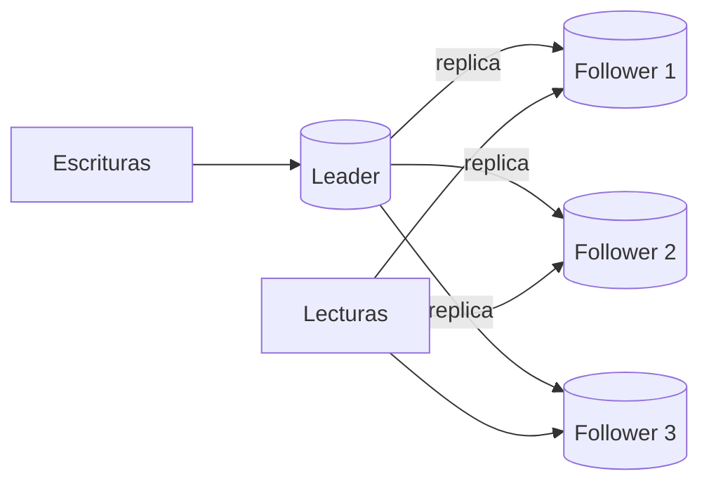

# Caché y leader-follower para escalar lecturas

La mayoría de los sistemas lee mucho más de lo que escribe: un producto se ve mil veces por cada vez que se compra. Las dos técnicas clásicas para escalar **lecturas** son la **caché** y la replicación **leader-follower**. Ninguna de las dos ayuda con las escrituras, y esa es la trampa favorita de las pruebas.

## Caché en la capa de datos

**Almacenamos una respuesta que creemos que se pedirá con alta frecuencia** para reducir la latencia y la carga de la base.

**Problemas:**
- **Invalidación de la caché**: saber cuándo un dato cacheado dejó de ser válido.
- **Consistencia** entre la caché y la base.
- **Cuellos de botella**: la propia caché puede saturarse o volverse un punto único de falla.

**"Soluciones":**
- **CDN** para el contenido estático.
- **Memoization** para resultados de funciones costosas.
- **Statelessness**: servicios sin estado que pueden apoyarse en una caché compartida.
- Buenas prácticas de expiración y desalojo. Redis, por ejemplo, permite replicar la caché.

## Leader-follower (*master-slave*)

> [!tip] Leader-follower
> **Un líder recibe todas las escrituras y las propaga a los followers, que atienden las lecturas.**

| Pros | Contras |
|---|---|
| **Mejora la capacidad de lectura** al agregar nodos | **Complejidad de coordinación** (qué pasa si cae el líder: elección de un nuevo líder) |
| **Mejora la redundancia** por la replicación | **Latencia de escritura** y **lag de replicación**: un follower puede devolver un dato viejo |
| | **La escalabilidad del líder**: todas las escrituras siguen yendo a un solo nodo |

> [!warning] Leader-follower no escala escrituras
> Si el problema son **muchas escrituras** (peaks de writes, 100 GB por minuto de subidas), agregar followers **no ayuda**: todas las escrituras siguen yendo al líder, y además cada follower agrega trabajo de replicación. Para escrituras se usa **sharding**, y opcionalmente cada shard tiene su propio leader-follower.

| Problema | Técnica |
|---|---|
| Muchas lecturas repetidas | Caché |
| Muchas lecturas variadas | Leader-follower (réplicas de lectura) |
| Muchas escrituras | Sharding |
| Tabla enorme en una base | Partitioning |
| Consultas lentas puntuales | Índices y query tuning |

## Los costos de todos estos métodos

- **Agregar nuevas funcionalidades se vuelve más complejo.**
- **El sistema se vuelve más complejo.**
- **El código puede volverse menos testeable.**
- **Identificar y corregir defectos se vuelve más complejo.**

Igual que en performance, hay que **medir**:
- **latencia**;
- **espacio**: cuánto ocupan las réplicas y las cachés;
- **redundancia**: cuántas copias hay y si sobreviven a las fallas;
- ***chaos***: apagar componentes a propósito (*chaos engineering*) para verificar que la redundancia funciona.

## Preguntas de repaso

> [!question]- Explique cómo funciona leader-follower y qué escala.
> Un nodo líder recibe todas las escrituras y las replica a los followers, que atienden las lecturas. Escala la capacidad de lectura (más followers, más lecturas) y da redundancia, pero no escala las escrituras.

> [!question]- Mini caso: una app recibe 100 GB por minuto de subidas desde todo el mundo y pocas lecturas. Un compañero propone leader-follower. ¿Qué responde?
> Que no sirve: el problema son las escrituras, y en leader-follower todas van al líder. Hay que hacer sharding (por ejemplo, por región) junto con replicación de los servicios de recepción en cada zona.

> [!question]- ¿Qué es el lag de replicación y qué problema causa?
> Es el tiempo que tarda una escritura del líder en llegar a un follower. Mientras tanto, una lectura en ese follower devuelve el valor antiguo: el usuario actualiza su perfil y al recargar ve el dato viejo.

> [!question]- ¿Cuáles son los tres problemas de la caché como técnica de escalabilidad de datos?
> La invalidación (saber cuándo un dato dejó de ser válido), la consistencia entre la caché y la base, y que la propia caché se convierta en cuello de botella o punto único de falla.

> [!question]- ¿Qué técnica elegiría para cada problema? a) consultas repetidas del mismo producto · b) muchas lecturas distintas de reportes · c) millones de escrituras de eventos · d) una tabla de logs que crece por fecha
> a) Caché. b) Réplicas de lectura (leader-follower). c) Sharding. d) Partitioning por rango de fechas.

> [!question]- Nombre dos costos de aplicar métodos de escalabilidad de datos y cómo se verifica que la redundancia funciona.
> Agregar funcionalidades se vuelve más complejo, y encontrar y corregir errores también, además de que el código se vuelve menos testeable. La redundancia se verifica midiendo y con chaos engineering: apagando componentes a propósito para comprobar que el sistema sigue funcionando.

> [!question]- V o F: "Agregar followers reduce la carga de escritura del líder".
> Falso. Cada escritura sigue yendo al líder y además debe replicarse a cada follower, así que el líder trabaja igual o más. Los followers solo alivian las lecturas.
