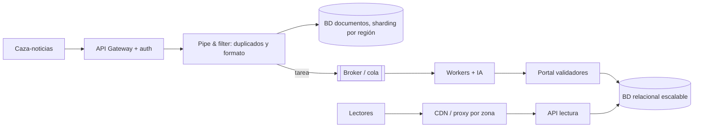

# Caso News Hunter Unlimited

Caso de la I2 2024-2. Combina las tres secciones típicas de un sistema con distintos usuarios (los que suben, los que validan y los que leen), cada una con un problema distinto: **bases de datos por sección**, **lectura rápida por zona** y **escrituras masivas**.

## El enunciado, resumido

- **Caza-noticias** certificados (usuario y contraseña) suben noticias en **JSON**, desde todo el mundo y en gran volumen. Las noticias se **filtran**: se revisa que no se hayan subido antes y se dejan para revisión, creando una tarea. No deben poder subir personas no certificadas, para no sobrecargar el sistema.
- **Validadores** de la empresa entran a un portal, ven las noticias **de su zona** y aprueban manualmente. Antes, **workers** toman la tarea y una **IA** descarta las noticias mal redactadas. Las aprobadas se guardan en una **base relacional escalable**. Solo se entra con permisos.
- **Lectores**, sin sesión, deben leer **rápidamente** las noticias aprobadas **de su zona**.

## Preguntas propias del caso

**a) Una base de datos por sección (tipo, qué guarda y por qué).**
- Caza-noticias: **base de documentos**, porque guarda JSON de estructura variable.
- Validadores: documentos (puede ser la misma), o relacional si se justifica. Debe soportar las actualizaciones que hace la IA.
- Lectores: **relacional**, que el enunciado pide explícitamente, con la metadata para filtrar por zona.

**b) Lectura rápida por zona (una sola herramienta).** Caché geográfica: un **proxy que detecte la zona**, una **CDN** o un componente dedicado a entregar datos por zona. Va en la **sección de lectores, entre los usuarios y el servidor**. Puntaje: 1 por la solución, 2 por la justificación y 1 por la ubicación.

**c) 100 GB por minuto de noticias subidas.** **Sharding** (o partitioning) junto con **replicación por zona** de los servicios de la sección de caza-noticias. Hay muchas escrituras y pocas lecturas, así que **leader-follower no serviría**.

## Preguntas comunes

**d) Características válidas:**
1. **Performance**: el enunciado pide velocidad explícitamente.
2. **Escalabilidad**: hay que soportar muchas noticias.
3. **Elasticidad**: picos de noticias cuando ocurre un evento particular.
4. **Seguridad**: lo pide el enunciado.
5. **Confiabilidad**: las mismas noticias para todos.

**No aplican:** integrabilidad (no se habla de otros sistemas), mantenibilidad y flexibilidad (no se habla de corregir errores ni de extender el sistema).

**e) Estilos válidos:**

| Estilo | Responsabilidad |
|---|---|
| En capas | Separar las secciones por tipo de usuario |
| EDA | Broker de eventos para muchas peticiones y tareas con workers (revisión con IA) |
| Pub/sub | Subida masiva de noticias |
| Pipe & filter | **Filtrado** de noticias al subirse (duplicados, formato) |
| Por lotes secuencial | Flujo de subida o de aprobación |

Cliente-servidor **solo** con un contexto específico, como la sección de lectores accediendo por una única API. **No aplican:** pizarra (no hay un motor con muchas fuentes), main y subrutinas (no se requiere bloqueo) y código móvil (no hay ejecución en varios ambientes).

**g) Falencias posibles:**
- El broker de tareas es un punto único de falla → un cluster con réplicas (más costo y operación).
- La caché por zona puede servir noticias desactualizadas → invalidación al aprobar o un TTL corto (más carga en el origen).
- Los shards por región se desbalancean si una región tiene muchas más noticias → rebalanceo o claves más finas (complejidad).

## Preguntas de repaso

> [!question]- ¿Por qué la sección de caza-noticias usa una base de documentos?
> Porque las noticias llegan en JSON, de estructura posiblemente variable, y una base de documentos las guarda nativamente sin forzar un esquema relacional.

> [!question]- ¿Por qué leader-follower no resuelve los 100 GB por minuto?
> Porque el problema son las escrituras: en leader-follower todas van al líder, y los followers solo reparten lecturas. Hay que repartir las escrituras con sharding.

> [!question]- ¿Dónde se ubica la caché geográfica y por qué ahí?
> En la sección de lectores, entre los usuarios y el servidor, como CDN o proxy que detecta la zona. Así las lecturas repetidas de noticias de una misma zona se responden cerca del usuario y no llegan al servidor.

> [!question]- Justifique pipe & filter en este caso y diga cuándo no valdría.
> Vale para filtrar las noticias al subirse (descartar duplicadas y validar el formato JSON), porque son filtros simples y encadenables. No valdría para el análisis con IA, que es procesamiento pesado y corresponde a workers con EDA.

> [!question]- ¿Por qué integrabilidad no aplica en este caso?
> Porque el enunciado no habla de conectarse con sistemas externos: la IA y los workers son parte del propio sistema.

> [!question]- Proponga una falencia del diagrama y su solución.
> El broker de tareas es un punto único de falla: si cae, las noticias subidas no llegan a revisión. Lo replicaría en un cluster con quorum queues, lo que implica más costo de infraestructura y más operación.
