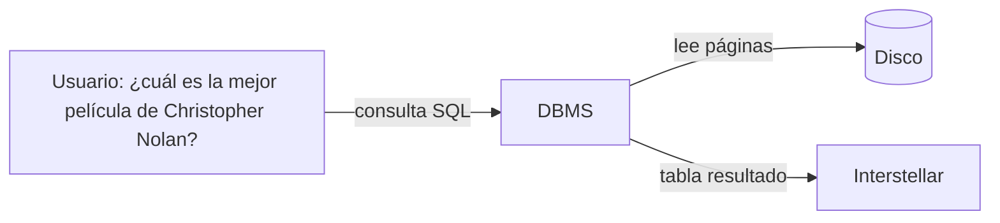

# Sistemas de bases de datos y DBMS

Un **DBMS** (*Database Management System*) es el programa que guarda grandes volúmenes de datos en disco y deja consultarlos y modificarlos a través de una capa lógica (tablas). Así no hay que reprogramar desde cero el almacenamiento, la búsqueda ni la consistencia.

> [!tip] Complemento — nota nueva (fuente: slides "Clase 1: Motivación")
> **Por qué importa:** casi todo lo cotidiano pasa por una base de datos: búsquedas en la web, datos públicos, redes sociales, métodos de pago, criptomonedas… Trabajes donde trabajes, vas a interactuar con bases de datos. Según la clase, es la competencia más buscada en ciencia de datos: modelo relacional, SQL y NoSQL.
>
> **Qué necesitamos:** una forma de almacenar los datos
> - para poder procesarlos de forma eficiente,
> - sin tener que programar desde 0,
> - que sea portable y estándar.
>
> **Sistema de gestión de bases de datos (DBMS):** programa que facilita la lectura y el almacenamiento de grandes volúmenes de datos.
> - Los datos se almacenan en **disco**.
> - Pero los usuarios interactúan con una **capa lógica** (por ejemplo, tablas), fácil de acceder.

## Cómo funciona un DBMS

> [!tip] Complemento — por qué usar un DBMS (slides "Clase 1")
> Un DBMS resuelve:
> - **Almacenar** datos (insertar).
> - **Encontrar** datos (búsquedas y consultas).
> - **Modificar** datos (update).
> - Asegurar la **consistencia** de los datos.
> - **Seguridad y privacidad** de los datos.
>
> "¿Y si lo programamos todo en Python?": se puede, pero tendríamos que resolver de nuevo problemas que otros ya resolvieron mucho mejor.
>
> **En el curso se usa PostgreSQL.**

> [!tip] Complemento — DBMS que existen (slides "Clase 1")
> | Tipo | Ejemplos |
> |---|---|
> | Relacionales open source | **PostgreSQL** (el del curso), **MySQL** (muy usado en producción), **SQLite** (pequeña, típica en apps móviles) |
> | Relacionales comerciales | IBM DB2, Microsoft SQL Server, Oracle |
> | Otros modelos | Neo4J y Titan DB (grafos), MongoDB (documentos), Cassandra (key-value / column store), Apache Jena (RDF), Redis (en memoria) |

> [!tip] Complemento — mapa del curso según la clase 1
> 1. **Modelo relacional** y sus lenguajes de consulta: **SQL** y su base teórica, el **álgebra relacional**.
> 2. **Modelar** los problemas (diseño de la base de datos).
> 3. SQL avanzado y cómo el DBMS ejecuta una consulta.
> 4. **SQL + programación:** consumir la base desde Python. El proyecto es una aplicación web que usa una base de datos. Aunque un framework web la esconda, conviene saber SQL: "es posible armar un puente sin saber cómo hacerlo", pero no es buena idea.
> 5. Cómo funciona un DBMS por dentro: **índices, algoritmos internos, transacciones y recuperación de fallas**. Un sistema puede ser lento porque está mal indexado, porque los datos están mal modelados o porque hay demasiados datos.
> 6. **NoSQL** (JSON y MongoDB), búsqueda de texto y análisis de datos. Lo importante es saber cuándo conviene cada tecnología. Ojo: una aplicación típica funciona perfecto con una base SQL.
>
> Esto mismo se relaciona con la [[02 - Arquitectura cliente-servidor|arquitectura cliente-servidor]] de Ingeniería de Software: en una app web de tres niveles, el DBMS es el servidor de datos.

## Preguntas de repaso

1. ¿Qué es un DBMS y qué separa el disco de lo que ve el usuario?
> [!question]- Respuesta
> Es un programa que facilita leer y almacenar grandes volúmenes de datos. Los datos viven en disco, pero el usuario trabaja con una capa lógica (tablas) y no necesita saber cómo se ejecutan las acciones.

2. Nombra cinco cosas que resuelve un DBMS.
> [!question]- Respuesta
> Almacenar (insertar), encontrar (consultas), modificar (update), asegurar la consistencia y dar seguridad y privacidad a los datos.

3. ¿Qué DBMS se usa en el curso y qué otros relacionales open source existen?
> [!question]- Respuesta
> PostgreSQL. Otros open source son MySQL (muy usado en producción) y SQLite (pequeña, típica en apps móviles).

4. ¿Por qué no basta con programar el manejo de datos en Python?
> [!question]- Respuesta
> Habría que volver a resolver almacenamiento eficiente, consultas, consistencia, concurrencia y recuperación de fallas, que los DBMS ya resuelven de forma estándar y portable.
