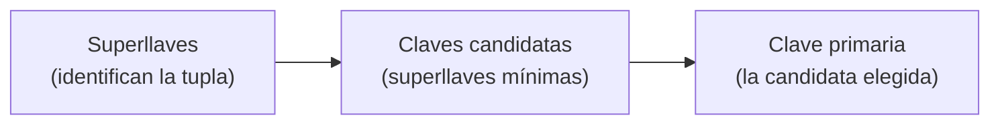

# Superllaves, claves candidatas y clave primaria

Las llaves son conjuntos de atributos que **identifican de manera única** cada tupla de una relación. Distinguir superllave, clave candidata y clave primaria es la base de las restricciones de integridad y de la normalización.

## Explicación de llaves
- “Una superllave es cualquier conjunto de uno o más atributos que identifica de manera única una tupla en una relación. En otras palabras:
  - “No puede haber dos filas en la tabla que tengan los mismos valores para los atributos de la superllave.”

### Clave primaria y clave candidata
- **Clave candidata:** Es un conjunto mínimo de atributos que puede identificar de manera única una tupla en una relación. Una relación puede tener múltiples claves candidatas.
- **Clave primaria:** Es una clave candidata elegida por el diseñador de la base de datos para identificar de manera única las tuplas de una relación. Solo puede haber una clave primaria por tabla.
- **Superllave:** Cualquier combinación de atributos que incluya una clave candidata. Por lo tanto.
  - “Todas las claves candidatas son superllaves, pero no todas las superllaves son claves candidatas.”

> [!warning] Posible error (registrado en `_meta/Bases de Datos/DUDAS.md`)
> La frase "Por lo tanto." quedó sin terminar. Por la cita que viene después, la idea completa sería: *por lo tanto, toda clave candidata es una superllave (la mínima), pero no toda superllave es clave candidata*.

### Ejemplo
Consideremos la siguiente tabla de `Estudiantes`:

| student_id | first_name | last_name | email | phone_number |
|---|---|---|---|---|
| 1 | John | Doe | john.doe@mail.com | 1234567890 |
| 2 | Jane | Smith | jane.smith@mail.com | 2345678901 |
| 3 | Alice | Brown | alice.brown@mail.com | 3456789012 |

### Claves candidatas
- `student_id`: Identifica de manera única a cada estudiante.
- `email`: También puede identificar de manera única a cada estudiante si cada correo es único.

### Superllaves
Cualquier combinación de atributos que incluya una clave candidata es una superllave. Por ejemplo:
- `{student_id}`
- `{email}`
- `{student_id, email}`
- `{student_id, first_name}`
- `{email, last_name, phone_number}`
- etc.

### Clave primaria
Clave candidata elegida para identificar de manera única las tuplas en una relación. Por ejemplo:
- `{student_id}`

> [!tip] Complemento (slides "Clase 1" y "Clase 3: Repaso de llaves + SQL")
> **Terminología de la clase:**
> - **Super llave (superkey):** cualquier conjunto de atributos que determina a todo el resto. El conjunto de **todos** los atributos siempre es una superllave.
> - **Llave (candidata/minimal):** una superllave de la que **ningún subconjunto propio** es superllave: "una super llave que no se puede achicar".
> - **Llave primaria:** la llave candidata que queremos destacar; se **subraya** en el esquema.
>
> **Ejemplo de la clase:** `Persona(id, rut, nombre)` con llave primaria `id`.
> | Llaves candidatas | Superllaves |
> |---|---|
> | `id`, `rut` | `id`, `rut`, `id,rut`, `id,nombre`, `rut,nombre`, `id,rut,nombre` |
>
> **Elegir mal la llave trae problemas.** En `Vinos(Productor, Cepa, Gama, Año, Grados, Orígen)`, si la llave fuera `(Productor, Cepa, Gama)`, un productor no podría hacer el mismo vino en dos años distintos. La llave natural es `(Productor, Cepa, Gama, Año)`.
>
> **Surrogate key:** una llave genérica que simplifica las cosas, como un `id` artificial: `Vinos(id, Productor, Cepa, Gama, Año, Grados, Orígen)`. Es más fácil de manejar que un `rut` o una llave de cuatro atributos. Ojo: no reemplaza la lógica de la relación. Si `(Productor, Cepa, Gama, Año)` debe ser única, hay que seguir exigiéndolo (por ejemplo, con `UNIQUE`).

> [!example] Ejemplo extra — ¿es superllave?
> En `Estudiantes`: `{first_name}` **no** es superllave, porque dos estudiantes pueden llamarse igual. `{student_id, first_name}` **sí** lo es (contiene `student_id`), pero **no** es candidata, porque al quitarle `first_name` sigue identificando: no es mínima.

## Preguntas de repaso

1. ¿Qué diferencia hay entre una superllave y una clave candidata?
> [!question]- Respuesta
> Ambas identifican de forma única cada tupla. La clave candidata además es mínima: ningún subconjunto propio de ella es superllave.

2. ¿Cuántas claves candidatas y cuántas claves primarias puede tener una tabla?
> [!question]- Respuesta
> Varias claves candidatas (en `Estudiantes`, `student_id` y `email`), pero solo una clave primaria, que elige el diseñador entre las candidatas.

3. ¿Por qué `{student_id, first_name}` es superllave pero no clave candidata?
> [!question]- Respuesta
> Porque incluye la clave candidata `student_id`, así que identifica cada tupla, pero no es mínima: sin `first_name` sigue identificándola.

4. ¿Qué es una surrogate key y qué cuidado hay que tener al usarla?
> [!question]- Respuesta
> Es un identificador artificial (por ejemplo, un `id`) que simplifica el manejo de la llave. Hay que seguir respetando la unicidad de la llave natural, porque el `id` no impide que se dupliquen los datos reales.
