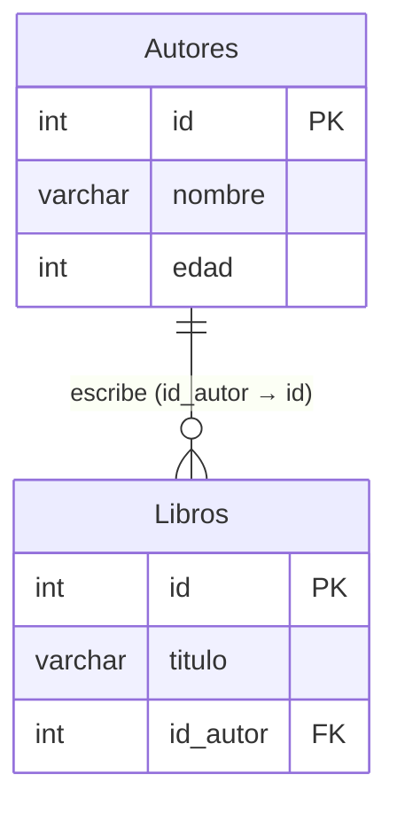

# Llaves foráneas

Una llave foránea (`FOREIGN KEY … REFERENCES`) obliga a que el valor de una columna exista como llave en otra tabla. Así se enlazan las tablas y se mantiene la integridad referencial.

## Llaves foráneas
Una llave foránea establece un enlace entre los datos en dos tablas, y lo hace con el propósito de asociar los datos que se encuentran en las tablas.

```sql
CREATE TABLE Autores (
    id int,
    nombre varchar(255),
    edad int,
    PRIMARY KEY (id)
);

CREATE TABLE Libros (
    id int,
    titulo varchar(255),
    id_autor int,
    PRIMARY KEY (id),
    FOREIGN KEY (id_autor) REFERENCES Autores(id)
);
```

| Autores | | | Libros | | |
|---|---|---|---|---|---|
| id | nombre | edad | id | titulo | id_autor |
| 1 | Gabriel Garcia Marquez | 87 | 1 | Cien años de soledad | 1 |
| 2 | Julio Cortázar | 69 | 2 | Rayuela | 2 |
| 3 | Carlos Ruiz Zafón | 55 | 3 | La sombra del viento | 3 |
| | | | 4 | El amor en los tiempos del cólera | 1 |

En este ejemplo, la tabla 'Libros' tiene una llave foránea 'id_autor' que referencia a la columna 'id' de la tabla 'Autores'. Esto significa que cada libro en la tabla 'Libros' está asociado con un autor en la tabla 'Autores' a través de la llave foránea 'id_autor'.



> [!tip] Complemento — definición formal (slides "Clase 6: Diseño de Bases de Datos II")
> Si la relación $R$ tiene atributos $A_1,\dots,A_n$ que referencian a $B_1,\dots,B_n$ de $S$, y $B_1,\dots,B_n$ son **llave** de $S$, entonces "$R$ contiene la llave de $S$". Se escribe $R[A_1,\dots,A_n] \subseteq S[B_1,\dots,B_n]$: todo valor de la llave foránea debe existir en la tabla referenciada.
>
> Sin llave foránea pueden aparecer filas "huérfanas". En la slide, `fabrica(pid, cid)` tenía `(3, C8)` y `(89, C2)`, pero no existía la compañía C8 ni el producto 89. Con `FOREIGN KEY` la base de datos lo rechaza. Más en [[05 - INSERT e integridad referencial|INSERT e integridad referencial]] y [[06 - Eliminación con llaves foráneas|Eliminación con llaves foráneas]].

> [!example] Ejemplo extra — relaciones según dónde va la llave foránea (slides "Clase 6")
> - **1 a muchos** (un autor, muchos libros): la FK va en el lado "muchos" (`Libros.id_autor`).
> - **Muchos a muchos** (actores y películas): tabla intermedia con dos FK y llave compuesta:
> ```sql
> CREATE TABLE fabrica(
>   p_nombre varchar(30),
>   c_nombre varchar(30),
>   desde date,
>   PRIMARY KEY (p_nombre, c_nombre),
>   FOREIGN KEY(p_nombre) REFERENCES producto(nombre),
>   FOREIGN KEY(c_nombre) REFERENCES compania(nombre)
> );
> ```
> - **1 a 1:** basta una FK en cualquiera de las dos tablas, con `UNIQUE` para que no se repita: `id_compañia int UNIQUE, … FOREIGN KEY(id_compañia) REFERENCES Compañia(id)`.
>
> En Rails, estas relaciones son las [[08 - Asociaciones en Active Record|asociaciones de Active Record]] (`belongs_to`, `has_many`).

## Preguntas de repaso

1. ¿Qué es una llave foránea?
> [!question]- Respuesta
> Una columna (o conjunto de columnas) cuyo valor debe existir como llave en otra tabla. Enlaza los datos de las dos tablas.

2. En el ejemplo, ¿qué columna es llave foránea y a qué apunta?
> [!question]- Respuesta
> `Libros.id_autor`, que referencia `Autores.id`.

3. ¿En qué tabla va la llave foránea en una relación 1 a muchos? ¿Y en una muchos a muchos?
> [!question]- Respuesta
> En 1 a muchos va en la tabla del lado "muchos". En muchos a muchos se crea una tabla intermedia con dos llaves foráneas y una llave primaria compuesta.

4. ¿Cómo se modela una relación 1 a 1 con llaves foráneas?
> [!question]- Respuesta
> Con una llave foránea en cualquiera de las dos tablas y una restricción `UNIQUE` sobre ella.
