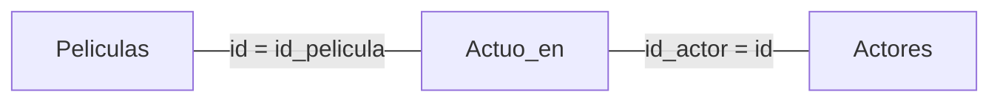

# Join con WHERE

Un join implícito: se ponen varias tablas en el `FROM` (producto cruz) y en el `WHERE` la condición que las relaciona, normalmente llave foránea = llave primaria.

## Join: `FROM Tabla1, Tabla2` + `WHERE`
Un JOIN en SQL se puede realizar utilizando la cláusula WHERE para indicar la condición de coincidencia entre las tablas. Aunque actualmente es más común utilizar la cláusula JOIN para realizar estas operaciones, la cláusula WHERE puede ser utilizada para obtener el mismo resultado.

Por ejemplo, si tenemos dos tablas, 'Pedidos' y 'Clientes':

| Pedidos | | | Clientes | |
|---|---|---|---|---|
| id_pedido | id_cliente | producto | id | nombre |
| 1 | 1 | Manzanas | 1 | Carlos |
| 2 | 2 | Bananas | 2 | Ana |
| 3 | 3 | Naranjas | 3 | Pedro |

Podríamos querer obtener una nueva tabla que muestre el nombre del cliente junto con el producto que compró. Para ello, podríamos realizar un JOIN de las tablas 'Pedidos' y 'Clientes' utilizando la cláusula WHERE para indicar que queremos combinar las filas donde 'id_cliente' es el mismo en ambas tablas:

```sql
SELECT Pedidos.producto, Clientes.nombre FROM Pedidos, Clientes WHERE Pedidos.id_cliente = Clientes.id;
```

El resultado de esta consulta sería una nueva tabla que combina el producto de cada pedido con el nombre del cliente que realizó el pedido:

| producto | nombre |
|---|---|
| Manzanas | Carlos |
| Bananas | Ana |
| Naranjas | Pedro |

- **Join de tres tablas:**

```sql
SELECT Peliculas.nombre, Actores.nombre
FROM Peliculas, Actuo_en, Actores
WHERE Peliculas.id = Actuo_en.id_pelicula
AND Actores.id = Actuo_en.id_actor;
```

Esta consulta SQL realiza dos operaciones JOIN. Primero, une las tablas 'Peliculas' y 'Actuo_en' basándose en una coincidencia entre los campos 'id' de 'Peliculas' y 'id_pelicula' de 'Actuo_en'. Luego, une el resultado de esta operación con la tabla 'Actores', basándose en una coincidencia entre los campos 'id' de 'Actores' y 'id_actor' de 'Actuo_en'. El resultado es una tabla que incluye los nombres de las películas y los nombres de los actores para cada película.



> [!tip] Complemento — desambiguar atributos (slides "Clase 3")
> Si los nombres de columna no se repiten, se puede escribir `WHERE id = id_pelicula`, porque `id` solo existe en `Peliculas` e `id_pelicula` solo en `Actuo_en`. Cuando dos tablas tienen una columna con el mismo nombre (por ejemplo, `nombre` en `Peliculas` y en `Actores`), hay que anteponer la tabla: `Peliculas.nombre`. Además, la consulta queda más clara.

> [!tip] Complemento — equivalencia con el álgebra
> Este join corresponde a $\pi_{producto,\ nombre}(\sigma_{Pedidos.id\_cliente = Clientes.id}(Pedidos \times Clientes))$. Con la sintaxis explícita se escribe `FROM Pedidos JOIN Clientes ON Pedidos.id_cliente = Clientes.id`: ver [[10 - INNER JOIN|INNER JOIN]].

## Preguntas de repaso

1. ¿Qué pasa si en el join de Pedidos y Clientes se olvida el `WHERE`?
> [!question]- Respuesta
> Queda solo el producto cruz: 3 × 3 = 9 filas, que combinan cada pedido con cada cliente, aunque no corresponda.

2. ¿Por qué el ejemplo de películas necesita tres tablas y dos condiciones?
> [!question]- Respuesta
> Porque la relación muchos a muchos entre películas y actores está en `Actuo_en`. Se une Peliculas con Actuo_en por `id = id_pelicula`, y Actores con Actuo_en por `id = id_actor`.

3. ¿Cuándo es obligatorio escribir `Tabla.columna`?
> [!question]- Respuesta
> Cuando el mismo nombre de columna existe en más de una tabla del `FROM`, para que la referencia no sea ambigua.
