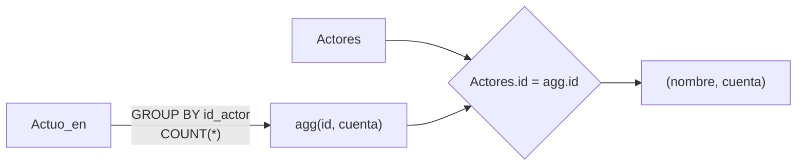

# Subconsultas en el FROM

Una subconsulta en el `FROM` funciona como una **tabla temporal** con alias, que luego se une con otras tablas. Sirve sobre todo para cruzar un resultado agregado con los datos de detalle.

## Join anidado: total de películas por actor
Se busca el nombre de cada actor junto con el total de películas en las que ha actuado.

```sql
SELECT Actores.nombre, agg.cuenta 
FROM Actores, (
	SELECT id_actor as id, COUNT(*) as cuenta 
	FROM Actuo_en
	GROUP BY id_actor
) as agg
WHERE Actores.id = agg.id
```

| Actores | |
|---|---|
| id | nombre |
| 1 | Leonardo DiCaprio |
| 2 | Matthew McConaughey |
| 3 | Daniel Radcliffe |
| 4 | Jessica Chastain |

| Actuo_en | |
|---|---|
| id_actor | id_pelicula |
| 1 | 1 |
| 1 | 2 |
| 1 | 3 |
| 2 | 1 |
| 3 | 2 |
| 4 | 3 |

**Subconsulta:**

```sql
SELECT id_actor as id, COUNT(*) as cuenta
FROM Actuo_en
GROUP BY id_actor;
```

Cuenta el número de películas en las que cada actor ha actuado. Devuelve dos columnas: "id" (el id del actor) y "cuenta" (el número de películas en las que ha actuado cada actor).

**Resultado:**

| nombre | cuenta |
|---|---|
| Leonardo DiCaprio | 3 |
| Matthew McConaughey | 1 |
| Daniel Radcliffe | 1 |
| Jessica Chastain | 1 |



El segundo ejemplo (año de la primera película) está en [[09 - Subconsulta en el FROM - primera película de cada actor|Subconsulta en el FROM: primera película de cada actor]].

> [!tip] Complemento (slides "Clase 4: SQL Avanzado", "Consultas anidadas como joins")
> - La subconsulta del `FROM` **debe** llevar alias (`as agg`) para poder referirse a sus columnas (`agg.id`, `agg.cuenta`).
> - ¿Por qué no basta un `GROUP BY` directo sobre `Actores, Actuo_en`? Sí se puede: `SELECT a.nombre, COUNT(*) FROM Actores a, Actuo_en ae WHERE a.id = ae.id_actor GROUP BY a.id, a.nombre`. La versión anidada separa el cálculo del agregado de la unión, lo que sirve cuando el agregado es complejo o se reutiliza.
> - Un actor sin películas no aparece: no está en `agg`. Para verlo con cuenta 0 se usa un `LEFT JOIN` y `COALESCE(agg.cuenta, 0)`.
> - En PostgreSQL moderno lo mismo se escribe más legible con `WITH agg AS (…) SELECT …` (CTE).

## Preguntas de repaso

1. ¿Qué devuelve la subconsulta `SELECT id_actor as id, COUNT(*) as cuenta FROM Actuo_en GROUP BY id_actor`?
> [!question]- Respuesta
> Una tabla con una fila por actor: su id y cuántas películas tiene en `Actuo_en`. Aquí: (1,3), (2,1), (3,1), (4,1).

2. ¿Por qué la subconsulta del `FROM` necesita un alias?
> [!question]- Respuesta
> Porque se usa como una tabla, y hay que poder nombrar sus columnas en el resto de la consulta (`agg.id`, `agg.cuenta`).

3. ¿Qué pasa con un actor que no tiene películas? ¿Cómo lo incluirías?
> [!question]- Respuesta
> No aparece, porque no tiene fila en `agg`. Se incluye con `Actores LEFT JOIN (…) agg ON Actores.id = agg.id` y `COALESCE(agg.cuenta, 0)`.
