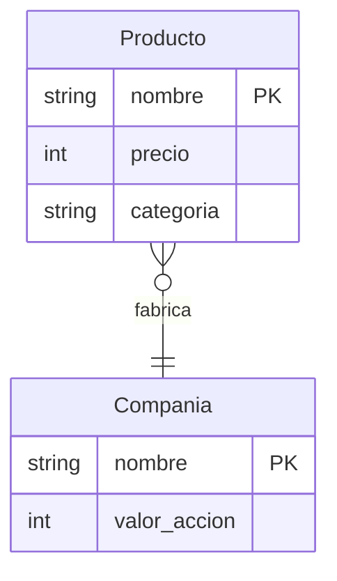

# Diagramas entidad-relación

El modelo **E/R** describe el dominio con **entidades** (rectángulos), sus **atributos** (óvalos) y las **relaciones** entre ellas (rombos). Es la etapa conceptual, previa a las tablas.

> [!tip] Complemento — nota nueva (fuente: slides "Clase 5: Diseño de Bases de Datos")
> 
>
> | Elemento | Símbolo | Ejemplo |
> |---|---|---|
> | Entidad | rectángulo | `Producto` |
> | Atributo | óvalo (la llave va **subrayada**) | `nombre` |
> | Relación | rombo | `compra` |
>
> - **Obligatorio:** cada entidad debe tener una **llave**, es decir, un conjunto **mínimo** de atributos cuyos valores identifican de manera unívoca a cada entidad del conjunto.
> - **Relación binaria:** relaciona dos entidades, por ejemplo `Producto —fabrica— Compañía`. La llave de la relación está formada por las llaves de las entidades participantes.
> - **Las relaciones pueden tener atributos** (`desde` en `fabrica`), pero estos **no pueden ser parte de una llave**.

> [!note]- Transcripción de la imagen
> Diagramas E/R: **Entidad** = rectángulo ("Producto"); **Atributo** = óvalo ("nombre"); **Relación** = rombo ("compra").

En Mermaid se puede dibujar algo parecido (con la notación "pata de gallo", no la del curso):

## Relaciones múltiples

> [!tip] Complemento (slides "Clase 5")
> ¿Cómo se modela un alquiler que involucra **Personas, Películas y Locales de Videos**? Con una relación **ternaria** `alquila` que une las tres entidades.
> - ¿Por qué no un atributo? Porque la película quizás no es un "valor simple": queremos guardar año, director, etc.
> - No se pueden relacionar atributos de diferentes entidades: las relaciones son **entre entidades**.
> - Con una flecha de Persona a `alquila` ("dime la persona y te diré qué arriendas": flecha = llave), una persona puede alquilar **a lo más 1 película en un solo local**.
>
> 
>
> - **Alternativa:** convertir el alquiler en una entidad `Alquiler` con relaciones binarias hacia Persona (cliente, vendedor), Película y Local. Es **más flexible**; la relación ternaria es **más concisa**.
> - **Roles:** una entidad puede participar más de una vez en una relación. Por ejemplo, Persona como *cliente* y como *cajero* en `alquila`.

> [!note]- Transcripción de la imagen
> Relación ternaria `alquila` entre Película, Local de Videos y Persona, con una flecha desde Persona. Globos: "Una persona puede alquilar a lo más 1 sola película en un solo local de videos" y "Dime la persona y te diré que arriendas (flecha = llave)".

## Preguntas de repaso

1. ¿Qué representan el rectángulo, el óvalo y el rombo en un diagrama E/R?
> [!question]- Respuesta
> Una entidad, un atributo y una relación, respectivamente.

2. ¿Qué es obligatorio para toda entidad?
> [!question]- Respuesta
> Tener una llave: un conjunto mínimo de atributos que identifica de forma única a cada entidad del conjunto.

3. ¿Por qué el atributo `desde` de la relación `fabrica` no puede ser parte de la llave?
> [!question]- Respuesta
> Porque la llave de una relación la forman las llaves de las entidades que participan. Los atributos propios de la relación solo describen cada vínculo.

4. ¿Qué ventaja tiene reemplazar una relación ternaria por una entidad con relaciones binarias?
> [!question]- Respuesta
> Es más flexible: permite expresar restricciones que la ternaria no puede (por ejemplo, varias películas pero un solo local). La ternaria es más concisa.
