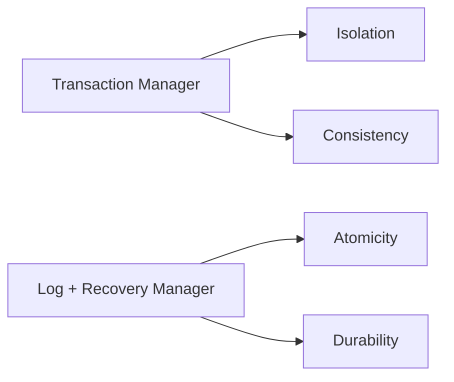

# Propiedades ACID

**A**tomicidad, **C**onsistencia, a**I**slamiento y **D**urabilidad: las cuatro garantías que un DBMS da a cada transacción.

## Propiedades ACID (mis apuntes)
Las transacciones deben cumplir con las propiedades ACID para asegurar su correcto funcionamiento:
1. **Atomicidad:** O se ejecutan todas las operaciones de la transacción, o no se ejecuta ninguna.
2. **Consistencia:** Cada transacción preserva la consistencia de la base de datos (restricciones de integridad, etc.).
3. **Isolation:** Cada transacción debe ejecutarse como si se estuviera ejecutando sola, de forma aislada.
4. **Durabilidad:** Los cambios que hace cada transacción son permanentes en el tiempo, independiente de cualquier tipo de falla.

> [!note]- Transcripción de la imagen
> **Módulo de Transacciones:** Transaction Manager, Log Manager y Recovery Manager. El **Transaction Manager** se encarga de asegurar **Isolation y Consistency**. **Log y Recovery Manager** se encargan de asegurar **Atomicity y Durability**.

## Si no se cumple ACID
### Sin atomicidad y durabilidad
1. Problemas con transacciones a la mitad
2. Cambios en las transacciones no se ven reflejados en la DB

### Sin consistencia
1. La DB Viola las restricciones momentaneamente
2. Al ejecutar transacciones, queda la DB que no cumple restricciones

### Sin isolación
1. El sistema de DB planifica orden de las operaciones
2. Resultados no es igual a haber corridos transiciones en serie

> [!tip] Complemento (slides "Clase 11: Transacciones y Recuperación de Fallas")
> - **Sin atomicidad/durabilidad**, en concreto: se corta la luz y la transacción queda a la mitad; o la base vuelve a su estado pero perdemos la transacción, y un cambio confirmado no se ve reflejado.
> - **Sin aislamiento:** el resultado no es igual a haber corrido las transacciones **en serie** ("transiciones" en mis apuntes es una errata).
> - **¿Por qué no ejecutar todo en serie?** El ideal sería que cada operación se ejecute en el orden en que se pidió. Pero en la realidad, para optimizar los accesos a disco, conviene **intercalar** operaciones. El desafío es hacerlo "sin dejar la escoba": ver [[03 - Problemas de concurrencia|Problemas de concurrencia]] y [[05 - Schedules serial y serializable|Schedules]].
> - Cómo se logra cada propiedad: el aislamiento con [[08 - Strict 2PL|Strict 2PL]] y la atomicidad y durabilidad con el log (ver «Recuperación de fallas»).

## Preguntas de repaso

1. Define cada letra de ACID.
> [!question]- Respuesta
> Atomicidad: todo o nada. Consistencia: la transacción deja la base cumpliendo sus restricciones. Aislamiento: cada transacción corre como si estuviera sola. Durabilidad: lo confirmado es permanente aunque haya fallas.

2. ¿Qué componente asegura cada propiedad?
> [!question]- Respuesta
> El Transaction Manager asegura aislamiento y consistencia. El Log Manager y el Recovery Manager aseguran atomicidad y durabilidad.

3. ¿Qué pasa si no hay aislamiento?
> [!question]- Respuesta
> El DBMS intercala operaciones y el resultado puede no ser igual al de ejecutar las transacciones una tras otra en serie.

4. ¿Por qué el DBMS intercala operaciones de distintas transacciones?
> [!question]- Respuesta
> Para optimizar el acceso a disco y el rendimiento, en vez de esperar a que cada transacción termine.
