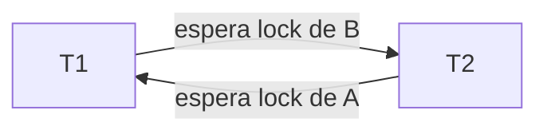

# Deadlocks

Un deadlock pasa cuando dos (o más) transacciones se esperan **mutuamente**: cada una tiene un lock que la otra necesita, y ninguna puede avanzar. Con 2PL puede ocurrir.

## Deadlocks en 2PL (mis apuntes)
- Deadlocks: en 2PL

> [!note]- Transcripción de la imagen
> | Locks de T1 | T1 | T2 | Locks de T2 |
> |---|---|---|---|
> | Shared lock (A) | R(A) | | |
> | | | W(B) | Exclusive lock (B) |
> | | | W(A) | **espera a T1** |
> | **espera a T2** | W(B) | | |
>
> **Deadlock:** T2 espera que termine T1; T1 espera que termine T2.

> [!tip] Complemento — cómo los manejan los DBMS (conocimiento general; PostgreSQL docs, "Deadlocks")
> - **Detección:** el DBMS mantiene un **grafo de espera** (*wait-for graph*). Si aparece un ciclo, hay deadlock: elige una víctima y la **aborta** (rollback), liberando sus locks para que la otra siga. PostgreSQL lo revisa tras `deadlock_timeout` (1 s por defecto) y responde `ERROR: deadlock detected`.
> - **Prevención:** pedir los locks siempre en el mismo orden (por ejemplo, primero A y luego B), o usar esquemas como *wait-die* / *wound-wait* basados en la antigüedad de cada transacción.
> - **Timeout:** abortar una transacción que lleva demasiado tiempo esperando.
> - La aplicación debe estar preparada para **reintentar** una transacción abortada por deadlock.
> - Es la desventaja "tiempo de espera / deadlocks" de la tabla de [[01 - Transacciones|Transacciones]].

## Preguntas de repaso

1. ¿Qué es un deadlock?
> [!question]- Respuesta
> Una situación en que dos o más transacciones se esperan mutuamente para obtener locks que la otra tiene, de modo que ninguna puede continuar.

2. Explica el deadlock del ejemplo.
> [!question]- Respuesta
> T1 tiene un shared lock sobre A y T2 un exclusive lock sobre B. T2 quiere escribir A, así que espera a T1; T1 quiere escribir B, así que espera a T2. Ninguna termina, así que ninguna libera.

3. ¿Cómo resuelve un deadlock un DBMS como PostgreSQL?
> [!question]- Respuesta
> Detecta el ciclo en el grafo de espera y aborta una de las transacciones (la víctima). Así se liberan sus locks y la otra puede continuar.

4. ¿Cómo se pueden prevenir los deadlocks desde la aplicación?
> [!question]- Respuesta
> Pidiendo los locks (o accediendo a las filas) siempre en el mismo orden global, y reintentando las transacciones abortadas.
