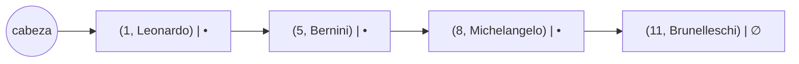

# Arreglos y listas ligadas

Dos formas de guardar una secuencia en memoria. El **arreglo** usa celdas contiguas de tamaño fijo, con acceso directo por índice. La **lista ligada** usa celdas dispersas unidas por punteros, crece sin límite, pero hay que recorrerla.

## Arreglo
- Un arreglo es una secuencia de celdas de **largo fijo**.
- Almacena valores del mismo tipo.
- Ocupa un bloque **contiguo** de la memoria RAM.

> [!note]- Transcripción de la imagen
> Un bloque de memoria donde **A** apunta al inicio del arreglo: $A_0 = 2.47$, $A_1 = 3.76$, $A_2 = 0.35$, $A_3 = -2.0$, en celdas contiguas.

## Listas ligadas
- Es una secuencia de celdas de **largo variable**: puede crecer o achicarse.
- Cada celda es del mismo tamaño.
- Las celdas quedan dispersas en la memoria y se unen con **punteros**: cada una apunta a la siguiente.

> [!note] Erratas
> "alteatoria" → aleatoria; "utlizando" → utilizando. "Largo variable" se refiere a la **lista** (puede crecer); cada celda tiene tamaño fijo.

> [!tip] Complemento — comparación y uso en BD (slides "Clase 9", "Repaso (o spoiler) de EDD")
> | Operación | Arreglo | Lista ligada |
> |---|---|---|
> | Acceso al i-ésimo | $O(1)$: dirección = $A + i \cdot$ tamaño | $O(i)$: hay que recorrer |
> | Buscar un valor | $O(n)$, u $O(\log n)$ si está ordenado | $O(n)$ |
> | Insertar al inicio | $O(n)$ (correr elementos) | $O(1)$ |
> | Tamaño | fijo | variable |
>
> Ejemplo de la clase: `Actores(aid, nombre)` guardado como lista ligada. Para buscar el artista con aid = 11 hay que visitar los nodos uno por uno: **lineal**. Para hacerlo mejor están las [[08 - Tablas de hash|tablas de hash]] y los árboles B+.

## Preguntas de repaso

1. ¿Por qué el acceso al elemento i de un arreglo es $O(1)$?
> [!question]- Respuesta
> Porque las celdas son contiguas y del mismo tamaño: la dirección se calcula directamente como inicio + i · tamaño.

2. ¿Cómo se guarda una lista ligada en memoria?
> [!question]- Respuesta
> Cada celda (nodo) puede estar en cualquier parte de la memoria y guarda un puntero a la siguiente.

3. ¿Qué ventaja tiene la lista ligada sobre el arreglo y qué desventaja?
> [!question]- Respuesta
> Ventaja: tamaño variable e inserción en $O(1)$ si se conoce la posición. Desventaja: para llegar a un elemento hay que recorrerla, $O(n)$.
