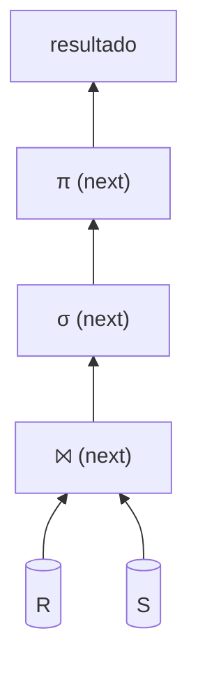

# Algoritmos en un DBMS e iteradores

Cada operador del álgebra relacional (σ, π, ⨝, …) se implementa como un **iterador** con `open()`, `next()` y `close()`. Así los operadores se encadenan en un plan y las tuplas fluyen de a una, sin materializar todo. Su costo se mide en I/O.

> [!tip] Complemento — nota nueva (fuente: slides "Clase 10: Evaluación de consultas")
> **Costo de un algoritmo:** cuántas veces hay que leer una página desde el disco o escribirla al disco. Las operaciones en el buffer (RAM) son órdenes de magnitud más rápidas: costo 0.
>
> **Interfaz de iterador lineal**, para una relación R:
> | Método | Qué hace |
> |---|---|
> | `R.open()` | se posiciona antes de la primera tupla de R |
> | `R.next()` | devuelve la siguiente tupla, o NULL si no quedan |
> | `R.close()` | cierra el iterador |
>
> **`SELECT * FROM R` con un iterador:**
> ```
> R.open()
> t := R.next()
> while t != null do
>     output t
>     t := R.next()
> R.close()
> ```
> Al hacer `open()` y el primer `next()`, el DBMS trae al buffer la página R-1 (t1, t2). Los `next()` siguientes leen de RAM hasta agotar la página; entonces se trae R-2 (t3, t4), y así. Costo: todas las páginas de R.
>
> **En realidad, cada operador del álgebra relacional implementa la interfaz de iterador.** Un plan como $\pi(\sigma(R \bowtie S))$ es un árbol de iteradores: el de arriba llama a `next()` del de abajo cada vez que necesita una tupla (modelo *pipeline* o "Volcano").



## Preguntas de repaso

1. ¿Qué tres métodos implementa todo operador en un DBMS y qué hace cada uno?
> [!question]- Respuesta
> `open()` prepara el iterador antes de la primera tupla, `next()` devuelve la siguiente tupla (o NULL) y `close()` lo cierra.

2. ¿Cómo se mide el costo de un algoritmo en un DBMS?
> [!question]- Respuesta
> Por el número de páginas leídas o escritas en disco. Lo que se hace en RAM se considera de costo 0.

3. ¿Qué ventaja tiene que todos los operadores sean iteradores?
> [!question]- Respuesta
> Que se pueden componer en un plan donde cada operador pide tuplas al de abajo con `next()`, sin materializar resultados intermedios completos.
