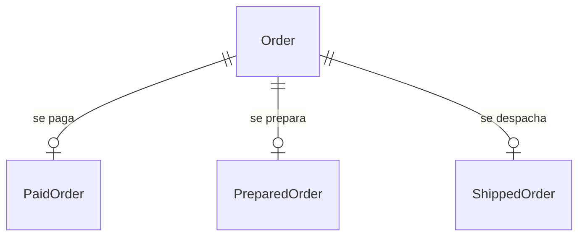

# Modelación de datos y procesos

Modelar bien los datos es **lo más importante al desarrollar una aplicación**: los datos se van a usar mucho más allá de la app (análisis, reportes, decisiones). Los procesos con estados conviene modelarlos de modo que no se pierda información de cada etapa.

> [!tip] Complemento — nota nueva (fuente: slides "Clase 14: Bases de Datos y desarrollo de software")
> **Modelación de datos** ⚠️
> - Más allá del uso que la aplicación les dé, los datos se van a querer para hacer análisis, reportes, campañas y otros.
> - Si el esquema es engorroso y difícil de entender, va a ser difícil trabajar con los datos. Arreglar una base de datos mal modelada suele ser una tarea poco abarcable.
> - Eventualmente queremos tomar decisiones a partir de los datos.
>
> **Modelación de procesos:** a veces hay que modelar procesos que van cambiando de estado:
> - Una compra (pagada, en preparación, despachada).
> - Una revisión manual (en espera de revisión; resultados distintos: aprobada, rechazada u otros).
>
> | Opción | Esquema | Problema |
> |---|---|---|
> | Campo de estado | `Order(id, state, comment, created_at, updated_at)` | solo se ve el estado actual; se pierde cuándo pasó por cada etapa |
> | Una fecha por etapa | `Order(id, comment, ordered_at, paid_at, prepared_at, shipped_at)` | ¿dónde se guarda información adicional de cada etapa (método de pago, n.º de seguimiento)? |
> | **Una tabla por etapa** | ver abajo | cada etapa guarda su propia información |
>
> ```
> Order(id, comment, created_at)
> PaidOrder(id, order_id, created_at, payment_method, payment_receipt)
> PreparedOrder(id, order_id, created_at, comment)
> ShippedOrder(id, order_id, created_at, tracking_number, shipping_company, expected_delivery_date)
> ```



## Preguntas de repaso

1. ¿Por qué la clase dice que modelar los datos es lo más importante al desarrollar una aplicación?
> [!question]- Respuesta
> Porque los datos se usarán para análisis, reportes y decisiones. Un esquema mal modelado es difícil de entender y muy costoso de arreglar después.

2. ¿Qué problema tiene modelar un proceso solo con una columna `state`?
> [!question]- Respuesta
> Que solo guarda el estado actual: se pierde cuándo ocurrió cada etapa y no hay dónde guardar la información propia de cada una.

3. ¿Qué ventaja tiene una tabla por etapa (PaidOrder, ShippedOrder…)?
> [!question]- Respuesta
> Cada etapa tiene su fecha y sus datos específicos (método de pago, número de seguimiento) sin columnas nulas en Order.
