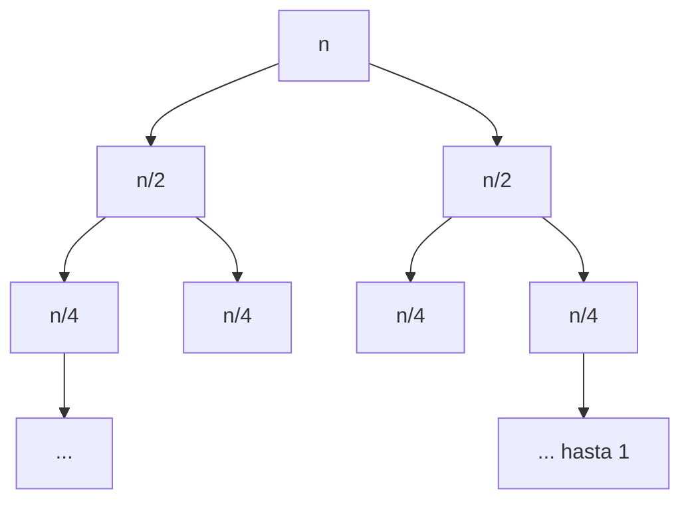

# Mergesort y su recurrencia

Selection e insertion sort atacan el problema de frente y pagan $O(n^2)$. **Mergesort** aplica [[04 - Búsqueda binaria y dividir para conquistar|dividir para conquistar]]: parte la secuencia en dos mitades, ordena cada una recursivamente y las combina con [[01 - Merge de dos secuencias ordenadas|merge]]. La recursión baja hasta secuencias de un elemento, que trivialmente ya están ordenadas.

## Algoritmo

```
input : secuencia A
output: secuencia ordenada B
MergeSort(A):
1   if |A| = 1: return A
2   dividir A en mitades A1 y A2
3   B1 <- MergeSort(A1)
4   B2 <- MergeSort(A2)
5   B  <- Merge(B1, B2)
6   return B
```

```python
def merge_sort(A):
    if len(A) <= 1:
        return A
    mitad = len(A) // 2
    return merge(merge_sort(A[:mitad]), merge_sort(A[mitad:]))
```


> [!example]- Transcripción de la imagen
> Un arreglo de 16 casillas de colores se divide por niveles: dos mitades de 8, cuatro grupos de 4, ocho pares y casillas sueltas. Después vuelve a subir: los pares se mezclan ordenados, luego los grupos de 4, los de 8, y finalmente el arreglo completo queda ordenado, como un degradado de colores.



Hay $\log_2 n$ niveles de división, y en cada nivel los merges suman $O(n)$ trabajo en total. De ahí la intuición de $O(n \log n)$.

## La recurrencia, resuelta

Sea $T(n)$ la cantidad de pasos para ordenar $n$ elementos. El caso base cuesta 1, y si $n > 1$ hay dos llamados de tamaño $n/2$ más el merge:

$$T(1) = 1, \qquad T(n) = 2\,T(n/2) + n$$

Dividiendo por $n$: $\frac{T(n)}{n} = \frac{T(n/2)}{n/2} + 1$. Si se escribe esta igualdad para $n, n/2, n/4, \dots, 2$ (suponiendo $n$ potencia de 2), se obtienen $k = \log n$ ecuaciones. Al sumarlas, los términos intermedios se cancelan en ambos lados (suma telescópica):

$$\frac{T(n)}{n} = \frac{T(1)}{1} + \log n \quad\Rightarrow\quad T(n) = n\log n + n \in O(n \log n)$$

```python
def T(n):
    return 1 if n == 1 else 2 * T(n // 2) + n
print(all(T(2**k) == 2**k * k + 2**k for k in range(12)))   # True
```

> [!tip] Mismo costo en todos los casos
> La recurrencia no depende del contenido del arreglo: mergesort siempre divide igual y siempre mezcla todo. Por eso el **mejor caso, el peor y el promedio son $\Theta(n \log n)$**. Es predecible, aunque no aprovecha que la entrada venga ordenada.

**Memoria adicional: $O(n)$.** Cada merge usa una secuencia auxiliar del tamaño de lo que mezcla. Los llamados recursivos **no acumulan** esa memoria, porque se libera al terminar cada merge y se puede reciclar.


> [!example]- Transcripción de la imagen
> Tabla con mejor caso, caso promedio, peor caso y memoria adicional. Selection sort: $\mathcal{O}(n^2)$, $\mathcal{O}(n^2)$, $\mathcal{O}(n^2)$, $\mathcal{O}(1)$. Insertion sort: $\mathcal{O}(n)$, $\mathcal{O}(n^2)$, $\mathcal{O}(n^2)$, $\mathcal{O}(1)$. Merge sort: $\mathcal{O}(n\log n)$ en los tres casos y $\mathcal{O}(n)$ de memoria. Quick sort y heap sort aparecen con "?" en todas las columnas (todavía no se habían visto).

Mergesort cambia memoria adicional por una gran mejora de tiempo. Además es **estable**, si el merge usa `<=`.

## Variante híbrida: merge-insertion sort

Con pocos datos, la recursión cuesta más de lo que ahorra. Una mejora práctica, que se propone como ejercicio en la ayudantía, es usar **insertion sort por debajo de un umbral** (por ejemplo, 16 elementos) y mergesort por encima. Combina lo mejor de ambos: insertion es rápido y sin recursión en casos pequeños, y mergesort mantiene el $O(n \log n)$ global. Por el [[03 - Inversiones y análisis de casos de insertion sort|ejercicio de las sublistas]], ordenar las $n/k$ hojas de largo $k$ cuesta $O(nk)$.

## Preguntas de repaso

> [!question]- ¿Por qué mergesort es $\Theta(n \log n)$ incluso si el arreglo ya viene ordenado?
> Porque su trabajo no depende del contenido: siempre divide en mitades hasta tamaño 1 y siempre mezcla todo. Hay $\log n$ niveles con $O(n)$ trabajo cada uno.

> [!question]- Resolver $T(n) = 2T(n/2) + n$ con $T(1) = 1$.
> Se divide por $n$ y se aplica la suma telescópica sobre $n, n/2, \dots, 2$: $T(n)/n = T(1) + \log n$, es decir, $T(n) = n \log n + n$.

> [!question]- ¿Por qué la memoria adicional es $O(n)$ y no $O(n \log n)$, si hay merges en cada nivel?
> Porque la memoria auxiliar de un merge se libera al terminar y la siguiente la reutiliza. En ningún momento hay más de $O(n)$ reservada a la vez.

> [!question]- ¿Qué gana un merge-insertion sort frente al mergesort puro?
> Evita el costo de la recursión en los subproblemas pequeños, donde insertion sort es más rápido en la práctica, sin perder el $O(n \log n)$ asintótico.
