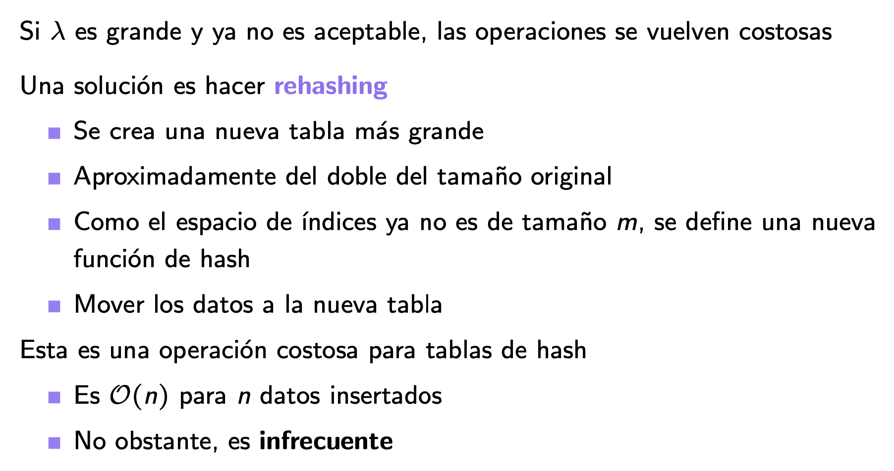

# Factor de carga y rehashing

El $O(1)$ de una tabla de hash depende de que haya **pocas colisiones**, y eso depende de **qué tan llena** está la tabla. Cuando se llena demasiado, las operaciones se degradan hacia $O(n)$, y la solución es agrandarla: **rehashing**.

> [!tip] Factor de carga
> $$\lambda = \frac{n}{m}$$
> con $n$ la cantidad de valores almacenados y $m$ el tamaño de la tabla. Con una buena función de hash, $\lambda$ es el largo promedio de las listas (en encadenamiento) o la fracción de celdas ocupadas (en sondeo).

| Estrategia | $\lambda$ razonable | Cuando $\lambda$ crece |
|---|---|---|
| Encadenamiento | $\lambda \approx 1$ es aceptable: listas de largo ~1 en promedio | Con $\lambda = 10$, cada búsqueda recorre ~10 elementos y la tabla se vuelve lenta |
| Direccionamiento abierto (sondeo) | Hay que mantener $\lambda < 0{,}5$ | Cerca de 1, las secuencias de prueba se alargan y todo se parece a $O(n)$; con $\lambda = 1$ no cabe nada más |

## Rehashing



> [!example]- Transcripción de la imagen
> "Si $\lambda$ es grande y ya no es aceptable, las operaciones se vuelven costosas. Una solución es hacer **rehashing**": se crea una nueva tabla más grande, aproximadamente del doble del tamaño original; como el espacio de índices ya no es de tamaño $m$, se define una nueva función de hash; se mueven los datos a la nueva tabla. "Esta es una operación costosa para tablas de hash: es $\mathcal{O}(n)$ para $n$ datos insertados. No obstante, es **infrecuente**".

No basta con copiar las celdas, porque cada llave hay que **volver a hashearla** con la función nueva ($k \bmod m'$ da otra posición). Como la tabla se duplica, el rehash ocurre cada vez menos seguido, y su costo $O(n)$ repartido entre todas las inserciones da $O(1)$ amortizado por inserción.

```python
def insert(self, k, v=None):          # en HashEncadenado
    ...                                # inserción normal
    self.n += 1
    if self.n / self.m > 1:            # λ > 1: agrandar
        self.rehash()

def rehash(self):
    viejos = [par for lista in self.A for par in lista]
    self.m = siguiente_primo(2 * self.m)          # ~doble y primo
    self.n, self.A = 0, [[] for _ in range(self.m)]
    for k, v in viejos:
        self.insert(k, v)                          # se recalcula k % m'
# con m = 7, la octava inserción dispara el rehash a m = 17
```

> [!example] Diagnóstico de un síntoma
> Un control de acceso para una biblioteca con 7000 alumnos funcionaba rápido y parejo. Al extenderlo a todos los campus (unos 35 000 alumnos), se volvió errático: a veces muy rápido y a veces muy lento, y a un alumno lo atiende bien y a otro no.
>
> **No es un árbol**: su costo es proporcional a $\log n$, y entre 7000 y 35 000 la diferencia es mínima. Además, un árbol no trata distinto a dos estudiantes. **Es una tabla de hash** dimensionada para ~7000 (por ejemplo, $m$ primo cercano a 7000). Con 35 000 llaves, $\lambda \approx 5$: algunos alumnos caen en listas cortas y otros en listas largas de colisiones. **Solución:** rehashing a una tabla más grande, con una nueva función de hash.

## Preguntas de repaso

> [!question]- ¿Qué mide el factor de carga y cómo afecta el rendimiento?
> Mide cuán llena está la tabla ($n/m$). A mayor $\lambda$, más colisiones: las listas se alargan o las secuencias de sondeo crecen, y las operaciones dejan de ser $O(1)$.

> [!question]- ¿Por qué el sondeo exige un $\lambda$ más bajo que el encadenamiento?
> Porque en sondeo las colisiones ocupan celdas de la propia tabla y generan bloques que alargan todas las búsquedas. En encadenamiento, las colisiones van a listas aparte y solo afectan a su propia celda.

> [!question]- ¿Por qué al hacer rehashing no se pueden copiar las celdas tal cual?
> Porque la posición de cada llave depende de $m$: con el nuevo tamaño $m'$, $k \bmod m'$ es otra celda. Hay que reinsertar todas las llaves con la nueva función.

> [!question]- Si el rehashing cuesta $O(n)$, ¿por qué la tabla sigue siendo eficiente?
> Porque es infrecuente: al duplicar el tamaño, el siguiente rehash ocurre después de otras ~$n$ inserciones. Repartido entre todas, el costo es $O(1)$ amortizado por inserción.
