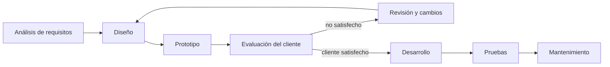

# Modelo de prototipos

El modelo de prototipos es un proceso **iterativo** en el que se construyen versiones que *se parecen* al producto final, para que el usuario lo vea temprano y aclare lo que realmente quiere.

## Idea
- Se construye un producto que **luce similar al objetivo final**, aunque todavía no lo sea.
- **Idea central:** que el usuario tenga una vista **temprana y cercana** del producto.
- La premisa es que *el usuario solo sabrá lo que quería cuando vea el resultado*; el prototipo adelanta ese momento.

## Tipos de prototipo
1. **Prototipo evolutivo:** el mismo prototipo evoluciona hasta ser el producto final.
2. **Prototipo desechable:** solo sirve para una vista rápida; después se descarta y el producto se construye desde cero.

Versión en texto del diagrama:

## Ventajas
- **Reduce los imprevistos:** no hay grandes sorpresas al final, lo que acorta el tiempo de desarrollo.
- Genera menos **frustración y ansiedad**, porque el usuario ve avances desde el principio.
- Aumenta la **satisfacción del usuario**.

## Desventajas
- **Proyecto sin fin:** el usuario nunca queda satisfecho y siempre pide otra vuelta.
- **Expectativa de "casi listo":** como el prototipo se ve terminado, el usuario cree que falta poco.
- El **producto final puede no quedar como el prototipo**, y eso decepciona.

> [!tip] Complemento (slides "Procesos de Desarrollo de Software" y libro del curso, cap. 2.3)
> El prototipo *"luce"* similar al objetivo, pero en realidad está bastante lejos de serlo.
>
> **Ventajas adicionales:**
> - permite enfrentar la **falta de claridad en los requerimientos**;
> - no hay grandes sorpresas al final, y por eso el tiempo de desarrollo es menor;
> - es más fácil lograr el **involucramiento del usuario**;
> - permite introducir el nuevo sistema gradualmente y facilita entrenar a los usuarios.
>
> **Desventajas adicionales:**
> - **análisis incompleto de los requisitos** (se entienden superficialmente);
> - se omiten requerimientos **no funcionales**;
> - es difícil de planificar (¿cuántos prototipos?, ¿cuánto tiempo?);
> - no hay entregables claros;
> - es poco apropiado para sistemas embebidos, de tiempo real o software científico.
>
> La desventaja "el producto final no queda igual que el prototipo" se da sobre todo con el **prototipo desechable**.

> [!tip] Complemento — evolutivo vs. desechable
> | | Evolutivo | Desechable |
> |---|---|---|
> | Qué pasa con el prototipo | Se convierte en el producto | Se tira |
> | Calidad del código del prototipo | Tiene que ser buena desde el inicio | Puede ser "rápido y sucio" |
> | Riesgo típico | Arrastrar malas decisiones tempranas | Que el cliente crea que ya está casi listo |
> | Útil cuando | Los requisitos se van aclarando de a poco | Hay que validar una idea o una interfaz rápido |

> [!example] Ejemplo extra
> Para una app de reservas, se hace un mockup navegable en Figma (prototipo desechable). El cliente lo prueba y pide cambiar el flujo de pago. Recién entonces se diseña e implementa el sistema real.

## Preguntas de repaso

1. ¿Qué problema busca resolver el modelo de prototipos?
> [!question]- Respuesta
> Que el usuario no sabe exactamente lo que quiere hasta ver el resultado. El prototipo le da una vista temprana y cercana del producto para aclarar los requisitos.

2. Diferencia entre prototipo evolutivo y desechable.
> [!question]- Respuesta
> El evolutivo se va mejorando hasta convertirse en el producto final. El desechable solo sirve para una vista rápida: luego se desecha y el producto se construye desde cero.

3. ¿Por qué el modelo de prototipos puede generar un "proyecto sin fin"?
> [!question]- Respuesta
> Porque el usuario puede seguir pidiendo cambios al ver cada prototipo sin quedar nunca satisfecho, y además puede creer que el software está "casi listo".

4. ¿Para qué tipo de sistemas es poco apropiado?
> [!question]- Respuesta
> Sistemas embebidos, de tiempo real o software científico, donde los requisitos no funcionales (rendimiento, precisión) son críticos y un prototipo superficial no los representa.
