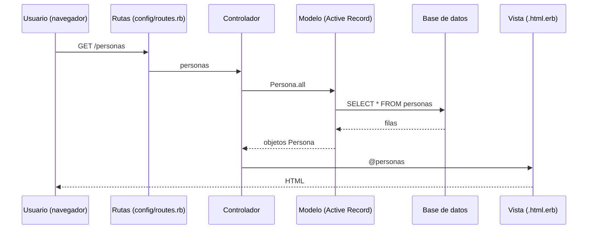

# Patrón MVC en Rails

MVC (Modelo-Vista-Controlador) es la **arquitectura que estructura una aplicación Rails**: separa los datos (modelo), lo que ve el usuario (vista) y la lógica que los conecta (controlador).

## MVC
Es una **arquitectura** que organiza la aplicación separando los datos, la lógica y la presentación:
- **Modelo:** maneja los datos y su relación con la base de datos.
- **Controlador:** es el **intermediario**. Recibe los requests del usuario, aplica la lógica de negocio y lleva los datos del modelo a la vista.
- **Vista:** se encarga de lo que el usuario ve.

## En Rails
- **Rutas** (*routes*): asocian cada URL que usa el usuario con una acción de un controlador.
- **Controladores** (*controllers*): clases que coordinan la interacción entre el usuario, la vista y el modelo.
- **Modelos** (*models*): clases que permiten interactuar con la **base de datos**.

El diagrama muestra el recorrido completo de un request:

> [!tip] Complemento — dónde vive cada parte en un proyecto Rails
> | Capa | Carpeta | Ejemplo |
> |---|---|---|
> | Modelo | `app/models/` | `persona.rb` → [[04 - Modelos y Active Record\|Modelos y Active Record]] |
> | Vista | `app/views/<recurso>/` | `personas/index.html.erb` → [[11 - Vistas ERB\|Vistas ERB]] |
> | Controlador | `app/controllers/` | `personas_controller.rb` → [[09 - Controladores en Rails\|Controladores en Rails]] |
> | Rutas | `config/routes.rb` | `resources :personas` → [[10 - Rutas en Rails\|Rutas en Rails]] |
>
> MVC organiza la aplicación por responsabilidades, igual que la [[03 - Arquitectura en capas|arquitectura en capas]].
>
> **Por qué separar:** cada parte tiene una sola responsabilidad (**alta cohesión**) y se puede cambiar una sin tocar las demás (**bajo acoplamiento**). Por ejemplo, se puede cambiar la vista HTML por una respuesta JSON sin tocar el modelo.

## Preguntas de repaso

1. ¿Qué responsabilidad tiene cada componente de MVC?
> [!question]- Respuesta
> Modelo: los datos y su interacción con la base de datos. Vista: lo que el usuario ve. Controlador: recibe los requests, aplica la lógica y lleva los datos del modelo a la vista (intermediario).

2. Describe qué ocurre cuando un usuario visita `/personas`.
> [!question]- Respuesta
> La ruta dirige el request a `PersonasController#index`, que pide `Persona.all` al modelo (que consulta la base de datos). El controlador deja el resultado en `@personas` y Rails renderiza `index.html.erb`, que genera el HTML de respuesta.

3. ¿Por qué el controlador es "intermediario"?
> [!question]- Respuesta
> Porque el modelo y la vista no se hablan directamente: el controlador obtiene los datos del modelo y se los entrega a la vista.
