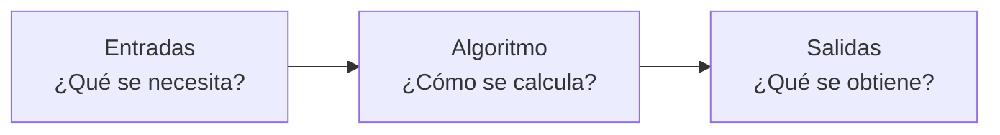
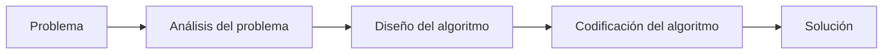

# Qué es un algoritmo

Antes de escribir una sola línea de código hay que saber **qué** se le quiere pedir al computador. Programar no es memorizar comandos: es resolver problemas, y la herramienta para eso es el **algoritmo**. Esta nota explica qué es, cómo se describe y por qué el computador necesita instrucciones tan precisas.

## Una receta es un algoritmo

Piensa en cómo hacer una pizza. La receta tiene dos partes:

- **Ingredientes:** masa, tomates, cebollas, queso, aceite, sal…
- **Preparación:** pasos numerados que se siguen uno tras otro ("extender la masa y untarla con aceite", "repartir los tomates", "hornear 25 minutos a 180 °C").

Eso ya es un algoritmo: un conjunto de instrucciones **ordenadas**, **bien definidas** y **finitas** que, si se siguen al pie de la letra, llevan de un problema ("quiero una pizza") a una solución (la pizza lista).

> [!tip] Definición
> Un **algoritmo** es una secuencia finita de pasos claros, en un orden determinado, que resuelve un problema o realiza una tarea sin dejar dudas a quien la ejecuta.

Dos detalles de la receta enseñan mucho:
- **El orden importa.** Hornear antes de poner los ingredientes no da una pizza.
- **No hay una sola solución.** Se puede freír la cebolla antes o después de extender la masa y el resultado es el mismo. Hay muchos algoritmos para un mismo problema; algunos son más claros, rápidos o cortos que otros.

## Entradas, algoritmo y salidas

Todo algoritmo se puede ver como una caja que transforma datos:

Ejemplo: convertir millas a kilómetros.
- **Entrada:** la cantidad de millas.
- **Algoritmo:** multiplicar las millas por 1,609.
- **Salida:** la cantidad de kilómetros.

Escrito como pasos:
1. Pedir las millas.
2. Calcular `kilómetros = millas * 1.609`.
3. Mostrar el resultado.

Hacerse estas tres preguntas (¿qué necesito?, ¿qué quiero obtener?, ¿cómo paso de uno a otro?) es el primer paso para resolver cualquier ejercicio del curso.

## Cómo se comunica un algoritmo

El mismo algoritmo se puede escribir de varias formas, de la más ambigua a la menos ambigua:

| Forma | Ejemplo | ¿Lo entiende el computador? |
|---|---|---|
| **Lenguaje natural** | "Agrega un poco de sal" | No: "un poco" es ambiguo |
| **Diagrama de flujo** | Cajas y flechas | No directamente |
| **Pseudocódigo** | `kms = millas * 1.609` mezclado con español | No, pero se acerca |
| **Lenguaje de programación** | `kms = millas * 1.609` en Python | Sí |

Una persona puede interpretar "un poco de sal"; el computador no. Por eso existe el **lenguaje de programación**: un idioma sin ambigüedades que sirve de puente entre la persona y la máquina. En este curso ese lenguaje es **Python**, que se presenta en el tema siguiente.

> [!warning] El computador hace exactamente lo que dices
> No adivina intenciones. Si un paso está mal escrito o en el orden equivocado, el programa hará algo distinto de lo que querías, sin avisar. Gran parte de programar es revisar que las instrucciones digan *exactamente* lo que se piensa.

## Resolver un problema programando

El curso usa la programación como herramienta para resolver problemas, y el proceso tiene tres etapas:

1. **Análisis:** entender qué se pide, qué datos hay y qué resultado se espera.
2. **Diseño:** pensar los pasos (en papel, en español o pseudocódigo).
3. **Codificación:** traducir esos pasos a Python.

El error más común al empezar es saltarse las dos primeras y escribir código directo. Si no se sabe resolver el problema "a mano", el computador tampoco lo resolverá. A esta forma de pensar (descomponer un problema, identificar los datos importantes y ordenar los pasos) se le llama **pensamiento computacional** o algorítmico.

## Preguntas de repaso

> [!question]- ¿Por qué "agregar sal a gusto" no sirve como instrucción para un computador?
> Porque es ambigua: no dice cuánta sal ni cómo decidirlo. Un algoritmo para un computador debe tener pasos exactos, sin interpretación.

> [!question]- Si dos estudiantes escriben algoritmos distintos para el mismo problema, ¿uno de los dos está mal?
> No necesariamente. Un problema puede tener muchas soluciones correctas; se comparan por claridad, largo o eficiencia, pero ambas pueden ser válidas si llegan al resultado correcto.

> [!question]- ¿Cuáles son las entradas y salidas de un algoritmo que calcula el promedio de tres notas?
> Entradas: las tres notas. Salida: el promedio. El algoritmo suma las tres notas y divide por 3.

> [!question]- ¿Por qué conviene diseñar el algoritmo antes de programarlo?
> Porque separa dos dificultades: primero se resuelve el problema (la lógica) y después se escribe en Python (la sintaxis). Si se mezclan, es mucho más difícil encontrar los errores.
