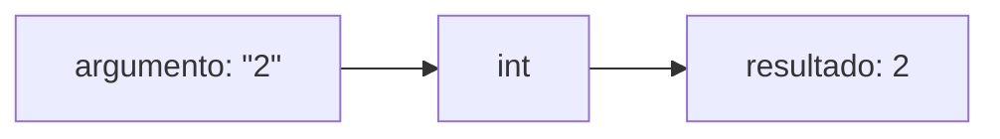

# Funciones predefinidas, random y booleanos

Python trae muchas herramientas listas para usar. Ya se vieron algunas (`print`, `input`, `int`), y todas son **funciones**. Esta nota explica qué es una función desde el punto de vista de quien la usa, cómo obtener números al azar con `random` y un tipo nuevo, `bool`, que permite hacer preguntas de sí o no.

## Qué es una función

Una función es como una máquina: recibe **argumentos** (lo que va entre paréntesis), hace un cálculo y **devuelve** (retorna) un resultado.



`int("2")` recibe el texto `"2"` y devuelve el número `2`. Hay dos tipos de funciones según lo que hacen con el resultado:

| Devuelven un valor | Solo realizan una acción |
|---|---|
| `int("2")`, `float("3.4")`, `str(5)`, `input("…")`, `len("hola")`, `abs(-3)`, `round(2.7)` | `print("hola")` |
| El resultado se guarda o se usa: `x = int("2")` | No hay nada útil que guardar |

Las que vienen incluidas en Python, sin importar nada, se llaman **funciones predefinidas** (*built-in functions*). Más adelante se aprenderá a crear funciones propias.

## Módulos: el caso de `random`

Algunas funciones no vienen cargadas: están en **módulos** (bibliotecas) que hay que **importar**. El módulo `random` genera números al azar:

```python
import random

dado = random.randint(1, 6)   # entero al azar entre 1 y 6, ambos incluidos
print(dado)
```

- `import random` va al principio del archivo y "trae" el módulo.
- Las funciones del módulo se usan con el nombre del módulo, un punto y la función: `random.randint(a, b)`.
- `random.randint(a, b)` incluye **ambos extremos**: puede salir `a` y puede salir `b`.

En realidad el computador no genera azar verdadero: usa una fórmula que produce números que *parecen* aleatorios (**pseudoaleatorios**) a partir de un valor inicial llamado **semilla**. Para juegos y simulaciones es más que suficiente.

## Un tipo nuevo: `bool`

Un valor **booleano** solo puede ser `True` (verdadero) o `False` (falso). Aparece al **comparar**:

| Operador | Pregunta | Ejemplo con `a = 5`, `b = 3` |
|---|---|---|
| `==` | ¿son iguales? | `a == b` → `False` |
| `!=` | ¿son distintos? | `a != b` → `True` |
| `<` | ¿menor? | `a < b` → `False` |
| `>` | ¿mayor? | `a > b` → `True` |
| `<=` | ¿menor o igual? | `b <= 3` → `True` |
| `>=` | ¿mayor o igual? | `a >= 6` → `False` |

También se comparan textos: `"hola" == "chao"` es `False` y `"hola" != "chao"` es `True`. El resultado de una comparación se puede guardar: `c = a > b` deja `True` en `c`.

> [!warning] `=` versus `==`
> `=` guarda un valor en una variable; `==` pregunta si dos valores son iguales. Escribir `if x = 5` es un error de sintaxis muy común.

## Ejemplo completo: adivinar el dado

```python
import random

print("Voy a tirar un dado")
usuario = int(input("Adivina cual numero me sale? "))
dado = random.randint(1, 6)
print(f"Me salio un {dado}")
print(f"Adivinaste: {dado == usuario}")
```

```
Voy a tirar un dado
Adivina cual numero me sale? 6
Me salio un 5
Adivinaste: False
```

Al diseñarlo conviene pasar por **pseudocódigo**: primero escribir "dado = tirar un dado" y "Adivinaste = True o False" en español, y después buscar qué instrucción de Python hace cada paso (`random.randint(1, 6)` y `dado == usuario`).

## ¿De qué tipo es? `type`

```python
print(type(3))       # <class 'int'>
print(type(3.0))     # <class 'float'>
print(type("3"))     # <class 'str'>
print(type(True))    # <class 'bool'>
```

`type` sirve para salir de dudas cuando algo no funciona como se esperaba (por ejemplo, si una variable que debía ser número en realidad es texto). Los cuatro tipos básicos del curso son `int`, `float`, `str` y `bool`.

> [!tip] Idea clave
> Las comparaciones producen valores `bool`, y los `bool` son los que permiten al programa **tomar decisiones**. Esa es la base de los condicionales `if`, el siguiente paso.

## Preguntas de repaso

> [!question]- ¿Por qué `x = print("hola")` no es útil, pero `x = int("4")` sí?
> Porque `print` solo realiza la acción de mostrar texto y no devuelve un valor útil (devuelve `None`). `int` devuelve el número convertido, que queda guardado en `x`.

> [!question]- ¿Qué valores puede entregar `random.randint(1, 6)`?
> Cualquier entero del 1 al 6, incluidos ambos extremos.

> [!question]- ¿Qué muestra `print(5 > 3)` y de qué tipo es ese valor?
> Muestra `True`, que es un valor de tipo `bool`.

> [!question]- ¿Qué pasa si se usa `random.randint` sin escribir `import random`?
> Python da un error (`NameError`) porque no conoce el nombre `random`: el módulo debe importarse antes de usarse.
