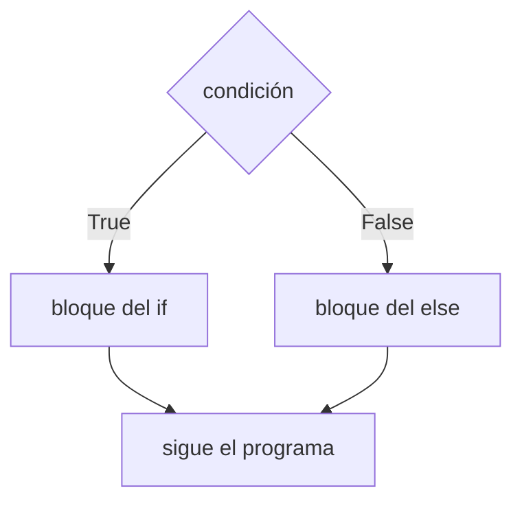

# If, else e indentación

Hasta ahora los programas ejecutaban siempre las mismas instrucciones, de arriba hacia abajo. Pero en la vida real las decisiones dependen de la situación: "si llueve, llevo paraguas; si no, no". La instrucción `if` permite que el programa **elija un camino** según si una condición es verdadera o falsa.

## La instrucción `if`-`else`

```text
if condición:
    instrucciones si la condición es True
else:
    instrucciones si la condición es False
```

- La **condición** es cualquier expresión que dé `True` o `False`, típicamente una comparación (`dado == n`, `nota >= 4`).
- Si es verdadera, se ejecuta el bloque del `if`; si es falsa, el bloque del `else`. **Nunca los dos.**
- Después de la condición y después de `else` van **dos puntos** (`:`).



Ejemplo, el juego del dado, ahora con un mensaje distinto según el resultado:

```python
import random

print("Voy a tirar un dado!")
dado = random.randint(1, 6)
usuario = int(input("Adivina cual numero me sale: "))
print(f"Salio un {dado}")
if dado == usuario:
    print("Bien! Ganaste!!")
    print(":-)")
else:
    print("Lo siento, perdiste")
print("FIN")
```

`"FIN"` se muestra siempre, porque está fuera de ambos bloques.

## La indentación importa

En Python, los **espacios al inicio de la línea** (la **indentación**) indican qué instrucciones pertenecen a cada bloque. Todas las líneas con la misma sangría bajo el `if` forman su bloque; al volver a la sangría original, el bloque terminó.

```python
nota = 3.5
if nota >= 4:
    print("Aprobado")
    print("Felicidades")      # también es parte del if
print("Fin del programa")     # fuera del if: se muestra siempre
```

```
Fin del programa
```

> [!warning] Errores típicos de indentación
> - Olvidar la sangría después de `if …:` da `IndentationError`.
> - Mezclar tabulaciones y espacios puede confundir a Python. Lo usual es usar **4 espacios** (los editores lo hacen solos al presionar Tab).
> - Si una línea queda con sangría por error, pasa a ser parte del bloque y solo se ejecuta cuando se cumple la condición.

## `else` es opcional

A veces solo hay que hacer algo **si** pasa una cosa, y nada en caso contrario. Por ejemplo, advertir cuando no alcanzan los chocolates:

```python
chocolates = int(input("Cuantos chocolates hay? "))
personas = int(input("Cuantas personas hay? "))
if chocolates < personas:
    print("ADVERTENCIA: no hay suficientes chocolates")
print(f"Repartir {chocolates // personas}, sobran {chocolates % personas}")
```

> [!tip] Regla
> Puede existir un `if` sin `else`, pero **nunca un `else` sin `if`**: el `else` siempre es "el caso contrario" de un `if` anterior.

## Pasar de la idea al código

Para decidir cómo escribir un `if` sirve preguntarse:
1. ¿Qué pregunta de sí o no hay que hacer? → esa es la condición.
2. ¿Qué pasa si la respuesta es sí? → bloque del `if`.
3. ¿Hay algo que hacer si es no? → si lo hay, bloque del `else`; si no, se omite.

## Preguntas de repaso

> [!question]- En el juego del dado, ¿por qué "FIN" se imprime siempre y "Ganaste" no?
> Porque "Ganaste" está con sangría dentro del bloque del `if` y solo corre si `dado == usuario`. "FIN" está sin sangría, fuera del `if`/`else`, así que se ejecuta después de cualquiera de los dos caminos.

> [!question]- ¿Se pueden ejecutar el bloque del `if` y el del `else` en la misma pasada?
> No. La condición es verdadera o falsa, así que se ejecuta exactamente uno de los dos bloques.

> [!question]- ¿Cuándo conviene omitir el `else`?
> Cuando en el caso contrario no hay que hacer nada especial, como en la advertencia de los chocolates: si alcanzan, el programa simplemente sigue.
