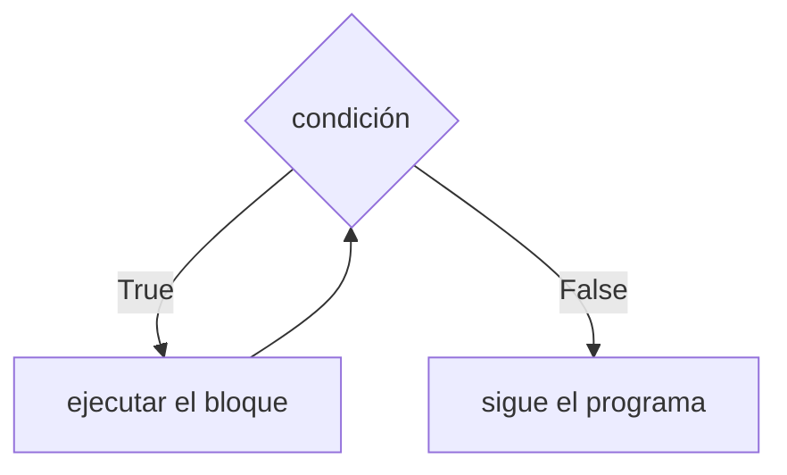

# El ciclo while

Mostrar los cuadrados del 1 al 4 se puede hacer con cuatro `print`. Pero ¿y del 1 al 100? ¿O calcular el promedio de 100 notas? Copiar la misma instrucción cien veces no tiene sentido. Los **ciclos** (o bucles) permiten **repetir** un bloque de instrucciones, y el primero que se ve es `while`.

## Cómo funciona `while`

```text
while condición:
    instrucciones
```

`while` significa "mientras". Su regla es: **mientras la condición sea verdadera, ejecuta el bloque; cuando sea falsa, sigue con lo que viene después.**



Es parecido a un `if`, con una diferencia clave: al terminar el bloque, **vuelve a preguntar** la condición. Cada pasada por el bloque se llama **iteración**.

## Ejemplo: la tabla de cuadrados

```python
n = 1
while n <= 4:
    print(n, n ** 2)
    n = n + 1
print("listo")
```

```
1 1
2 4
3 9
4 16
listo
```

Seguir el programa a mano (hacer una **traza**) ayuda a entenderlo:

| Iteración | `n` antes | ¿`n <= 4`? | Muestra | `n` después |
|---|---|---|---|---|
| 1 | 1 | True | `1 1` | 2 |
| 2 | 2 | True | `2 4` | 3 |
| 3 | 3 | True | `3 9` | 4 |
| 4 | 4 | True | `4 16` | 5 |
| – | 5 | False | (sale del ciclo) | – |

Para llegar hasta 100 solo hay que cambiar `4` por `100`. Ese es el poder del ciclo.

## Contador y acumulador

Calcular el promedio de varias notas usa dos variables con roles típicos:
- Un **contador** (`n`) que cuenta cuántas veces se ha repetido el ciclo: parte en 0 y suma 1 en cada vuelta.
- Un **acumulador** (`suma`) que va juntando los valores: parte en 0 y en cada vuelta se le suma la nota.

```python
cuantas = int(input("cuantas notas vas a ingresar? "))
suma = 0     # acumulador
n = 0        # contador
while n < cuantas:
    nota = float(input("nota? "))
    suma = suma + nota
    n = n + 1
print("promedio =", suma / cuantas)
```

> [!tip] Asignación abreviada
> `suma = suma + nota` se puede escribir `suma += nota`, y `n = n + 1` como `n += 1`. Ambas formas hacen lo mismo: calcular la expresión de la derecha con el valor actual y guardar el resultado en la variable. También existen `-=`, `*=` y `/=`.

> [!warning] Inicializar antes del ciclo
> El contador y el acumulador se crean **antes** del `while`. Si `suma = 0` se pusiera dentro del ciclo, se volvería a cero en cada vuelta y al final solo tendría la última nota.

## El bucle infinito

```text
n = 1
while n <= 99:
    print(n, n ** 2)      # olvidé n += 1
```

Como `n` nunca cambia, `n <= 99` siempre es verdadera y el programa muestra `1 1` para siempre. Esto es un **bucle infinito** (*infinite loop*). Para detenerlo hay que interrumpir el programa (Ctrl+C o el botón de detener del editor).

> [!warning] Regla de oro del while
> Dentro del bloque tiene que pasar algo que, tarde o temprano, haga **falsa** la condición. Si no, el ciclo nunca termina.

## Validar datos con while

Un ciclo también sirve para no aceptar datos malos. Aquí el contador solo avanza cuando la nota es válida:

```python
cuantas = 2
suma = 0
n = 0
while n < cuantas:
    nota = float(input("nota? "))
    if 1 <= nota <= 7:
        suma += nota
        n += 1
    else:
        print("Ingresa una nota entre 1 y 7")
print(suma / cuantas)
```

Si el usuario escribe 9, se muestra el aviso y se vuelve a pedir, porque `n` no aumentó.

## Preguntas de repaso

> [!question]- ¿Qué diferencia hay entre `if` y `while` si ambos tienen una condición?
> `if` revisa la condición una vez y ejecuta el bloque como máximo una vez. `while` vuelve a revisarla después de cada ejecución del bloque y lo repite mientras siga siendo verdadera.

> [!question]- ¿Cuántas veces se ejecuta el bloque de `n = 0; while n < 5: n += 1`?
> Cinco veces, con `n` valiendo 0, 1, 2, 3 y 4 al entrar. Cuando `n` llega a 5 la condición es falsa y el ciclo termina.

> [!question]- ¿Por qué el programa de las notas quedaría en un bucle infinito si se borra `n += 1`?
> Porque `n` se quedaría en 0 para siempre, `n < cuantas` nunca sería falsa y el programa pediría notas sin parar.

> [!question]- ¿Para qué sirve hacer una traza?
> Para seguir el programa paso a paso, anotando cómo cambian las variables. Así se entiende qué hace el ciclo y se encuentran errores, como un contador que no avanza o que se detiene una vuelta antes.
