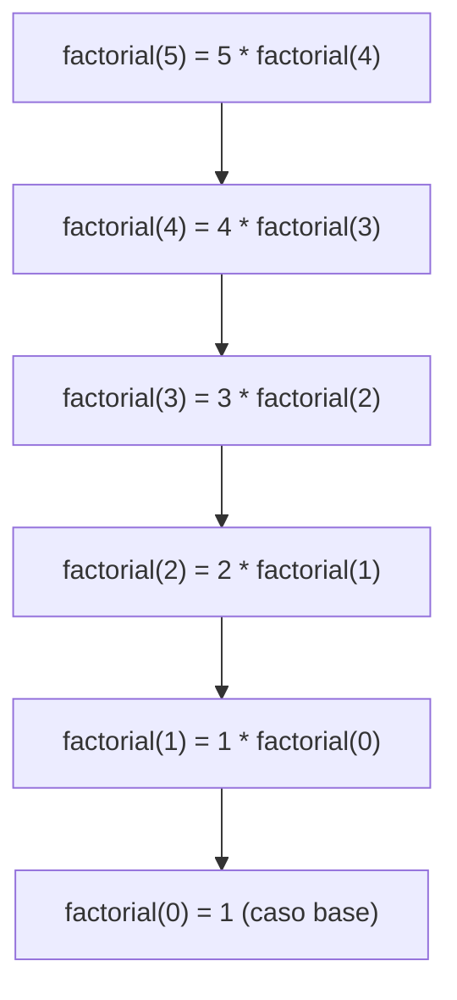

# Caso base y caso recursivo

Una función puede llamar a otras funciones… y también **a sí misma**. Eso es la **recursión**: resolver un problema usando la solución de una versión **más pequeña** del mismo problema. Suena circular, pero funciona siempre que el problema se vaya achicando hasta llegar a un caso tan simple que se responde directo, como las muñecas rusas: cada una contiene otra más chica, hasta llegar a la última, que ya no se abre.

## Factorial, de dos formas

El factorial se puede definir de dos maneras:

| Definición | Idea | Código natural |
|---|---|---|
| n! = 1 · 2 · 3 · … · n | Multiplicar todos los números | Un ciclo `for` |
| n! = n · (n − 1)!, y 0! = 1 | El factorial de n usa el de n − 1 | Recursión |

La segunda definición dice, por ejemplo, que 5! = 5 · 4!. No calcula 4! directamente: lo deja en manos del mismo procedimiento. Escrita en Python es casi idéntica:

```python
def factorial(n):
    if n == 0:                        # caso base
        return 1
    return n * factorial(n - 1)       # caso recursivo

print(factorial(5))
```

```
120
```

## Cómo se calcula `factorial(5)`

Cada llamada queda **esperando** el resultado de la siguiente, hasta llegar al caso base. Recién ahí las respuestas vuelven, de la última a la primera:



De vuelta: `factorial(1)` = 1 · 1 = 1, `factorial(2)` = 2 · 1 = 2, `factorial(3)` = 3 · 2 = 6, `factorial(4)` = 4 · 6 = 24 y `factorial(5)` = 5 · 24 = **120**.

## Las dos reglas de toda función recursiva

> [!tip] Receta
> 1. **Caso base:** al menos un caso que se responde **sin** llamarse a sí misma (`n == 0` → 1).
> 2. **Caso recursivo:** la función se llama a sí misma con un problema **más pequeño**, que se acerca al caso base (`n - 1`).

Si falta el caso base, o si las llamadas no se acercan a él, la función se llama infinitamente. Python lo corta con un error: `RecursionError: maximum recursion depth exceeded`.

```text
def factorial_malo(n):
    return n * factorial_malo(n - 1)   # sin caso base: nunca termina
```

> [!warning] Un caso base que nunca se alcanza
> `factorial(-1)` también falla: -1, -2, -3… se alejan del 0 y nunca llegan al caso base. Una versión más segura usa `if n <= 0: return 1`.

## Cómo pensar una solución recursiva

1. ¿Cuál es el caso más simple, cuya respuesta sé de memoria? → caso base.
2. Si alguien me regalara la respuesta para un problema un poco más chico, ¿cómo la uso para resolver el mío? → caso recursivo.

Ejemplo: **potencia** xʸ con y ≥ 0.
1. Caso más simple: x⁰ = 1.
2. Si ya sé xʸ⁻¹, entonces xʸ = x · xʸ⁻¹.

```python
def potencia(x, y):
    if y == 0:
        return 1
    return x * potencia(x, y - 1)

print(potencia(2, 10))
```

```
1024
```

Otro ejemplo: sumar los dígitos de un número. El caso base es un número de un solo dígito; el caso recursivo suma el último dígito con la suma de los dígitos del resto:

```python
def suma_digitos(n):
    if n < 10:
        return n
    return n % 10 + suma_digitos(n // 10)

print(suma_digitos(2024))
```

```
8
```

> [!tip] Confiar en la llamada recursiva
> Al escribir el caso recursivo no hay que seguir mentalmente todas las llamadas. Basta suponer que `suma_digitos(202)` ya funciona y preguntarse cómo usar su resultado (6) para responder `suma_digitos(2024)`: 6 + 4.

## Preguntas de repaso

> [!question]- ¿Qué pasa si a `factorial` se le quita el `if n == 0`?
> La función se llama a sí misma sin parar (5, 4, 3, …, 0, -1, -2…) hasta que Python la detiene con un `RecursionError`.

> [!question]- En `factorial(5)`, ¿cuál es la primera multiplicación que se calcula de verdad?
> `1 * factorial(0)`, es decir `1 * 1`. Las llamadas se van apilando hasta llegar al caso base, y las multiplicaciones se resuelven de vuelta, desde la más profunda.

> [!question]- ¿Cuál es el caso base y el caso recursivo de `potencia(x, y)`?
> Caso base: `y == 0`, que retorna 1. Caso recursivo: `x * potencia(x, y - 1)`, que achica el exponente en 1 en cada llamada.
