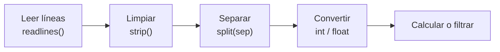

# Procesar datos: separadores y CSV

En la vida real los datos llegan en archivos con muchas líneas, una por registro: los puntajes de cada estudiante, las ventas de cada día, los resultados de un juego. Preguntas como "¿cuántas personas tienen todos los puntos?" o "¿cuál es el puntaje máximo?" se responden con un mismo esquema: **leer, separar, convertir y calcular**.

## El esquema general



Cada línea es un string como `"kaatt 455"`; después de `strip().split()` es la lista `["kaatt", "455"]`, y cada posición es un dato.

## Ejemplo: buscar en un registro

Un archivo de puntajes de un juego, con una línea `nombre puntaje` por partida. Mostrar todos los puntajes de un jugador:

```python
with open("registro.txt", "w") as f:
    f.write("kaatt 455\nlucy 300\nkaatt 512\n")

nombre = "kaatt"
for linea in open("registro.txt").readlines():
    datos = linea.strip().split()        # ['kaatt', '455']
    if datos[0] == nombre:
        print(datos[1])
```

```
455
512
```

## Archivos CSV

Un **CSV** (*comma-separated values*, valores separados por comas) es un archivo de texto donde cada línea es una fila de una tabla y las columnas se separan con un carácter (coma, o punto y coma). Las planillas como Excel pueden guardar y abrir este formato, por eso es la forma más común de intercambiar tablas de datos.

```text
Alumno;Set 1;Set 2;Set 3
1;1;1;0.5
2;1;0.2;0
3;1;1;1
```

La **primera línea** suele ser el **encabezado** (los nombres de las columnas), que no son datos y hay que saltarse.

## Ejemplo: filtrar estudiantes y guardar un reporte

Sumar los puntajes de cada estudiante y guardar en otro CSV solo a quienes tienen 2.5 o más:

```python
with open("datos.csv", "w") as f:
    f.write("Alumno;Set 1;Set 2;Set 3\n1;1;1;0.5\n2;1;0.2;0\n3;1;1;1\n")

lineas = open("datos.csv").readlines()
lineas.pop(0)                            # quitar el encabezado (o lineas = lineas[1:])
salida = open("aprobados.csv", "w")
for linea in lineas:
    datos = linea.strip().split(";")     # ['1', '1', '1', '0.5']
    total = 0
    for puntaje in datos[1:]:            # todas las columnas menos el número de alumno
        total += float(puntaje)
    if total >= 2.5:
        print(f"{datos[0]};{total}", file=salida)
salida.close()
print(open("aprobados.csv").read())
```

```
1;2.5
3;3.0
```

> [!warning] Coma decimal
> Algunas planillas en español guardan los decimales con coma (`0,06`). `float("0,06")` da error; antes hay que cambiarla por punto: `float(texto.replace(",", "."))`.

## Del archivo a una lista de listas

Para hacer varias preguntas sobre los mismos datos conviene cargar todo una vez en una **lista de listas**, ya convertida:

```python
with open("registro.txt", "w") as f:
    f.write("kaatt 455\nlucy 300\nkaatt 512\n")

tabla = []
for linea in open("registro.txt").readlines():
    nombre, puntaje = linea.strip().split()
    tabla.append([nombre, int(puntaje)])

mejor = tabla[0]
for fila in tabla:
    if fila[1] > mejor[1]:
        mejor = fila
print(tabla)
print("Mejor:", mejor)
```

```
[['kaatt', 455], ['lucy', 300], ['kaatt', 512]]
Mejor: ['kaatt', 512]
```

> [!tip] Idea clave
> Procesar un archivo = **leer → limpiar → separar → convertir → calcular**. Una vez que los datos están en una lista de listas, el archivo deja de importar y se trabaja como con cualquier lista.

## Preguntas de repaso

> [!question]- ¿Por qué hay que quitar la primera línea de un CSV antes de sumar sus valores?
> Porque normalmente es el encabezado con los nombres de las columnas; al intentar convertirlo con `float` daría error.

> [!question]- ¿Qué entrega `"3;1;0.5\n".strip().split(";")`?
> La lista `["3", "1", "0.5"]`: tres strings, que hay que convertir a número para calcular.

> [!question]- ¿Qué ventaja tiene cargar el archivo en una lista de listas antes de responder preguntas?
> Se lee y convierte una sola vez; después cada pregunta (máximo, filtros, búsquedas) es un simple recorrido de la lista, sin volver a separar ni convertir las líneas.
