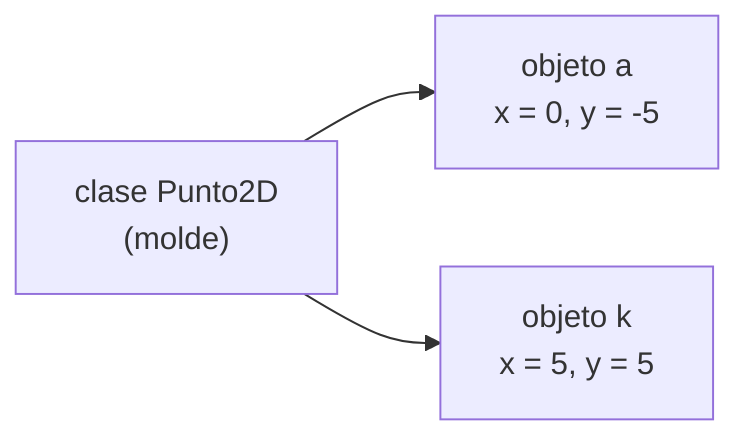

# Clases, objetos, atributos y métodos

Python trae tipos para números (`int`, `float`), texto (`str`), verdad (`bool`) y colecciones (`list`). Pero muchos programas hablan de cosas que no son ninguno de esos: personas, puntos, cartas, películas. La **programación orientada a objetos** (POO, u OOP en inglés) permite **crear tipos propios** que juntan los datos de una cosa con las acciones que se pueden hacer con ella.

## El problema de usar listas

Una persona tiene nombre, apellido, edad y RUT. Con una lista:

```python
persona = ["Margaret", "Hamilton", 83, 123456]
print(persona[2])     # ¿qué era la posición 2? hay que recordarlo
```

Funciona, pero el código no dice qué significa `persona[2]`; un error de posición pasa desapercibido. Y las funciones que trabajan con personas quedan sueltas, sin relación visible con los datos.

## Clase y objeto

- Una **clase** es el **molde**: describe qué datos tiene y qué puede hacer cualquier persona. Es como el molde de galletas.
- Un **objeto** (o **instancia**) es **una cosa concreta** hecha con ese molde: Margaret Hamilton, de 83 años, es un objeto de la clase `Persona`. Cada galleta es un objeto.

Una clase define dos cosas:

| | Qué son | Ejemplo en una clase `Perro` |
|---|---|---|
| **Atributos** | Las características (datos) de cada objeto | nombre, raza, edad, color |
| **Métodos** | Las acciones: funciones que pertenecen a la clase | ladrar, comer, correr |

Los métodos se aplican a un objeto con un punto, igual que los métodos de strings y listas que ya se usaban (`s.upper()`, `l.append(x)`): `objeto.metodo(parámetros)`.

## Ejemplo: distancia entre dos puntos

Con variables sueltas y una función, la distancia entre A(0, −5) y K(5, 5) necesita cuatro números:

```python
import math

def distancia(x1, y1, x2, y2):
    return math.sqrt((x1 - x2) ** 2 + (y1 - y2) ** 2)

print(distancia(0, -5, 5, 5))
```

Con una clase `Punto2D`, cada punto guarda sus propias coordenadas y sabe calcular su distancia a otro:

```python
import math

class Punto2D:
    def __init__(self, x, y):         # constructor: crea el punto
        self.x = x                    # atributo x
        self.y = y                    # atributo y

    def distancia(self, otro):        # método
        return math.sqrt((self.x - otro.x) ** 2 + (self.y - otro.y) ** 2)

a = Punto2D(0, -5)
k = Punto2D(5, 5)
print(a.x, a.y)                       # 0 -5
print(round(a.distancia(k), 2))       # 11.18
```

El programa principal (`a.distancia(k)`) se lee casi como el problema: "la distancia de A a K".

## Las piezas de una clase

**`class Punto2D:`** empieza la definición. Por convención, los nombres de clases van con mayúscula inicial.

**`__init__`** es el **constructor**: el método que se ejecuta automáticamente al crear un objeto con `Punto2D(0, -5)`. Su trabajo es dar valor inicial a los atributos.

**`self`** es el primer parámetro de todo método y representa **al objeto sobre el que se aplica**. Al escribir `a.distancia(k)`, dentro del método `self` es `a` y `otro` es `k`. Python lo pasa solo: en la llamada no se escribe.

**`self.x = x`** crea el atributo `x` **del objeto**. Sin `self.`, `x` sería solo una variable local que desaparece al terminar el método.



> [!warning] Errores típicos
> - Olvidar `self` como primer parámetro de un método: al llamarlo, Python avisa que recibió un argumento de más.
> - Escribir `x = x` en vez de `self.x = x` en el constructor: el atributo nunca se crea y después `a.x` da `AttributeError`.
> - `__init__` lleva **dos** guiones bajos a cada lado.

## Los objetos se pueden modificar

Un método puede cambiar los atributos del objeto:

```python
class Cuenta:
    def __init__(self, titular):
        self.titular = titular
        self.saldo = 0                # todo objeto parte con saldo 0

    def depositar(self, monto):
        self.saldo += monto

c = Cuenta("Ada")
c.depositar(1000)
c.depositar(500)
print(c.titular, c.saldo)            # Ada 1500
```

Cada objeto tiene **sus propios** atributos: depositar en una cuenta no cambia el saldo de otra.

> [!tip] Idea clave
> Una clase junta **datos** (atributos, en `self`) y **comportamiento** (métodos) de un tipo de cosa. Se crea un objeto llamando a la clase como función, y se usa con `objeto.atributo` y `objeto.metodo()`.

## Preguntas de repaso

> [!question]- ¿Qué diferencia hay entre una clase y un objeto?
> La clase es el molde que describe atributos y métodos; un objeto es una instancia concreta creada con ese molde, con sus propios valores.

> [!question]- Al ejecutar `a.distancia(k)`, ¿qué valen `self` y `otro` dentro del método?
> `self` es el objeto `a` (el que está antes del punto) y `otro` es `k` (el argumento).

> [!question]- ¿Qué ventaja tiene `p.edad` sobre `persona[2]`?
> Se entiende qué dato es sin recordar posiciones, y es más difícil equivocarse de dato.
