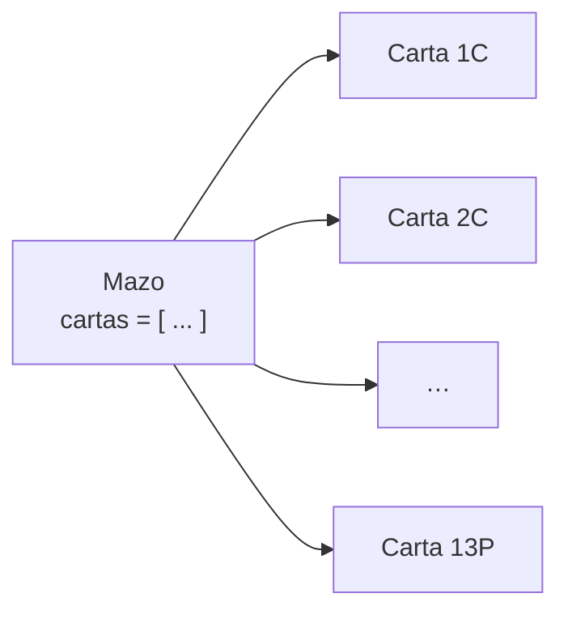

# Composición: objetos que contienen objetos

Los programas reales tienen varias clases que trabajan juntas. Un mazo de naipes está formado por cartas; un curso, por estudiantes; una playlist, por canciones. Cuando un objeto **contiene** otros objetos (por lo general en una lista que es uno de sus atributos) se habla de **composición**. Esta nota la muestra con un ejemplo completo: cartas y mazo.

## La clase `Carta`

Una carta tiene un número (1 a 13) y una pinta (C, D, T, P: corazón, diamante, trébol, pica).

```python
class Carta:
    def __init__(self, num, pinta):
        self.num = num
        self.pinta = pinta

    def diferencia(self, otra):
        return abs(self.num - otra.num)

    def __str__(self):
        nombres = {1: "A", 11: "J", 12: "Q", 13: "K"}
        if self.num in nombres:
            return nombres[self.num] + self.pinta
        return str(self.num) + self.pinta

c1 = Carta(13, "C")
c2 = Carta(5, "D")
print(c1, c2, c1.diferencia(c2))
```

```
KC 5D 8
```

(`nombres` es un **diccionario**: una tabla que asocia cada número especial con su letra; `nombres[13]` entrega `"K"`. Equivale a una cadena de `if`/`elif`.)

## Un mazo es una lista de cartas

La lista de un mazo no guarda números ni strings, sino **objetos `Carta`**:

```python
class Carta:
    def __init__(self, num, pinta):
        self.num = num
        self.pinta = pinta

    def __str__(self):
        return str(self.num) + self.pinta

lista = []
for i in range(1, 14):
    lista.append(Carta(i, "C"))
print(len(lista), lista[0], lista[12])     # 13 1C 13C
```

Cada posición de la lista contiene un objeto con sus propios atributos `num` y `pinta`; `lista[12].num` es 13.

## La clase `Mazo`

Ahora el mazo mismo es una clase cuyo atributo `cartas` es la lista. Crearlo arma las 52 cartas, y tiene métodos para saber si quedan y para sacar una al azar:

```python
import random

class Carta:
    def __init__(self, num, pinta):
        self.num = num
        self.pinta = pinta

    def __str__(self):
        return str(self.num) + self.pinta

class Mazo:
    def __init__(self):
        self.cartas = []                       # atributo: lista de objetos Carta
        for pinta in "CDTP":
            for numero in range(1, 14):
                self.cartas.append(Carta(numero, pinta))

    def quedan_cartas(self):
        return len(self.cartas) > 0

    def sacar(self):
        pos = random.randint(0, len(self.cartas) - 1)
        return self.cartas.pop(pos)            # la quita del mazo y la entrega

m = Mazo()
mano = []
for i in range(5):
    mano.append(m.sacar())
print(len(m.cartas))                           # 47
for carta in mano:
    print(carta, end=" ")
print()
```



El programa principal no necesita saber cómo está hecho el mazo por dentro: solo usa `sacar()` y `quedan_cartas()`. Si mañana se cambiara la forma de guardar las cartas, el resto del programa seguiría funcionando.

> [!tip] Idea clave
> Cada clase se encarga de lo suyo: `Carta` sabe mostrarse y compararse; `Mazo` sabe crear, contar y repartir cartas. Dividir así un problema en clases es la misma idea de "dividir para conquistar" de las funciones, pero con datos incluidos.

## Métodos que validan

Un método puede negarse a hacer un cambio inválido y avisar con un `bool`:

```python
class Carta:
    def __init__(self, num, pinta):
        self.num = num
        self.pinta = pinta

    def cambiar_pinta(self, nueva):
        if nueva in "CDTP":
            self.pinta = nueva
            return True
        return False

c = Carta(3, "C")
print(c.cambiar_pinta("X"), c.pinta)     # False C
print(c.cambiar_pinta("D"), c.pinta)     # True D
```

> [!warning] `"" in "CDTP"` es `True`
> El string vacío está "contenido" en cualquier string, así que `cambiar_pinta("")` lo aceptaría. Una validación más estricta revisa también `len(nueva) == 1`.

## Preguntas de repaso

> [!question]- ¿Qué guarda el atributo `cartas` de un `Mazo`?
> Una lista de objetos `Carta`, cada uno con su propio número y pinta.

> [!question]- ¿Por qué `sacar` usa `pop` y no solo `self.cartas[pos]`?
> Porque `pop` además de entregar la carta la quita del mazo; así no se puede volver a sacar la misma carta.

> [!question]- ¿Qué ventaja tiene que el programa principal solo use `sacar()` y no la lista `cartas` directamente?
> Que no depende de cómo está hecho el mazo por dentro: se puede cambiar la implementación de la clase sin tocar el resto del programa.
