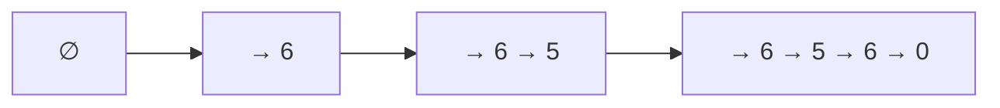

# Definiciones inductivas y listas enlazadas

Los naturales se definen por inducción: un caso base ($0$) y un operador (el sucesor). La misma idea sirve para construir otros conjuntos, como las listas, y para definir operaciones sobre ellos. Es la base de la recursión en programación.

## Cómo se define un conjunto inductivamente

Una definición inductiva necesita tres cosas:

1. Declarar que el conjunto es el **menor** que cumple las reglas (nada más entra "por accidente").
2. Un conjunto (no necesariamente finito) de **elementos base** que pertenecen de partida.
3. Un conjunto finito de **reglas de construcción**, que producen elementos nuevos a partir de elementos que ya están.

Pueden existir infinitos casos base y más de una regla recursiva.

**Ejemplo:** los pares son el menor conjunto tal que $0$ es par y, si $n$ es par, $n + 2$ es par.

## Las listas enlazadas $L_\mathbb{N}$

> [!tip] Definición
> $L_\mathbb{N}$ es el menor conjunto tal que **(1)** $\emptyset \in L_\mathbb{N}$ y **(2)** si $L \in L_\mathbb{N}$ y $k \in \mathbb{N}$, entonces $L \to k \in L_\mathbb{N}$.

La regla (2) significa "agregar una flecha y un natural al final de la lista". Se omite $\emptyset$ cuando hay más elementos. Son listas: $\emptyset$, $\to 6$ y $\to 6 \to 5 \to 6 \to 0$.

El diagrama muestra la construcción: cada paso aplica la regla (2) a una lista ya construida.

## Operaciones definidas por inducción

Para definir una función sobre $L_\mathbb{N}$ se da su valor en $\emptyset$ y su valor en $L \to k$ en términos de $L$:

| Operador | Caso base | Regla recursiva |
|---|---|---|
| Largo $\lvert\cdot\rvert$ | $\lvert\emptyset\rvert = 0$ | $\lvert L \to k\rvert = \lvert L\rvert + 1$ |
| Suma | $\mathrm{sum}(\emptyset) = 0$ | $\mathrm{sum}(L \to k) = \mathrm{sum}(L) + k$ |
| Máximo | $\max(\emptyset) = -1$ | $\max(L \to k) = \max(L)$ si $\max(L) \ge k$; si no, $k$ |
| Cabeza (lista no vacía) | $\mathrm{head}(\to k) = k$ | $\mathrm{head}(L \to k) = \mathrm{head}(L)$ |
| Sufijo (lista no vacía) | $\mathrm{suf}(\to k) = \emptyset$ | $\mathrm{suf}(L \to k) = \mathrm{suf}(L) \to k$ |

El sufijo quita el primer elemento: por eso el caso base es la lista de un solo elemento y la recursión trabaja sobre lo ya construido. Del mismo modo se define el factorial: $0! = 1$ y $(n+1)! = (n+1)\cdot n!$.

## Igualdad de listas

Dos listas son iguales según su construcción: si alguna es vacía, lo son solo si ambas lo son; si no, $L_1 \to k_1 = L_2 \to k_2$ si y solo si $L_1 = L_2$ y $k_1 = k_2$. Con esta definición se pueden demostrar propiedades por [[06 - Inducción estructural]].

> [!warning] Definición y propiedad son cosas distintas
> Una **función** devuelve un valor (el largo, la suma); una **propiedad** es verdadera o falsa para cada lista. Se demuestran propiedades; se definen funciones. Una función bien definida por inducción exige cubrir todos los casos que genera la regla.

## Preguntas de repaso

> [!question]- ¿Por qué la definición inductiva exige "el menor conjunto" que cumple las reglas?
> Porque sin esa condición, un conjunto más grande (con elementos extra) también cumpliría las reglas. Pedir el menor asegura que solo hay elementos construidos con casos base y reglas.

> [!question]- ¿Cuál es el caso base de $\mathrm{suf}$ y por qué no es $\emptyset$?
> Es $\mathrm{suf}(\to k) = \emptyset$; el sufijo solo está definido para listas no vacías, así que el caso base es la lista de un elemento.

> [!question]- Calcular $\mathrm{sum}(\to 6 \to 5 \to 6 \to 0)$ y $\max$ de esa lista.
> $\mathrm{sum} = 6 + 5 + 6 + 0 = 17$ aplicando la regla cuatro veces; $\max = 6$.
