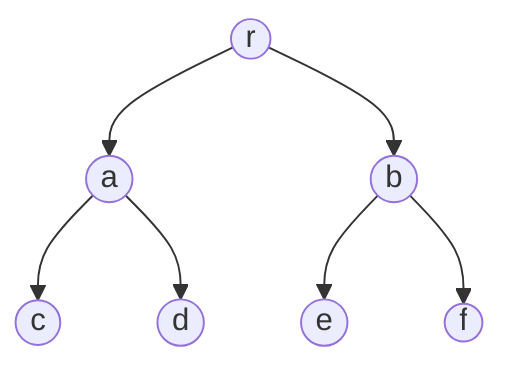

# Árboles binarios completos y altura logarítmica

Cuando se quiere acotar el costo de un algoritmo que recorre un árbol (por ejemplo, una búsqueda), el caso más cargado y más regular es el **árbol binario completo**: todos los niveles están llenos. Sus tamaños son exactos y de ellos se deduce que una altura pequeña basta para alojar muchas hojas.

## Definición

> [!tip] Árbol binario completo
> Es un árbol binario donde **(1)** todas las hojas están a la misma profundidad y **(2)** todo vértice que no es hoja tiene exactamente dos hijos.

El ejemplo tiene altura $H = 2$, $4$ hojas ($c, d, e, f$) y $7$ vértices en total.

## Tres resultados

> [!tip] Teorema
> Un árbol binario completo de altura $H$ tiene
> 1. exactamente $2^H$ hojas;
> 2. exactamente $2^{H+1} - 1$ vértices;
> 3. y si tiene $n$ vértices, entonces $H \le \log_2 n$.

**1. Hojas.** Inducción en $H$. Con $H = 0$ hay un vértice, una hoja: $1 = 2^0$. Si la propiedad vale para altura $H$, un árbol completo de altura $H + 1$ con raíz $r$ queda, al quitar $r$, en dos árboles completos de altura $H$ (un subárbol por hijo). Cada uno tiene $2^H$ hojas, y las hojas de $T$ son la unión de ambas: $2^H + 2^H = 2^{H+1}$.

**2. Vértices.** Por el teorema de hojas del tema anterior, con $2^H$ hojas hay $2^H - 1$ vértices de dos hijos. En un árbol completo cada vértice o es hoja o tiene dos hijos, así que el total es $2^H + (2^H - 1) = 2^{H+1} - 1$.

**3. Altura.** Las hojas son parte de los vértices: $2^H \le n$, y aplicando $\log_2$ resulta $H \le \log_2 n$.

## Tabla de tamaños

| $H$ | hojas $2^H$ | vértices $2^{H+1} - 1$ |
|---|---|---|
| 0 | 1 | 1 |
| 1 | 2 | 3 |
| 2 | 4 | 7 |
| 3 | 8 | 15 |
| 4 | 16 | 31 |

La altura crece como el logaritmo del tamaño: con $1023$ vértices la altura es $9$. Por eso las búsquedas en árboles equilibrados tardan tiempo logarítmico (ver [[01 - Diccionarios y árboles binarios de búsqueda]] para la aplicación a diccionarios).

> [!warning] Otra definición de "completo"
> Algunos textos llaman "completo" a un árbol binario donde cada vértice tiene $0$ o $2$ hijos, sin exigir que las hojas estén a la misma profundidad. Aquí vale la definición con ambas condiciones.

## Preguntas de repaso

> [!question]- ¿Por qué el árbol de la prueba por inducción queda en dos árboles de altura $H$ y no de altura $H - 1$?
> Se parte de un árbol de altura $H + 1$; al quitar la raíz, cada subárbol tiene altura $H$, y como el árbol es completo ambos están llenos hasta el mismo nivel.

> [!question]- ¿Cuántos vértices tiene un árbol binario completo de altura $5$?
> $2^6 - 1 = 63$, de los cuales $32$ son hojas y $31$ tienen dos hijos.

> [!question]- ¿Por qué la cota $H \le \log_2 n$ no usa los vértices internos?
> Basta con contar solo las hojas: $2^H$ hojas son a lo más $n$ vértices, y eso ya acota la altura.

> [!question]- ¿Puede un árbol binario completo tener exactamente $10$ vértices?
> No: el número de vértices es $2^{H+1} - 1$, que siempre es impar ($1, 3, 7, 15, \dots$).
