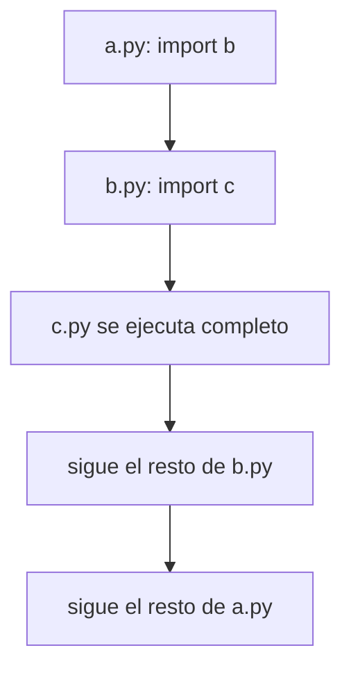

# Modularización: qué es y por qué sirve

Un programa pequeño cabe en un archivo, pero uno grande no: se vuelve largo, desordenado y difícil de entender incluso para su autor. La **modularización** resuelve esto separando el código en piezas independientes, los **módulos**. Esta nota explica la idea y cómo Python ejecuta una importación.

## Qué es la programación modular

Es una técnica de diseño que divide un programa en componentes lógicos llamados **módulos**, cada uno con funcionalidades independientes. En términos simples: separar el código ordenadamente en varios archivos.

En Python esto viene incorporado: **cada archivo `.py` con definiciones es un módulo**, y con la palabra `import` se pueden usar sus variables, funciones y clases desde otro archivo.

Imagina un módulo `ejemplo.py`:

```python
# ejemplo.py
from typing import Any


mi_variable = 10


def saludar() -> None:
    print("¡Hola!")


class MiClase:
    def __init__(self, argumento: Any) -> None:
        self.argumento = argumento
```

Desde otro archivo, en la misma carpeta, se usa así:

```python
# main.py
import ejemplo

print(ejemplo.mi_variable)
ejemplo.saludar()
instancia = ejemplo.MiClase("42")
print(instancia.argumento)
```

```
10
¡Hola!
42
```

## Cómo se ejecuta una importación

Python ejecuta un archivo línea por línea. Cuando llega a un `import`:

1. **Ejecuta completo** el archivo importado (crea sus variables y definiciones).
2. Vuelve al archivo original y sigue con la línea siguiente, ya con todo disponible.

Esto funciona en cadena. Si `a.py` importa a `b.py` y este a `c.py`, al ejecutar `a.py` ocurre:

1. En `import b` de `a.py`, empieza a ejecutarse `b.py`.
2. En `import c` de `b.py`, empieza a ejecutarse `c.py`.
3. Se ejecuta el resto de `c.py`.
4. Se ejecuta el resto de `b.py`.
5. Se ejecuta el resto de `a.py`.



Python recuerda qué módulos ya empezó a importar y **no los ejecuta dos veces**. Por eso un ciclo de importaciones (por ejemplo `c.py` con `import a`) no se queda dando vueltas para siempre: ese segundo `import a` se ignora.

> [!warning] Importar ejecuta código
> Todo lo que esté escrito «suelto» en un módulo (un `print`, un cálculo) se ejecuta al importarlo. Por eso los módulos pensados para importarse solo deberían tener definiciones. La nota siguiente muestra cómo proteger código con `__name__`.

## Por qué usar módulos

Pongamos un programa que, dado un archivo de contactos, envíe un correo con un PDF a cada persona. Tiene muchas subtareas: comprobar que el archivo existe, leerlo, limpiar contactos con datos faltantes, validar correos, leer el PDF, enviarlo. Una función por subtarea ya son muchas funciones en un archivo.

Pero se pueden agrupar por tipo de trabajo, y los grupos no dependen entre sí:

| Módulo | Funciones que agrupa |
|---|---|
| `contactos.py` | Comprobar, leer y procesar el archivo de contactos |
| `pdf.py` | Comprobar, leer y extraer contenido del PDF |
| `emails.py` | Validar correos y enviar el contenido |

Ventajas:

- **Mejor organización y legibilidad**, y por lo tanto más facilidad para depurar: si falla el envío de correos, se busca en `emails.py`.
- **Reutilización:** si `pdf.py` sabe leer cualquier PDF, otro programa distinto puede usarlo tal cual.

## Abstracción: cada módulo es una caja negra

Al identificar módulos y sus dependencias se puede pensar en el programa sin entrar en los detalles de cada pieza. Es como una radio: tiene perillas para encenderla, cambiar de estación y subir el volumen, y no hace falta saber cómo funciona por dentro.

```python
import radio

radio.encender()
radio.cambiar_estacion(99.3)
radio.subir_volumen(10)
radio.apagar()
```

Al importar un módulo importa **lo que hace**, no **cómo lo hace**. Un ejemplo real es `random`: se usa para generar números al azar sin saber cómo está implementado.

```python
import random

print(random.randint(1, 10))
print(random.choice(["a", "b", "c"]))
```

> [!tip] Regla
> Un módulo bien hecho se usa por lo que ofrece (su interfaz), sin necesidad de leer su interior. Es la misma idea de encapsulamiento que en las clases, aplicada a archivos.

La modularización hoy parece obvia, pero no siempre lo fue: Barbara Liskov, ganadora del Premio Turing 2008, ha contado cómo surgió y cómo se conecta con la programación orientada a objetos.

## Preguntas de repaso

> [!question]- ¿Qué ocurre exactamente cuando Python llega a una línea `import ejemplo`?
> Ejecuta el archivo `ejemplo.py` completo (creando sus variables y definiciones) y luego vuelve al archivo original a seguir con la línea siguiente, ya con esas definiciones disponibles.

> [!question]- ¿Por qué un ciclo de importaciones (`a` importa `b` y `b` importa `a`) no se queda en un bucle infinito?
> Porque Python lleva registro de los módulos que ya empezó a importar y ignora un segundo `import` del mismo módulo.

> [!question]- ¿Qué ventaja tiene dividir el programa de correos en `contactos.py`, `pdf.py` y `emails.py`?
> Cada parte es más fácil de leer y de depurar, y los módulos que no dependen del contexto (como el lector de PDF) se pueden reutilizar en otros programas.

