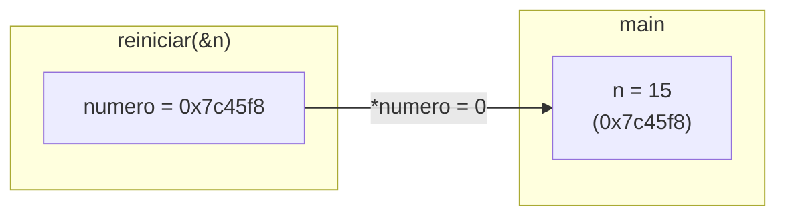

# Paso por valor y punteros como referencia

En C, **todos los argumentos se pasan por valor**: la función recibe una **copia** de lo que se le entrega. Cualquier cambio sobre esa copia se pierde al retornar, porque la copia vivía en el marco de la función en el stack. C no tiene paso por referencia, pero se puede **simular** pasando la dirección de la variable: la copia es entonces una dirección, y a través de ella se modifica el original.

## La misma función, con y sin puntero

```c
#include <stdio.h>

void reiniciar_copia(int numero)  { numero = 0; }    // cambia una copia
void reiniciar(int* numero)       { *numero = 0; }   // cambia el original

int main(void)
{
    int n = 15;
    reiniciar_copia(n);
    printf("%d\n", n);   // 15: la copia murió con la función
    reiniciar(&n);
    printf("%d\n", n);   // 0: se escribió en la dirección de n
    return 0;
}
```

`gcc -Wall -Wextra` incluso avisa que en `reiniciar_copia` el parámetro "se asigna pero no se usa": el compilador detecta que esa asignación no tiene ningún efecto visible.




> [!example]- Transcripción de la imagen
> RAM con la zona de funciones (`increase`, `main`) y el stack. En el marco de `(main)` está `x = 3` en la dirección `0x7c45f8`. Debajo, en gris porque ya retornó, está el marco `(increase)` con `a = 0x7c45f8`. Es la situación después de `increase(&x)`, que hizo `*a += 1` y dejó `x` en 3.

> [!tip] Para modificar algo dentro de una función, se le pasa su dirección
> Si una función tiene que cambiar un `int`, recibe `int*`. Si tiene que cambiar un `int*` (por ejemplo, para hacerlo apuntar a otro lado), recibe `int**`.

## Por qué esto importa con datos grandes

Pasar por valor un dato grande, como un struct con muchos campos, **copia todo** en el stack en cada llamada. Eso es lento y, con muchas llamadas anidadas, puede agotar el stack. Pasar un puntero copia solo 8 bytes y además permite modificar el original. Por eso las funciones que trabajan con estructuras de datos reciben casi siempre punteros (`void list_append(List* list, ...)`).

> [!warning] Copia del puntero no es copia del dato
> Dentro de `reiniciar`, `numero` sigue siendo una copia: si se hace `numero = NULL;`, el `n` de `main` no se entera. Lo que se comparte es el dato apuntado (`*numero`), no la variable puntero.

## Preguntas de repaso

> [!question]- ¿Por qué `reiniciar_copia(n)` no cambia `n`?
> Porque C pasa una copia del valor de `n` al parámetro `numero`, que vive en el marco de la función. Al retornar, ese marco se libera y el cambio se pierde.

> [!question]- ¿Qué recibe exactamente una función declarada como `void f(int* p)` cuando se llama `f(&x)`?
> Una copia de la dirección de `x`. Como copia y original apuntan al mismo lugar, `*p = ...` modifica `x`.

> [!question]- ¿Qué tipo debería recibir una función que quiere hacer que un puntero del llamador apunte a otro lugar?
> Un puntero a ese puntero (`int**`). Así puede escribir `*pp = nueva_direccion` y cambiar la variable puntero original.

> [!question]- ¿Qué ventaja tiene pasar un struct grande por puntero en vez de por valor?
> Copia solo la dirección (8 bytes) en vez del struct completo, así que es más rápido y gasta menos stack. Además, la función puede modificar el struct original.
